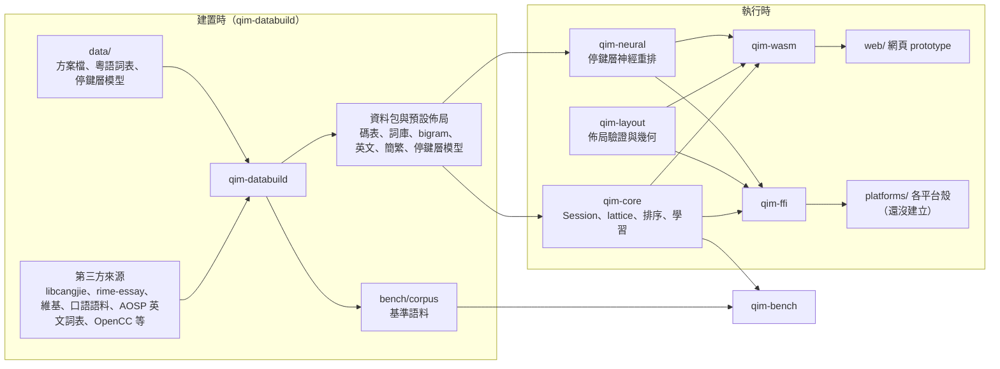

# QIM 架構

> 狀態：從 `docs/plan.md` 搬移中。核心、平台殼、測試策略、風險與回寫點還在 plan 的同名節，搬完後刪掉 plan。這裡是模組地圖與跨模組的規則，給第一次進這個 repo 的人和 agent 讀；需求與決定在 `docs/design-brief.md`，里程碑的順序與範圍在 `docs/roadmap.md`，名詞在 `GLOSSARY.md`。
>
> 寫法：只寫現況，改了就改寫原句，舊說法留給 git；票號與「某日改」不寫進來。只寫打開程式碼看不出來的：模組的分工、誰能依賴誰、跨模組的資料與契約。單一模組內的行為由測試與程式碼說明；操作步驟（建置、在裝置上驗、排除故障）寫在 `docs/development.md`；選型與取捨的理由寫 ADR，這裡連過去。節用標題引用、不編號。全檔上限 15,000 字元，`scripts/check_docs.py` 強制。

## 執行形態

核心是 Rust 函式庫，各平台殼把它連進自己的程序（ADR 0002）：網頁經 WebAssembly（`qim-wasm`），Apple 與 Android 經 uniffi 產生的 Swift / Kotlin 綁定（`qim-ffi`），Windows 與 Linux 經 C ABI。Windows 的程序配置未定：依成熟做法傾向把核心放在獨立程序、TSF DLL 只轉傳（`docs/research/platform-frameworks.md` §6），兩種做法的比較見 roadmap〈平台里程碑（M7–M11）〉的 M10。

## 模組地圖

| 路徑 | 內容 |
| --- | --- |
| `crates/qim-core/` | 純邏輯：方案、資料包讀取、lattice、排序、學習、`Session` |
| `crates/qim-layout/` | 佈局模型、JSON Schema 驗證、點擊判定、按鍵幾何計算、觸控空間模型與實體鍵盤的鄰鍵先驗 |
| `crates/qim-neural/` | 停鍵層的神經重排（ADR 0005）：推論與量化；模型由殼以位元組傳入，執行緒由殼開 |
| `crates/qim-databuild/` | CLI：取得來源、建資料包與預設佈局、訓練 bigram、匯入停鍵層模型、產生基準語料 |
| `crates/qim-bench/` | 首選字基準 runner，量正確率與每鍵延遲 |
| `crates/qim-wasm/`、`crates/qim-ffi/` | 綁定層，不放邏輯；Swift 綁定由 `cargo xtask ffi` 產生 |
| `xtask/` | 閘門與開發指令（`cargo xtask check` 等），用法見 `docs/development.md` |
| `data/` | 自己維護的方案檔、粵語詞表、來源清單 `sources.toml`、進資料包的授權全文 `licenses/`，與停鍵層採用的模型 `neural-rerank/`（訓練不是決定性的，重訓分數會變，所以採用的那份進 git）；不放其他第三方原始檔與建置產物 |
| `bench/` | `fixed.tsv`、`corpus/`、`colloquial/`（都含授權與署名）、`baseline.json` |
| `web/` | 網頁 prototype（Vite + TypeScript）、Playwright 測試 |
| `platforms/` | 各平台殼放這裡，還沒建立 |

### 識別符

程式碼識別符用英文，對應 `GLOSSARY.md` 的詞：

| 名詞 | 識別符 | 名詞 | 識別符 |
| --- | --- | --- | --- |
| 輸入方案 | `Scheme` | 候選 / 首選 | `Candidate` / `top` |
| 輸入碼 | `input` | 組字 | `Composition` |
| 速成碼 / 倉頡碼 | `QuickCode` / `CangjieCode` | 上屏 | `commit` |
| 碼表 / 詞庫 | `CodeTable` / `Lexicon` | 字根提示 | `RadicalHint` |
| 連打 | `continuous` | 英文候選 | `EnglishCandidate` |
| 使用者詞 / 觸發詞 | `UserWord` / `Trigger` | 聯想 | `Association` |
| 自動造詞 | `AutoPhrase` | 無痕模式 | `Incognito` |
| 常用語 | `Phrase` | 詞表匯入 | `import_word_list`（`WordList…`） |
| 個人 bigram / 學習（開關） | `Bigrams` / `Options::learning` | 英文使用者詞 | `EnglishUserWords`（`Options::english_user_words`） |
| 核心 / 平台殼 | `core` / `Shell` | 佈局 / 資料包 | `Layout` / `…Pack`（方案資料包 `SchemePack`） |
| 首選字基準 | `TopChoiceBench` | 修正次數 | `correction_count` |
| 分段 | `Segment` | 佈局版本 | `LayoutVariant` |
| 個人模型 | `UserModel` | 空間模型 | `SpatialModel` |
| 重排 | `Rerank` | 譯詞 | `Gloss` |
| 容錯 | 四種修正沒做、沒有識別符；速成的容錯是鄰鍵讀法（下面） | 萬用鍵 | `Wildcard` |
| 退格撤銷 / 動作 | `Undo`（`Session::expire_undo`） / `Action` | 撤銷學習 | `forget`（`Session::forget`、`UserModel::forget`） |
| 連打字集 / 擴展區 | `continuous` / `extension` | 目前分段 | `focus` |
| 英文直通 / 臨時英文 | `ascii` / `inline` | 分隔記號 | `SEPARATOR` |
| 簡體模式 / 簡體字排後 | `Options::simplified` / `simplified_after_traditional` | 簡體字（碼表的標記） | `CodeEntry::simplified` |
| emoji 候選 | `emoji_candidates`（對照表 `EmojiTable`） | manifest / 資料包種類 | `Manifest` / `PackKind` |
| 使用中的資料包 | `active`（網頁 `activeIds`） | 更新索引 | `PackIndex`（一項 `IndexEntry`） |
| 線上更新 | `update`（網頁 `updatePacks`） | 資料包的來源（內建、匯入、線上更新） | `PackOrigin`（`builtin`、`imported`、`downloaded`） |
| 粵典詞庫 / 粵典的詞頭 | `quick-lexicon-words-hk`（`WORDS_HK_LEXICON_ID`）/ `headwords`（`words_hk.rs`） | 預設詞庫 | 方案 `[packs] lexicon` 指名的那份（`quick-lexicon`） |
| 停鍵層模型（資料包） | `ModelPack`（種類 `model`，id `zh-hant-neural-rerank`） | 神經重排 | `qim_neural::Reranker` |
| 最後使用的日期 / 今天的日期 | `last_used` / `UserModel::set_today`（型別 `Date`） | 裝置 id | `device`（`UserModel::set_device`） |
| 學習的時限 / 最後整串上屏的日期 | `EXPIRY_DAYS` / `last_commit_date` | 條目上限 | `Limits`（`UserModel::set_limits`） |
| 停鍵結果快取 | `RerankCache`（`RERANK_CACHE_LIMIT`、`Inspection::rerank_cached`） | 重排識別（殼正在用的停鍵層模型） | `Session::set_reranker_id`（網頁 `rerankerId`） |
| 按鍵機率 | `Weights`（觸控 `Key::Weighted`、實體鍵盤 `Key::Physical`、`Inspection::key_weights`、`qim_layout::Output::Weighted`） | 點擊位置 | `qim_layout::Touch` |
| 鄰鍵讀法 | `Options::neighbor_readings`（網頁 `setNeighborReadings`）、模組 `neighbor`、`Engine::neighbor_edges_ending`、`InspectedCandidate::neighbor` | 原樣讀法 | `Reading::Literal`（鄰鍵讀法的 lattice 是 `Reading::Neighbor`） |
| 鄰鍵先驗 | `qim_layout::PhysicalModel` | 實體鍵位 | `KeyboardEvent.code`（網頁綁定 `Session.pressCode`） |
| 各台的次數 | `Tally`（一台一格 `Cell`） | 墓碑 / 墓碑表 | `Tombstone` / `graveyard`（匯出種類 `deleted`） |
| 跨裝置合併 | `UserModel::merge`（結果 `Merged`，網頁 `mergeUserDict`） | 讀回自己的存檔 | `UserModel::replace_learning`（網頁 `loadUserDict`） |
| 清空記號 | `Cleared`（`UserModel::clear`，網頁 `clearUserDict`） | 從備份還原 | `UserModel::restore`（網頁 `restoreUserDict`） |
| 打錯碼的集合（含打錯碼 / 觸控模擬） | `typo` / `touch`（`qim_databuild::typo`、`qim_bench::parse_typo`、`parse_touch`） | 原樣正確卻被改錯 | `false_corrections`（`qim_bench::TypoStats`） |

## 依賴規則

| crate | 可以依賴 | 不可以 |
| --- | --- | --- |
| `qim-core` | `serde`、`postcard`、`serde_json`、`sha2`、`semver`（後三個給資料包 manifest）；之後要加的依賴先改本表 | 任何 workspace crate（含綁定與平台 crate）；`std::fs`、`std::net`、`std::thread`、`std::time::SystemTime`（時間由殼傳入：上屏次數與今天的日期） |
| `qim-layout` | `serde`、`serde_json`、`jsonschema` | `qim-core`；同上的 I/O |
| `qim-neural` | `candle-core`、`candle-nn`（停鍵層的神經重排；模型由殼以位元組傳入，執行緒由殼開） | 任何 workspace crate；同上的 I/O |
| `qim-wasm` | `qim-core`、`qim-layout`、`qim-neural`、綁定工具 `wasm-bindgen` | 被 `qim-core` 或 `qim-layout` 依賴 |
| `qim-ffi` | `qim-core`、`qim-layout`、`qim-neural`、綁定工具 `uniffi` | 同上 |
| `qim-databuild` | `qim-core`（資料包格式）、`qim-layout`（算出預設佈局）、`qim-neural`（匯入停鍵層模型時核對分數、量化）；外部 crate 不限（I/O 套件） | 被 `qim-core` 或 `qim-layout` 依賴 |
| `qim-bench` | `qim-core`（資料包格式）、`qim-layout`（照殼的做法把實體鍵與觸控點擊轉成按鍵機率）；外部 crate 不限（I/O 套件） | 被 `qim-core` 依賴 |
| `web/`、`platforms/*` | 只透過綁定呼叫核心與 `qim-layout` | 重寫排序、查碼或點擊判定邏輯 |

強制：`cargo xtask check` 的 `deps` 步驟（`xtask/src/deps.rs`）。

- 白名單是 `deps.rs` 的 `RULES`。改上表時兩邊同一 commit 改；`cargo test` 比對兩邊的「可以依賴」與「不可以」欄。「不可以」欄以「；」分子句，每句要是反引號包住的禁用路徑或 crate、`被 … 依賴`、`任何 workspace crate`、`同上`、`同上的 I/O` 之一，其他寫法測試會紅（`web/` 那類非 crate 的列不比）。
- 一般與 build 依賴照「可以依賴」欄；dev 依賴不受白名單限制，但 workspace crate 不論哪種依賴都只能是欄內列的。
- workspace 成員不在上表就紅，要先改表；`xtask` 是開發工具，例外。
- 禁用路徑只查 `qim-core`、`qim-layout`、`qim-neural` 的 `src/`（含 `#[cfg(test)]` 模組）；`build.rs`、`tests/`、`benches/`、`examples/` 不編進函式庫，整合測試可以讀檔。

## 跨模組的資料與契約

核心對殼的介面與學習資料還在 plan〈核心〉。

### 資料包

`qim-databuild` 建、核心讀的單位，一份一個目錄 `<id>/`：`<id>.pack`（postcard，整份解開進記憶體；格式在 `crates/qim-core/src/pack.rs`）、`manifest.json`、`LICENSE`、`NOTICE`。授權檔不跨資料包共用，各寫它用到的來源；manifest 的 `license` 是那些來源的 SPDX 以 ` AND ` 接起。

- manifest 是對外格式（`crates/qim-core/src/manifest.rs`）：一種 `kind` 對一個 `Pack` 型別；不認得的欄位略過，欄位的意思改了才加 `manifest_version`；`version` 是 semver、內容改了就加；`min_core_version` 是讀得了它的最舊 `qim-core`。
- 殼只做 I/O 與儲存，交 manifest 加位元組給核心；核心依序核對格式、核心版本、種類、大小、sha256 才解開（`Pack::open`）。
- 方案 `[packs]` 指名的是預設；同一種可以裝好幾份，殼選一份交給核心，核心只核對方案要不要那種、不核對 id；建出的預設是不是指名的那份由 `cargo xtask data --verify` 擋。
- 字頻在詞庫資料包：速成資料包不帶語料衍生的資料，`Engine` 載入兩份時才依字頻排字序。字頻與字級 bigram 用同一組語料權重，屬於共用的語言模型、不寫在方案檔。
- 詞級 trigram 的段是用預設詞庫、字級 bigram 與方案的 β、γ 切的：改了其中一樣，詞級 trigram 要一起重建、一起發佈；對不上不會打錯，只是首選的進步變小。
- 線上更新讀 GitHub release（固定 tag `packs`）上的 `index.json`（`crates/qim-core/src/pack_index.rs`）：每項是一份 manifest 加相對於索引的 `url`；只換裝著的、同 id 同種類、版本較大、核心讀得了的那份，下載後一樣經 `Pack::open` 核對。
- 同 id 的內建版與下載版取版本較高的，同版用內建的；從檔案匯入的一律取代內建的。

## 主要依賴

版本看 `rust-toolchain.toml`、`Cargo.lock`、`web/package-lock.json`；加依賴時用 `cargo add` / `npm install` 取當時的 stable，並在本表加一列。

| 依賴 | 用途 | 理由 |
| --- | --- | --- |
| Rust | 核心與工具 | ADR 0002 |
| `serde` / `postcard` | 資料包序列化 | `no_std` 友善、體積小；資料包格式是內部格式，可換 |
| `toml` | 方案檔、`data/sources.toml` | Rust 生態標準格式，可寫註解 |
| `ureq` / `sha2` | `qim-databuild` 下載來源並核對 sha256；`sha2` 另給 `qim-core` 核對資料包的 manifest | 同步 API、不必帶 async runtime |
| `semver` | `qim-core` 比 manifest 的 `min_core_version` 與核心版本 | dtolnay 維護、Cargo 用的同一套；不自己寫版本比較 |
| `zip` | `qim-databuild` 讀 Unihan.zip、HKCanCor 的 zip | Unicode 只發 zip；只開 deflate 解壓 |
| `dirs` | `qim-databuild` 找平台的使用者快取目錄，放下載的來源 | 各平台的快取目錄慣例不必自己寫 |
| `bzip2` / `quick-xml` | `qim-databuild` 讀維基 dump（`pages-articles.xml.bz2`） | `bzip2` 預設用純 Rust 的 libbz2-rs-sys；串流讀 XML，不必整份載入 |
| `flate2` / `base64` | `qim-databuild` 讀 LatinIME 的 `en_US_wordlist.combined.gz`；googlesource 的 `?format=TEXT` 只給 base64 | `zip` 已帶 `flate2`；兩者都是 rust-lang 生態的主流 crate，不自己寫 |
| `serde_json` / `jsonschema` | 佈局檔與驗證、`qim-core` 讀寫資料包 manifest、`qim-databuild` 匯入停鍵層模型時讀 `reference.json`、`train.json`；`jsonschema` 關掉預設 features（不要網路與檔案的 `$ref` 解析） | 佈局要給 TS、Swift、Kotlin 直接讀 |
| `wasm-bindgen` / `wasm-bindgen-cli` | WebAssembly 綁定 | 直接用 CLI，不依賴 wasm-pack |
| `uniffi` | Swift / Kotlin 綁定；proc-macro 宣告介面，`uniffi-bindgen-swift` 從靜態函式庫產生綁定（library mode），它要的 `cli` feature 只在 `qim-ffi` 的 `bindgen` feature 開 | 一份介面產生兩種語言 |
| `ferrous-opencc` | 只給 `qim-databuild` 前處理語料的 `s2hk`、`t2hk`（用它內建的字典） | 純 Rust、Apache-2.0。簡體模式不用它：編得進 WebAssembly，但只能用編進 crate 的字典、不能從資料包載入，改由簡繁資料包加 `qim-core` 的轉換 |
| `rustc-hash` | `qim-databuild` 數詞級 trigram 的次數（兩千萬種 trigram 的雜湊表） | rustc 自己用的雜湊，比標準庫的 SipHash 快得多；建置端不必防碰撞攻擊 |
| `rand_chacha` | `qim-databuild` 產生打錯碼的基準集合：每題以那一行的 sha256 當種子的 ChaCha8；`qim-bench` 抽觸控點對鍵的點擊，種子同樣是字串的 sha256 | rust-random 維護，官方保證跨平台、跨版本輸出相同；常態分布自己寫，不用數值可能隨小版本變的 `rand_distr` |
| `strsim` | `qim-bench` 算字正確率的編輯距離（以字計的 Levenshtein） | 維護中、無依賴；不自己寫 |
| `candle-core` / `candle-nn` | `qim-neural` 的推論（q8 GGUF 權重、CPU；網頁經 `qim-wasm` 編成 WebAssembly、開 SIMD128）與量化（`qim-databuild` 匯入模型時經 `qim-neural`） | 驗過能編進 iOS 鍵盤擴充、沒有完整取用也能跑；1.4M 參數的模型在 iPhone 量 p95 11 ms、+2 MB；Hugging Face 維護、純 Rust |
| `proptest` | 核心與 `qim-layout` 點擊判定的性質測試（dev） | — |
| Vite / TypeScript | 網頁 prototype | — |
| Biome | TS lint 與 format | 一個工具包辦兩件事 |
| `idb-keyval` | 網頁把匯入的資料包存進 IndexedDB | Jake Archibald 維護、無依賴，只包一層 Promise；不自己寫 IndexedDB 的樣板 |
| `@playwright/test` | 網頁 e2e 與驗收 | 使用者指定 |
| `@types/node` | `web/bench/` 的 Node 腳本（WebAssembly 每鍵延遲）、`web/test/` 單元測試（Node 內建的 `node:test`，不另加測試框架）與 Playwright 設定、e2e 的型別 | 跟 Node 26 同主版本；只給 `web/bench/tsconfig.json` 與 `web/tsconfig.node.json`，網頁的程式碼（`src/`）看不到 Node 的 API |

## 測試策略

還在 plan〈測試策略〉。

## 風險與回寫點

還在 plan〈風險與回寫點〉。
