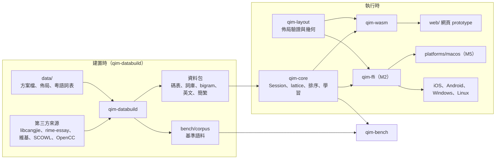
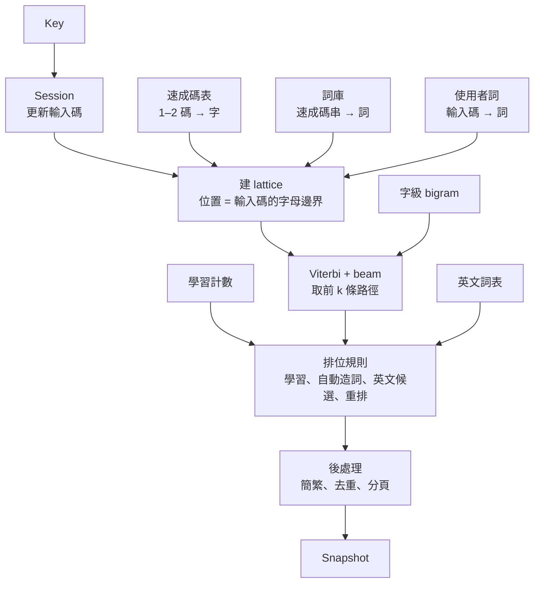

# QIM 實作計劃

> 狀態：M0、M1 寫到任務與驗收；M2 之後只有目標、範圍與完成標準。本檔只寫現況：決定改了就直接改寫，不留「原寫」「取代原」「某日改」；舊版與理由記在 progress〈偏差與決定〉，影響架構的寫 ADR。里程碑開工時，它在〈里程碑任務〉的那一節細化成 `.scratch/<里程碑>/spec.md`，這裡縮成一行連結；拆票後以票為準。需求與決定見 `docs/design-brief.md`，名詞見 `GLOSSARY.md`。

## 0. 工程慣例

- Rust edition 2024，toolchain 用 stable（寫本檔時 1.99.1），`rust-toolchain.toml` 釘版本。
- 核心的新功能與修 bug 走 `mattpocock-skills:tdd`；一個 session 一張票（`CLAUDE.md`）。
- 程式碼識別符用英文，對應 `GLOSSARY.md` 的詞：

| 名詞 | 識別符 | 名詞 | 識別符 |
| --- | --- | --- | --- |
| 輸入方案 | `Scheme` | 候選 / 首選 | `Candidate` / `top` |
| 輸入碼 | `input` | 組字 | `Composition` |
| 速成碼 / 倉頡碼 | `QuickCode` / `CangjieCode` | 上屏 | `commit` |
| 碼表 / 詞庫 | `CodeTable` / `Lexicon` | 字根提示 | `RadicalHint` |
| 連打 | `continuous` | 英文候選 | `EnglishCandidate` |
| 使用者詞 / 觸發詞 | `UserWord` / `Trigger` | 聯想 | `Association` |
| 自動造詞 | `AutoPhrase` | 無痕模式 | `Incognito` |
| 核心 / 平台殼 | `core` / `Shell` | 佈局 / 資料包 | `Layout` / `Pack` |
| 首選字基準 | `TopChoiceBench` | | |

## 1. 架構總覽

### 1.1 執行形態

核心是 Rust 函式庫，各平台殼把它連進自己的程序（ADR 0002）：網頁經 WebAssembly，Apple 與 Android 經 uniffi 產生的 Swift / Kotlin 綁定，Windows 與 Linux 經 C ABI。Windows 依成熟做法把核心放在獨立程序，TSF DLL 只轉傳（`docs/research/platform-frameworks.md` §6），到 M8 再定。



### 1.2 目錄結構

| 路徑 | 內容 |
| --- | --- |
| `crates/qim-core/` | 純邏輯：方案、資料包讀取、lattice、排序、學習、`Session` |
| `crates/qim-layout/` | 佈局模型、JSON Schema 驗證、按鍵幾何計算 |
| `crates/qim-databuild/` | CLI：取得來源、建資料包、訓練 bigram、產生基準語料 |
| `crates/qim-bench/` | 首選字基準 runner，量正確率與每鍵延遲 |
| `crates/qim-wasm/`、`crates/qim-ffi/` | 綁定層，不放邏輯；`qim-ffi` 在 M2 建 |
| `xtask/` | 閘門與開發指令（`cargo xtask check`、`bench`、`commit-msg`） |
| `data/` | 自己維護的方案檔、佈局檔、粵語詞表、來源清單 `sources.toml`；不放第三方原始檔與建置產物 |
| `bench/` | `fixed.tsv`、`corpus/`（含授權與署名）、`baseline.json` |
| `web/` | 網頁 prototype（Vite + TypeScript）與 Playwright 測試 |
| `platforms/` | 各平台殼，M5 起逐一建立 |

建置產物不進 git：`target/`、`.cache/sources/`（下載的來源）、`build/packs/`、`web/public/packs/`。

### 1.3 依賴規則【決定】

| crate | 可以依賴 | 不可以 |
| --- | --- | --- |
| `qim-core` | `serde`、`postcard`；之後要加的依賴先改本表 | 任何綁定或平台 crate；`std::fs`、`std::net`、`std::thread`、`std::time::SystemTime`（時間由殼以上屏次數傳入） |
| `qim-layout` | `serde`、`serde_json`、`jsonschema` | `qim-core`；同上的 I/O |
| `qim-wasm`、`qim-ffi` | `qim-core`、`qim-layout`、各自的綁定工具 | 被 `qim-core` 或 `qim-layout` 依賴 |
| `qim-databuild`、`qim-bench` | `qim-core`（資料包格式）、I/O 套件 | 被 `qim-core` 依賴 |
| `web/`、`platforms/*` | 只透過綁定呼叫核心 | 重寫排序或查碼邏輯 |

強制：`cargo xtask check` 的 `deps` 步驟讀 `cargo metadata` 比對上表的白名單，並掃 `qim-core`、`qim-layout` 原始碼的禁用路徑。測試做雙向變異：在暫存副本加入違規依賴或 `use std::fs` 會紅；改無關的格式或命名不紅。M0 票 01 接上。

### 1.4 主要依賴

版本為寫本檔時的 stable，開工時以 `cargo add` / `npm install` 取當時 stable 並更新本表。

| 依賴 | 版本 | 用途 | 理由 |
| --- | --- | --- | --- |
| Rust | 1.99.1 | 核心與工具 | ADR 0002 |
| `serde` / `postcard` | 1.0.229 / 1.1.3 | 資料包序列化 | `no_std` 友善、體積小；資料包格式是內部格式，可換 |
| `toml` | 1.1.8 | 方案檔 | Rust 生態標準格式，可寫註解 |
| `serde_json` / `jsonschema` | 1.0.154 / 0.60.2 | 佈局檔與驗證 | 佈局要給 TS、Swift、Kotlin 直接讀 |
| `wasm-bindgen` / `wasm-bindgen-cli` | 0.2.130 | WebAssembly 綁定 | 直接用 CLI，不依賴 wasm-pack |
| `uniffi` | 0.32.2 | Swift / Kotlin 綁定（M2） | 一份介面產生兩種語言 |
| `ferrous-opencc` | 0.4.0 | 簡繁轉換 | 純 Rust、Apache-2.0；能否編 WebAssembly 在 M1 票開工時驗證 |
| `proptest` | 1.12.0 | 核心的性質測試（dev） | — |
| Vite / TypeScript | 8.3.5 / 7.0.2 | 網頁 prototype | — |
| Biome | 2.6.4 | TS lint 與 format | 一個工具包辦兩件事 |
| `@playwright/test` | 1.64.1 | 網頁 e2e 與驗收 | 使用者指定 |

## 2. 核心

### 2.1 介面

參考 librime 的 `RimeApi`（`process_key`、`get_context`、`select_candidate`）與 fcitx5 的 InputContext：殼把事件交給 session，拿回一份完整快照，殼只負責畫。

```rust
pub struct Engine;      // 不可變：方案 + 資料包，多個 Session 共用
pub struct UserModel;   // 可變：使用者詞、學習計數；export() / import() 給殼存檔
pub struct Session;     // 一個輸入框的組字狀態

pub enum Key { Letter(char), Space, Enter, Backspace, Escape, Digit(u8), PageUp, PageDown, ToggleAscii }

pub struct Options { pub simplified: bool, pub incognito: bool, pub english_candidates: bool }

pub struct Snapshot {
    pub composition: Composition,   // 輸入碼、已打的字根、已分段選定的前綴
    pub candidates: Vec<Candidate>, // 目前頁
    pub page: usize,
    pub has_more: bool,
    pub commit: Option<String>,     // 這次事件要上屏的文字
    pub ascii: bool,
    pub generation: u64,            // 每次候選變動 +1，非同步重排用
}

impl Session {
    pub fn handle(&mut self, engine: &Engine, user: &mut UserModel, key: Key) -> Snapshot;
    pub fn select(&mut self, engine: &Engine, user: &mut UserModel, index: usize) -> Snapshot;
    pub fn set_options(&mut self, options: Options);
    pub fn rerank_request(&self) -> Option<RerankRequest>;            // 上下文 + 前 k 個候選
    pub fn apply_rerank(&mut self, generation: u64, order: &[usize]) -> Option<Snapshot>;
}
```

- 殼負責：鍵碼轉 `Key`、欄位類型轉 `Options.incognito`、保存 `UserModel.export()`、畫候選與鍵盤。
- 上下文（M3）：`Session::set_context(before: &str)`，n-gram 用前文當起點。
- 重排：`apply_rerank` 只接受目前的 `generation`，過期結果丟棄；重排過的候選最高只到第 2 位（afm-ime 做法，brief §1.3）。M1 只有介面與網頁的假實作，M3 起接雲端 LLM。

### 2.2 資料流



### 2.3 排序：同一把尺

所有候選，不論是一個長詞條、拼出來的句子，還是單字，都用同一個函式打分。不採用 Rime「有精確詞條就不造句」的規則（ADR 0001、`docs/research/rime.md` §5）。

```
score(path) = log P_bigram(輸出文字)
            + β × (路徑中屬於詞庫的段數)
            − γ × (路徑的段數)
```

- `P_bigram`：字級 interpolated Kneser-Ney bigram（§4.3），只看輸出文字，與切法無關；所以「問」和「門口」、「一台」和「歹口」都在同一把尺上比。
- `β` 鼓勵詞庫裡的詞，`γ` 抑制過度切碎；初值由首選字基準的開發集調出，寫進方案檔。
- 每個位置保留 beam 寬 20（libime 預設，`docs/research/ranking-techniques.md` §4）；每按一鍵只補算新增的位置。
- Unicode 擴展區的字不進 lattice；整串輸入碼就是一個字的碼時，排在一般字之後（brief §4.1）。

### 2.4 學習與排位（brief §4.5）

- 學習計數以「(輸入碼, 候選文字)」為鍵，記衰減後的次數與最後上屏的 tick；tick 是上屏次數，由 `UserModel` 自己累加，不讀系統時間。衰減參考 librime `formula_d`（時間常數 200 次上屏，brief §12.2）。
- 排位規則依序套用在 Viterbi 結果上：
  1. 觸發詞完全符合的使用者詞 → 首選。
  2. 衰減後計數 ≥ 2 的候選 → 首選；多個符合時取最近上屏的。
  3. 計數 ≥ 1 的使用者詞（含自動造詞）→ 至少第 2 位。
  4. 英文候選：輸入碼剛好是完整英文單字時放第 2 位（brief §4.3）。
- 自動造詞：一次組字分兩段以上選定後上屏，把「整串輸入碼 → 上屏文字」記成使用者詞，計數 1。
- `Options.incognito` 為真時不寫任何學習資料。
- 匯出格式（對外）：純文字 TSV，第一行 `# qim-userdict v1`，欄位為詞、輸入碼、計數、最後 tick、來源（`manual` / `learned` / `auto`）、觸發詞。參考 libime 的文字碼表格式與 Rime userdb 的文字匯出；細節在 M1 票定稿。

### 2.5 輸入方案（brief §6）

方案檔是 TOML，欄位命名參考 Rime `schema.yaml`：

```toml
id = "quick"
name = "速成"
version = "1"
alphabet = "abcdefghijklmnopqrstuvwxy"
max_code_length = 2

[radicals]            # 鍵 → 字根，組字與鍵盤標籤用
a = "日"
b = "月"
# …

[packs]
code_table = "quick-table"
lexicon = "essay-lexicon"
language_model = "zh-hant-bigram"
radical_hint = "cangjie-hint"   # 字根提示用的倉頡碼，不進 lattice（ADR 0003）

[ranking]
word_bonus = 0.0      # β，M1 由基準調出
segment_penalty = 0.0 # γ
beam = 20
```

核心只認方案檔與資料包；加入倉頡、粵拼時新增方案檔與對應資料包，不改核心的排序與學習。

## 3. 平台殼

### 3.1 網頁 prototype（M0–M4）

- 目的：手感驗證核心與佈局，並在平台殼開工前驗完所有核心功能；核心是真的，網頁 UI 之後會丟（ADR 0002）。
- 限制：只是測試頁，不能在其他 App 打字；手機上的手感用區網開在手機瀏覽器試，和真正的鍵盤仍有差距。
- 兩種模式：
  - 實體鍵盤：照 brief §4.3 的鍵位。
  - 觸控模擬：行動裝置尺寸的觸控鍵盤，照 brief §4.4。按鍵幾何由 `qim-layout` 算，網頁只畫。
- 候選列、展開面板、無痕開關、簡繁開關。
- 使用者資料存 `localStorage`；提供匯出、匯入。
- LLM：M1 只有 `rerank_request` / `apply_rerank` 的介面，加一個延遲後原樣回傳的假實作；M3 接雲端 LLM。瀏覽器呼叫不了 Apple Foundation Models，端上 LLM 到平台殼才接。
- 驗證：Playwright。實體鍵盤用 `page.keyboard.type`，觸控用行動裝置 viewport 加 `tap`；讀回輸入框文字與候選列並截圖。

### 3.2 macOS（M5）

InputMethodKit，Swift，經 `qim-ffi`（uniffi）呼叫核心。使用者資料存在輸入法自己的 Application Support。用 `orca computer` 在「文字編輯」與一個瀏覽器實打驗證（`CLAUDE.md`〈驗收輸入行為〉）。沒有付費帳號，先用本機簽章（brief §10）。

### 3.3 之後的平台

iOS（M6）、Android（M7）、Windows（M8）、Linux（M9）各在里程碑開頭補一節：框架、安裝與註冊、怎麼接核心、怎麼實跑驗證。iOS 的硬限制見 brief §12.3。

## 4. 碼表與資料管線

`data/sources.toml` 列出每個來源：URL、釘住的 commit 或檔案 sha256、授權、取用的檔案。`cargo xtask data` 依序執行下列步驟，產物放 `build/packs/`。每個資料包旁邊放它的 `LICENSE` 與 `NOTICE`（brief §5.1）。

### 4.1 速成碼表

1. 取 libcangjie `data/table.txt`（freedesktop GitLab，`346026b`）。
2. 只取 Big5 或 HKSCS 旗標為 1 的漢字當連打字集；其他漢字標成擴展區（只在單字查詢時出現）。
3. 由倉頡三代與五代碼推導速成碼，取聯集（brief §4.2）。
4. 字的排序先用字頻；沒有字頻的退回 libcangjie 的 Big5 排序值。
5. 另產一份字根提示資料包（字 → 倉頡三代 / 五代碼），只給字根提示用。

### 4.2 詞庫

- rime-essay（`054920d`）：先設最低詞頻門檻，初值 100，與 rime-quick 舊版相同，由基準調整；再丟掉含連打字集以外字的詞。每個字的速成碼展開成詞的碼，多碼字的組合數設上限。
- 粵語口語詞表：`data/lexicon/yue-colloquial.tsv`，CC0，自行整理，使用者審過才進資料包。
- 字頻：由 §4.3 的語料統計，與詞頻放同一個資料包。

### 4.3 字級 bigram

- 語料：中文維基與粵語維基。優先用 Wikimedia 的 CirrusSearch 內容 dump（已是純文字），dump 日期釘在 `sources.toml`；格式與可用性在 M1 票開工時查證。
- 前處理：OpenCC `s2hk` 轉繁體 → 切句 → 只留連打字集內的字。
- 切 train / dev / test：test 給首選字基準，不參與訓練。
- 訓練：字級 interpolated Kneser-Ney bigram；剪枝到資料包 ≤ 8 MB（Gboard 文獻的 5–10 MB 預算，brief §12.4）。
- 授權：語料是 CC BY-SA 4.0，這份模型隨 App 發佈是否要以相同授權散布，與 LGPL 資料並列 brief §11 的待決項，由使用者判斷。

### 4.4 英文與簡繁

- 英文：SCOWL / ESDB（`en-wl/wordlist`）size ≤ 60 的詞，size 級別當常見度。
- 簡繁：OpenCC（`fae2a0a`）的字典，經 `ferrous-opencc` 轉換。

### 4.5 驗證（`cargo xtask data --verify`，M0 起每次建置都跑）

- 不掉字：連打字集的字數等於來源中旗標符合、且有倉頡碼的字數。
- 速成碼表的每個鍵長度都是 1 或 2；不存在長度 3 以上的鍵（ADR 0003 的守門測試）。
- 抽查：`anr` 查不到「問」；「問」的速成碼含 `ar`；「丟」同時有 `hi` 與 `mi`。
- Unihan `kCangjie` 交叉比對，差異清單輸出成報表，不擋建置。
- 決定性：同樣的來源建出 sha256 相同的資料包。

## 5. 測試策略

### 5.1 核心

- 單元測試與性質測試（`cargo test`），新功能與修 bug 先寫會紅的測試。
- 性質測試例：任何 Snapshot 的候選都能由目前輸入碼打出；無痕模式下 `UserModel` 不變；`export` 後 `import` 等價。

### 5.2 首選字基準【決定】

| 檔案 | 內容 | 授權 / 位置 |
| --- | --- | --- |
| `bench/fixed.tsv` | 固定必過題：`輸入碼<TAB>期望首選<TAB>來源`；起始為 `mir 一台`、`anr 門口` | 進 git |
| `bench/corpus/` | 維基 test 切分的句子，機械轉成速成碼（多碼字取五代第一碼） | CC BY-SA 4.0，附 `ATTRIBUTION.md`，進 git |
| `bench/personal/*.tsv` | 使用者提供的真實句子 | 只在本機，`.gitignore`，存在就一起跑 |
| `bench/baseline.json` | 各集合的答錯數 | 進 git |

- 指標：固定題通過數、整句首選正確率、字正確率、每鍵延遲 p50 / p95（原生與 WebAssembly 各量一次）。
- `cargo xtask bench --check`：固定題全過，且各集合答錯數 ≤ baseline，否則失敗。改核心或資料包時必跑。
- 更新 baseline 要用 `--update-baseline`，並在同一個 commit 說明原因。
- 使用者回報的新案例一律加進 `fixed.tsv`。

### 5.3 佈局

- `data/layouts/` 下每個檔案都要通過 JSON Schema 驗證。
- 幾何測試：每排寬度總和等於可用寬度、按鍵不重疊、長按清單的鍵都存在。

### 5.4 平台殼

- 網頁：Playwright e2e，實體鍵盤與觸控兩種模式都要測。
- 原生殼：在真的宿主程式裡打字讀回（`CLAUDE.md`〈驗收輸入行為〉），單元測試不能取代。

## 6. 開發環境與閘門

M0 票 01 要交付：

- `docs/development.md`：環境需求、安裝、建置、〈全部檢查〉，是開發指令的單一來源。
- `cargo xtask check`：`cargo fmt --check`、`cargo clippy --all-targets -- -D warnings`、`cargo test`、`deps`（§1.3），以及網頁的 `tsc --noEmit` 與 `biome check`。
- `.githooks/`：pre-commit 跑 `cargo xtask check --fast`；commit-msg 跑 `cargo xtask commit-msg`（Conventional Commits、subject ≤ 72 字元）。以 `git config core.hooksPath .githooks` 啟用，寫進 `docs/development.md`。commit-msg 檢查附雙向測試（違規會紅、無關改動不紅）。
- `docs/progress.md` 的閘門守它〈寫法與封存〉的規則：
  - `##` 段固定是〈寫法與封存〉〈里程碑與閱讀指引〉〈Session 紀錄〉〈偏差與決定〉，各一次、依序（參考 Berth `tests/unit/test_progress_merge.py`，union 合併會安靜地抄重複）。
  - session 紀錄是一整張表。
  - 每列 / 每條不超過 200 字。
  - 條目的里程碑都是里程碑表中標「進行中」的那一個。
  - session 紀錄最後一列的「下一步」含反引號包住、`/` 開頭的指令，或以 `等使用者：` 開頭。
- 里程碑 spec 的閘門：`.scratch/` 下有 `issues/` 的目錄都要有 `spec.md`，且含〈目標〉〈範圍〉〈共同規則〉〈驗收〉〈票序〉五個 `##` 段；`.scratch/<里程碑>/` 只能是 progress 里程碑表中已開工（不是「未開始」）的里程碑。
- CI：repo 還沒有遠端。建立遠端與 GitHub Actions 屬於寫到遠端的動作，要先問使用者；接上前以 pre-commit 與〈全部檢查〉把關。

## 7. 里程碑任務

| 里程碑 | 目標 | 狀態 |
| --- | --- | --- |
| M0 骨架 | 閘門、資料管線 v0、核心 tracer bullet：在網頁打出第一個字 | 進行中 |
| M1 網頁 prototype | 速成連打、學習、英文候選、佈局；三個 Rime 案例首選正確 | 未開始 |
| M2 平台可行性實驗 | 只量數字不做產品：iOS 記憶體上限、Foundation Models、上下文長度 | 未開始 |
| M3 智慧候選 | 聯想、上下文、LLM、記住常打字串、詞庫擴充 | 未開始 |
| M4 輸入增強 | 容錯、滑動輸入、手機編輯手勢、同步的合併規則；使用者驗收關卡 | 未開始 |
| M5 macOS | 第一個平台殼，一次接上全部已完成的功能 | 未開始 |
| M6 iOS | 鍵盤擴充與主 App；多端檔案傳輸評估 | 未開始 |
| M7 Android | InputMethodService | 未開始 |
| M8 Windows | TSF | 未開始 |
| M9 Linux | Fcitx5 或 IBus | 未開始 |

排法：功能大多在共用核心裡，先在網頁把它們做完並確認可用（M1、M3、M4），平台殼開工時核心介面已穩定，每個平台一次接上全部功能（M5–M9），不必跟著核心反覆改。平台限制會影響核心設計的部分先量（M2），例如智慧候選要用多大的模型。網頁驗不到的部分（真實 App 內的行為、各平台讀上下文的差異、手機真實延遲）仍可能在平台里程碑修改。brief §1.5「之後」與「待評估」的每一項都落在 M3–M7 其中一個。

### 7.1 M0 骨架

目標：repo 骨架與閘門就位；資料管線產出速成碼表；按 `a` 在網頁上看到「日」等候選，按空白上屏（tracer bullet）。

1. **骨架與閘門**：Cargo workspace、`rust-toolchain.toml`、`xtask`、`.githooks/`、`web/` 的 Vite + TS + Biome 空殼、`docs/development.md`、§6 全部閘門與它們的測試。驗收：
   - `cargo xtask check` 綠燈。
   - 違規 commit message 被擋。
   - 在暫存副本讓 `qim-core` 依賴 `qim-wasm` 或 `use std::fs` 時 `deps` 會紅。
   - 違反 progress 規則時閘門會紅。
   - 同輪更新 `CLAUDE.md` 的頂層目錄地圖。
2. **資料管線 v0**：`data/sources.toml`、`qim-databuild` 取得 libcangjie、§4.1 速成碼表、§4.5 的驗證、`postcard` 資料包格式（含格式版本號）、`data/schemes/quick.toml`。驗收：
   - `cargo xtask data --verify` 綠燈。
   - 驗證報告列出連打字集字數與擴展區字數。
   - 同樣的來源建兩次，資料包 sha256 相同。
3. **核心 tracer bullet**：`Session` 處理字母、空白、Backspace、Escape、數字選字；只做單字查詢，依 Big5 排序；`qim-wasm` 綁定；網頁有輸入框與候選列。驗收：
   - Playwright 在網頁打 `a` 讀回候選含「日」，按空白讀回輸入框為「日」。
   - 打 `ar` 讀回候選含「問」。
   - 截圖存證。

### 7.2 M1 網頁 prototype

目標：使用者任務書的階段 5，手感驗證引擎與佈局。

1. **詞庫與字頻資料包**：§4.2 的 rime-essay（含門檻）與字頻；資料包附 LICENSE。驗收：`data --verify` 加入「詞的碼都由字的速成碼組成」。
2. **連打 v1**：lattice、Viterbi + beam、§2.3 打分（先只有 unigram 與 β、γ）；`qim-bench` 與 `bench/fixed.tsv`。驗收：`anr` 首選為「門口」；`bench` 輸出指標。
3. **字級 bigram 與基準語料**：§4.3 的語料管線、訓練、剪枝；`bench/corpus/` 與 baseline。驗收：
   - `mir` 首選為「一台」，`anr` 首選為「門口」。
   - 每鍵 p95 在原生 ≤ 10 ms、WebAssembly ≤ 50 ms（Mac 上量）。
   - bigram 資料包 ≤ 8 MB。
4. **使用者學習與使用者詞**：§2.4 的排位規則、自動造詞、觸發詞、無痕、TSV 匯出匯入。驗收：
   - 同一個碼選同一個非首選字兩次後成為首選。
   - 在 `mir` 分段選「一」「台」後，下次 `mir` 的「一台」在第 2 位，再選一次成首選。
   - 無痕模式下學習資料不變。
5. **英文候選與簡繁**：SCOWL 資料包、第 2 位規則；`ferrous-opencc` 接上（先驗證能編 WebAssembly，不能就退回自讀 OpenCC 字典檔，記偏差）。驗收：
   - 打 `the` 時第 2 位是 `the`。
   - 簡體模式打 `anr` 首選為「门口」。
6. **粵語口語詞表**：`yue-colloquial.tsv` 初版，使用者審過再進資料包；固定題加入 3–5 句粵語口語。驗收：使用者審過的詞表進資料包，新增的固定題全過。
7. **佈局格式與觸控鍵盤**：
   - 佈局 JSON 與 JSON Schema。慣例取自 FlorisBoard keyboard3 的每鍵 `width` / `gap` / 長按清單、Trime 的組字中行為欄位與 JSON Schema 驗證、HeliBoard JSON 的簡潔寫法（`docs/research/open-source-imes.md` §4）。
   - `qim-layout` 的驗證與幾何計算。
   - 預設 Gboard 速成佈局（字根主標籤、字母角標、長按出字母，第一排含數字）、符號頁（打完不跳回）、一個自訂頁面示範。
   - 驗收：§5.3 測試綠燈；Playwright 在行動裝置 viewport 點按鍵打出「門口」，長按讀回彈出的英文字母。
8. **prototype 整合與驗收**：實體鍵盤模式的 §4.3 鍵位、候選展開面板、組字中顯示字根、字根提示快捷鍵、重排介面的假實作。驗收（即使用者的階段 5 驗收）：
   - Playwright 實際打字並讀回畫面，貼上結果：
     - 三個 Rime 案例的首選；
     - 候選依使用次數前移；
     - 中文狀態下的英文候選；
     - 自訂頁面與長按。
   - `bench --check` 綠燈。

### 7.3 M2 平台可行性實驗

要回答：核心與資料包放不放得進 iOS 鍵盤擴充，端上模型與上下文能用到什麼程度。只量數字，不做產品。結果決定 M3 用多大的模型、資料包格式要不要改。

- 開工先查證：免費佈建能否在實機跑鍵盤擴充、App Group 能否使用（brief §11）。不能的話，請使用者決定要不要提前申請付費帳號，或改在模擬器做並註明限制。
- `crates/qim-ffi/` 最小版：只包到能載入資料包、處理按鍵的介面，用來量真實綁定的開銷。
- `scripts/experiments/ios-memory/`：鍵盤擴充載入核心與 M1 的資料包，在使用者的 iPhone 上量常駐記憶體，並逐步加壓找出被系統終止的上限。記下機型與 iOS 版本（上限隨機型而異，brief §12.3）。
- 同一個實驗順帶回答：Foundation Models 能否在鍵盤擴充內使用；`documentContextBeforeInput` 實際讀得到多少字。
- 完成標準：
  - 三個問題都有實測結果，寫回 brief §9（記憶體目標）、§11、§12.3。
  - 放不下時，資料包改 mmap 友善格式的決定寫回本檔 §1.4、§4。

### 7.4 M3 智慧候選

- 聯想；輸入框上下文配合 n-gram；自動記住 email 這類字串；常用語（與觸發詞共用格式）；emoji 候選（CLDR 繁中 / 粵語標註）。
- LLM 評估實驗（§7.7）先做，再依結果接入 LLM 候選優化與雲端聯想、補全：使用者自帶 API key，雲端結果非同步、標示來源（brief §8）。
- 詞庫匯入；完整粵語詞庫（授權查清後，查不清就留在之後）；資料包線上更新（可關；更新來源在開工時定，要建遠端先問使用者）。
- 完成標準：
  - 上述功能在網頁可用，有 Playwright 實打紀錄。
  - 首選字基準加「有前文」的集合，正確率比沒有上下文時高，其他集合不退步。
  - LLM 接入範圍或不做的理由寫回 brief。

### 7.5 M4 輸入增強

- 容錯（鄰鍵、漏碼、多碼）；萬用鍵；撤銷學習；空白鍵滑動移游標；英文滑動輸入（參考 FlorisBoard v0.5.2、AnySoftKeyboard，brief §12.4）；任意形狀的按鍵（佈局格式與 `qim-layout` 擴充）。
- 評估中文滑動輸入，結論寫回 brief。
- 同步的合併規則與使用者詞庫格式（含刪除墓碑）定稿，放在核心；平台殼之後不改格式。實際傳輸方式跟平台里程碑。
- 完成標準：
  - 上述功能在網頁可用，觸控功能也在手機瀏覽器試過。
  - 首選字基準加「含打錯碼」的集合並設 baseline。
  - 兩個瀏覽器設定檔互相同步一個新使用者詞與一筆刪除，讀回結果一致。
- **使用者驗收關卡**：M5 開工前要同時滿足三件事，不滿意的項目先修再驗：
  1. 首選字基準沒有退步。
  2. M1、M3、M4 的功能都有 Playwright 實打紀錄。
  3. 使用者在電腦和手機瀏覽器試用後回覆同意（progress〈偏差與決定〉記一條）。

### 7.6 平台里程碑（M5–M9）

每個平台一次接上當時已完成的全部功能。開工時補 §3 對應小節，完成標準都是：在真的宿主程式裡實打 M1、M3、M4 的驗收項目全部通過（`CLAUDE.md`〈驗收輸入行為〉）。

- **M5 macOS**：`qim-ffi` 完整版、IMK 殼、使用者資料存檔、設定視窗（含學習資料管理與 API key）。依 §7.7 的結果接端上 LLM。定同步的傳輸方式（要能跨 Apple 與 Android）；接剪貼簿歷史與可選的崩潰回報（預設關，brief §8）。
- **M6 iOS**：鍵盤擴充與主 App（設定、學習資料管理、使用者詞匯入匯出）。另外的完成標準：沒開完整取用權限時打字與學習照常；與 macOS 互相同步一個新使用者詞與一筆剪貼簿並讀回。做完後評估多端檔案傳輸，結論寫回 brief。
- **M7 Android**：InputMethodService 殼與設定 App。開工先查證 Gemini Nano 能否在輸入法內使用。另外的完成標準：與 macOS、iOS 互相同步並讀回。
- **M8 Windows**、**M9 Linux**：平台殼。

### 7.7 M3 的 LLM 評估實驗

要回答：用 LLM 重排候選，首選正確率能提升多少，延遲與費用是否可接受；結果決定 M3 接入雲端 LLM 的範圍，以及平台里程碑要不要接端上 LLM（brief §11）。

- 前置：M1 的 `rerank_request` / `apply_rerank` 介面與首選字基準；M2 對 Foundation Models 的結論。
- 測試集：首選字基準加一個「有前文」的集合：從 `bench/corpus/` 取連續句子，前一兩句當上下文，最後一句轉成速成碼。
- 受測模型：
  - 端上：這台 Mac 的 Apple Foundation Models，用 Swift 命令列跑（瀏覽器呼叫不了）。
  - 雲端：DeepSeek `deepseek-flash`（關閉思考模式），`deepseek-v4-pro` 當對照；經 OpenAI 相容介面（brief §12.4）。開工時重查模型清單與價格。
- 提示：上下文 + 輸入碼 + 前 10 個候選，要求模型只回序號（afm-ime 做法，`docs/research/open-source-imes.md` §5）。
- 指標：
  - 重排後首選正確率與「最高到第 2 位」規則下的前 2 名命中率，各和無 LLM 的基線比。
  - 每次請求延遲 p50 / p95；每千次請求費用。
  - 上下文長度 0、50、200 字各量一次。
- API key 只放本機環境變數 `DEEPSEEK_API_KEY`，不進 repo；腳本缺 key 時跳過雲端部分並註明。
- 產出：`scripts/experiments/llm-rerank/` 的腳本與 README（日期、模型版本、結果表）。結論寫回 brief §12 與 §1.5，必要時改 brief §8 的 200 字上限。

## 8. 風險與回寫點

| 風險 | 影響 | 何時確認 | 回寫 |
| --- | --- | --- | --- |
| 字級 bigram 不足以讓 `mir` 選「一台」 | M1 驗收 | M1 票 03 | 改用詞級 bigram 或其他資料，記偏差；必要時改 brief §5.2 |
| 維基語料授權（CC BY-SA）對模型的要求 | 發佈 | 上架前 | brief §11 的待決項，由使用者判斷 |
| `ferrous-opencc` 不能編 WebAssembly | M1 票 05 | 票開工時 | 改自讀 OpenCC 字典，記偏差 |
| iOS 鍵盤擴充放不下核心與資料包 | M3 的模型大小、M6 | M2 | 資料包改 mmap 友善格式（例如 `fst`），改 §1.4、§4 |
| 免費佈建不能跑鍵盤擴充 | M2、M6 | M2 開頭 | 請使用者決定提前申請帳號，或實驗改在模擬器做並註明限制 |
| CirrusSearch dump 不可用或格式改變 | M1 票 03 | 票開工時 | 改用 pages-articles 加文字抽取，記偏差 |
| 延遲超過預算 | 所有平台 | 每次 `bench` | 調 beam 或剪枝 bigram，記 baseline |
| LLM 重排提升太小或太慢 | M3 範圍 | §7.7 的實驗 | 改為只做雲端聯想或不做 LLM，寫回 brief §1.5 |
| iOS 鍵盤擴充不能用 Foundation Models | M6 的端上 LLM | M2 | iOS 只用雲端 LLM（需完整取用權限） |
| 瀏覽器呼叫雲端 LLM 被 CORS 擋 | M3 的網頁接入 | M3 開工時 | 用 Vite 開發伺服器轉發，只影響網頁測試頁 |
| 網頁驗不到的平台差異（真實 App 行為、讀上下文、手機延遲） | M5–M9 | 各平台實打 | 修平台殼；要動核心時記偏差並重跑首選字基準 |
