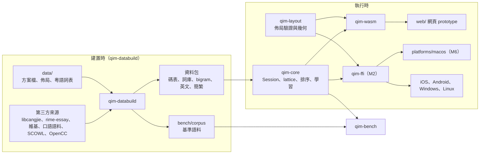
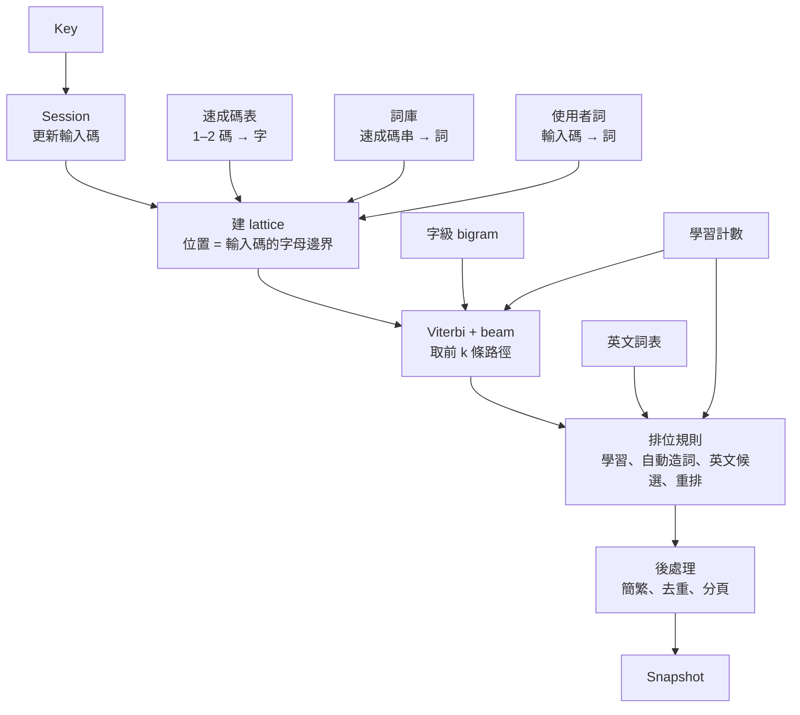

# QIM 實作計劃

> 狀態：M0、M1 完成（`.scratch/m0/spec.md`、`.scratch/m1/spec.md`，封存 `docs/archive/M0.md`、`docs/archive/M1.md`）；M2 進行中（`.scratch/m2/spec.md`）；M2 之後只有目標、範圍與完成標準。本檔只寫現況：決定改了就直接改寫，不留「原寫」「取代原」「某日改」；舊版與理由記在 progress〈偏差與決定〉，影響架構的寫 ADR。里程碑開工時，它在〈里程碑任務〉的那一節細化成 `.scratch/<里程碑>/spec.md`，這裡縮成一行連結；拆票後以票為準。需求與決定見 `docs/design-brief.md`，名詞見 `GLOSSARY.md`。

## 0. 工程慣例

- Rust edition 2024，toolchain 用 stable（寫本檔時 1.99.1），`rust-toolchain.toml` 釘版本。
- 核心的新功能與修 bug 走 `mattpocock-skills:tdd`；一個 session 一張票（`CLAUDE.md`）。
- 程式碼識別符用英文，對應 `GLOSSARY.md` 的詞：

| 名詞 | 識別符 | 名詞 | 識別符 |
| --- | --- | --- | --- |
| 輸入方案 | `Scheme` | 候選 / 首選 | `Candidate` / `top` |
| 輸入碼 | `input` | 組字 | `Composition` |
| 速成碼 / 倉頡碼 | `QuickCode` / `CangjieCode` | 上屏 | `commit` |
| 碼表 / 詞庫 | `CodeTable` / `Lexicon` | 字根提示 | `RadicalHint` |
| 連打 | `continuous` | 英文候選 | `EnglishCandidate` |
| 使用者詞 / 觸發詞 | `UserWord` / `Trigger` | 聯想 | `Association` |
| 自動造詞 | `AutoPhrase` | 無痕模式 | `Incognito` |
| 核心 / 平台殼 | `core` / `Shell` | 佈局 / 資料包 | `Layout` / `…Pack`（方案資料包 `SchemePack`） |
| 首選字基準 | `TopChoiceBench` | 修正次數 | `correction_count` |
| 分段 | `Segment` | 佈局版本 | `LayoutVariant` |
| 個人模型 | `UserModel` | 空間模型 | `SpatialModel` |
| 重排 | `Rerank` | 譯詞 | `Gloss` |
| 容錯 | `Correction` | 萬用鍵 | `Wildcard` |
| 連打字集 / 擴展區 | `continuous` / `extension` | 目前分段 | `focus` |
| 英文直通 / 臨時英文 | `ascii` / `inline` | 分隔記號 | `SEPARATOR` |

## 1. 架構總覽

### 1.1 執行形態

核心是 Rust 函式庫，各平台殼把它連進自己的程序（ADR 0002）：網頁經 WebAssembly，Apple 與 Android 經 uniffi 產生的 Swift / Kotlin 綁定，Windows 與 Linux 經 C ABI。Windows 依成熟做法把核心放在獨立程序，TSF DLL 只轉傳（`docs/research/platform-frameworks.md` §6），到 M9 再定。



### 1.2 目錄結構

| 路徑 | 內容 |
| --- | --- |
| `crates/qim-core/` | 純邏輯：方案、資料包讀取、lattice、排序、學習、`Session` |
| `crates/qim-layout/` | 佈局模型、JSON Schema 驗證、點擊判定、按鍵幾何計算 |
| `crates/qim-databuild/` | CLI：取得來源、建資料包、訓練 bigram、產生基準語料 |
| `crates/qim-bench/` | 首選字基準 runner，量正確率與每鍵延遲 |
| `crates/qim-wasm/`、`crates/qim-ffi/` | 綁定層，不放邏輯；`qim-ffi` 由 M2 票 07 建，Swift 綁定由 `cargo xtask ffi` 產生 |
| `xtask/` | 閘門與開發指令（`cargo xtask check`、`data`、`web`、`ffi`、`bench`、`commit-msg`） |
| `data/` | 自己維護的方案檔、佈局檔、粵語詞表、來源清單 `sources.toml`，與進資料包的授權全文 `licenses/`；不放其他第三方原始檔與建置產物 |
| `bench/` | `fixed.tsv`、`corpus/`、`colloquial/`（都含授權與署名）、`baseline.json` |
| `web/` | 網頁 prototype（Vite + TypeScript）、`web/editor/` 佈局編輯器、Playwright 測試 |
| `platforms/` | 各平台殼，M6 起逐一建立 |

建置產物不進 git：`target/`、`build/packs/`、`build/layouts/`、`build/ffi/`、`web/public/packs/`、`web/public/layouts/`。下載的來源放在 repo 外的使用者快取目錄（`QIM_CACHE_DIR` 可改），各 worktree 共用（`docs/development.md`〈資料建置〉）。

### 1.3 依賴規則【決定】

| crate | 可以依賴 | 不可以 |
| --- | --- | --- |
| `qim-core` | `serde`、`postcard`；之後要加的依賴先改本表 | 任何 workspace crate（含綁定與平台 crate）；`std::fs`、`std::net`、`std::thread`、`std::time::SystemTime`（時間由殼以上屏次數傳入） |
| `qim-layout` | `serde`、`serde_json`、`jsonschema` | `qim-core`；同上的 I/O |
| `qim-wasm` | `qim-core`、`qim-layout`、綁定工具 `wasm-bindgen` | 被 `qim-core` 或 `qim-layout` 依賴 |
| `qim-ffi` | `qim-core`、`qim-layout`、綁定工具 `uniffi` | 同上 |
| `qim-databuild` | `qim-core`（資料包格式）、`qim-layout`（算出預設佈局）；外部 crate 不限（I/O 套件） | 被 `qim-core` 或 `qim-layout` 依賴 |
| `qim-bench` | `qim-core`（資料包格式）；外部 crate 不限（I/O 套件） | 被 `qim-core` 依賴 |
| `web/`、`platforms/*` | 只透過綁定呼叫核心與 `qim-layout` | 重寫排序、查碼或點擊判定邏輯 |

強制：`cargo xtask check` 的 `deps` 步驟（M0 票 02 接上）。

- 白名單在 `xtask/src/deps.rs` 的 `RULES`。改上表時兩邊同一 commit 改；`cargo test` 比對兩邊的「可以依賴」與「不可以」欄。「不可以」欄以「；」分子句，每句要是反引號包住的禁用路徑或 crate、`被 … 依賴`、`任何 workspace crate`、`同上`、`同上的 I/O` 之一，其他寫法測試會紅（`web/` 那類非 crate 的列不比）。
- 讀 `cargo metadata`：一般與 build 依賴照「可以依賴」欄；dev 依賴不受白名單限制，但 workspace crate 不論哪種依賴都只能是欄內列的。
- workspace 成員不在上表就紅，要先改表；`xtask` 是開發工具，例外。表上的 crate 還沒建立時跳過。
- 掃 `qim-core`、`qim-layout` 的 `src/`（含 `#[cfg(test)]` 模組）找禁用路徑：斷詞後比對，註解與字串不算，`use` 的 `{..}` 與 `*` 會展開，`SystemTime` 這個名字出現就算。`build.rs`、`tests/`、`benches/`、`examples/` 不編進函式庫，不掃，整合測試可以讀檔。已知漏洞：把 `std` 本身改名（`use std as s`）後的路徑抓不到。
- 測試做雙向變異：在暫存副本加入違規依賴或 `use std::fs` 會紅；改無關的格式或命名不紅。

### 1.4 主要依賴

版本為寫本檔時的 stable，開工時以 `cargo add` / `npm install` 取當時 stable 並更新本表。

| 依賴 | 版本 | 用途 | 理由 |
| --- | --- | --- | --- |
| Rust | 1.99.1 | 核心與工具 | ADR 0002 |
| `serde` / `postcard` | 1.0.229 / 1.1.3 | 資料包序列化 | `no_std` 友善、體積小；資料包格式是內部格式，可換 |
| `toml` | 1.1.8 | 方案檔、`data/sources.toml` | Rust 生態標準格式，可寫註解 |
| `ureq` / `sha2` | 3.5.1 / 0.11.1 | `qim-databuild` 下載來源並核對 sha256 | 同步 API、不必帶 async runtime |
| `zip` | 9.3.0 | `qim-databuild` 讀 Unihan.zip、HKCanCor 的 zip | Unicode 只發 zip；只開 deflate 解壓 |
| `dirs` | 7.0.0 | `qim-databuild` 找平台的使用者快取目錄，放下載的來源 | 各平台的快取目錄慣例（macOS `~/Library/Caches`、XDG、Windows `LocalAppData`）不必自己寫 |
| `bzip2` / `quick-xml` | 0.6.1 / 0.42.0 | `qim-databuild` 讀維基 dump（`pages-articles.xml.bz2`） | `bzip2` 預設用純 Rust 的 libbz2-rs-sys；串流讀 XML，不必整份載入 |
| `serde_json` / `jsonschema` | 1.0.154 / 0.60.2 | 佈局檔與驗證；`jsonschema` 關掉預設 features（不要網路與檔案的 `$ref` 解析） | 佈局要給 TS、Swift、Kotlin 直接讀 |
| `wasm-bindgen` / `wasm-bindgen-cli` | 0.2.130 | WebAssembly 綁定 | 直接用 CLI，不依賴 wasm-pack |
| `uniffi` | 0.32.2 | Swift / Kotlin 綁定（M2 票 07 確認）；proc-macro 宣告介面，`uniffi-bindgen-swift` 從靜態函式庫產生綁定（library mode），它要的 `cli` feature 只在 `qim-ffi` 的 `bindgen` feature 開 | 一份介面產生兩種語言 |
| `ferrous-opencc` | 0.4.0 | 只給 `qim-databuild` 前處理語料的 `s2hk`、`t2hk`（用它內建的字典） | 純 Rust、Apache-2.0。簡體模式不用它：編得進 WebAssembly，但只能用編進 crate 的字典、不能從資料包載入，改由簡繁資料包加 `qim-core` 的轉換（§4.4，M1 票 16） |
| `strsim` | 0.11.1 | `qim-bench` 算字正確率的編輯距離（以字計的 Levenshtein） | 維護中、無依賴；不自己寫 |
| `proptest` | 1.12.0 | 核心與 `qim-layout` 點擊判定的性質測試（dev） | — |
| Vite / TypeScript | 8.3.5 / 7.0.2 | 網頁 prototype | — |
| Biome | 2.6.4 | TS lint 與 format | 一個工具包辦兩件事 |
| `@playwright/test` | 1.64.1 | 網頁 e2e 與驗收 | 使用者指定 |
| `@types/node` | 26.6.6 | `web/bench/` 的 Node 腳本（WebAssembly 每鍵延遲）、`web/test/` 單元測試（Node 內建的 `node:test`，不另加測試框架）與 Playwright 設定、e2e 的型別 | 跟 Node 26 同主版本；只給 `web/bench/tsconfig.json` 與 `web/tsconfig.node.json`，網頁的程式碼（`src/`）看不到 Node 的 API |

## 2. 核心

### 2.1 介面

參考 librime 的 `RimeApi`（`process_key`、`get_context`、`select_candidate`）與 fcitx5 的 InputContext：殼把事件交給 session，拿回一份完整快照，殼只負責畫。

```rust
pub struct Engine;      // 不可變：方案 + 資料包，多個 Session 共用
pub struct UserModel;   // 可變：使用者詞、學習計數；export() / import() 給殼存檔
pub struct Session;     // 一個輸入框的組字狀態

pub enum Key { Letter(char), Punct(char), Space, Enter, Backspace, Escape, Digit(u8), PageUp, PageDown, Left, Right, ToggleAscii(ShiftKey), Other, Modifier }
pub enum ShiftKey { Left, Right }
impl Key { pub fn parse(kind: &str, value: Option<&str>) -> Result<Key, KeyError>; } // 綁定收「種類 + 值」
pub enum ShiftSwitch { Rime, CommitText, InlineAscii } // 組字中單按 Shift，預設 Rime

pub struct Options { pub simplified: bool, pub incognito: bool, pub english_candidates: bool, pub digit_separators: bool, pub shift_switch: ShiftSwitch }

pub struct Snapshot {
    pub handled: bool,              // 核心吃下這個鍵；為假時殼交還宿主（librime process_key 的回傳值）
    pub composition: Composition,   // 輸入碼、各分段（碼、字根、字與原文、是否已選定）、目前分段
    pub candidates: Vec<Candidate>, // 目前頁；每個候選是字（`text`）與原文（`original`）
    pub page: usize,
    pub has_more: bool,
    pub commit: Option<String>,     // 這次事件要上屏的文字
    pub commit_original: Option<String>, // `commit` 的原文
    pub ascii: bool,                // 英文：沒有組字時是英文直通，鍵都交還宿主；組字中是臨時英文
    pub generation: u64,            // 每次候選變動 +1（翻頁不算），非同步重排用
}

impl Session {
    pub fn handle(&mut self, engine: &Engine, user: &mut UserModel, key: Key) -> Snapshot;
    pub fn select(&mut self, engine: &Engine, user: &mut UserModel, index: usize) -> Snapshot;
    pub fn text(&mut self, engine: &Engine, user: &mut UserModel, text: &str) -> Snapshot; // 觸控鍵盤的 `text` 動作
    pub fn focus_segment(&mut self, engine: &Engine, user: &mut UserModel, segment: usize) -> Snapshot;
    pub fn set_options(&mut self, options: Options);
    pub fn options(&self) -> Options;                                 // 殼改一項時讀出來改，不另存
    pub fn composing(&self) -> bool;                                  // 有還沒上屏的輸入碼（臨時英文也算）
    pub fn refresh(&mut self, engine: &Engine, user: &UserModel) -> Snapshot; // 換選項後依新選項重列候選
    pub fn all_candidates(&self) -> Vec<Candidate>;                  // 不分頁，候選展開面板用
    pub fn rerank_request(&self) -> Option<RerankRequest>;            // generation + 上下文 + 前 RERANK_LIMIT 個候選
    pub fn apply_rerank(&mut self, engine: &Engine, generation: u64, order: &[usize]) -> Option<Snapshot>;
}
```

- 分隔記號（`qim_core::SEPARATOR`，`'`，brief §4.3，M1 票 28）：組字中的 `Key::Punct('\'')` 不上屏組字，而是接在剩下的輸入碼後面（已經以它結尾時吃下不動作）；沒有組字時照其他沒有全形的標點交還宿主。它留在 `Composition.input` 與分段的碼裡，算在前一段的碼尾（`mi'r` 的分段是 `mi'` 與 `r`），跨過它的詞的分段碼中間含它（`an'r` 的「門口」是一段 `an'r`，M1 票 28b），所以「各分段的碼接起來是 `input`」照舊成立；字根照原字元顯示。觸控鍵盤組字中的「'詞」送同一個鍵，不另加 `Key`：實體鍵盤的 `'` 本來就是 `Punct`，殼不必知道哪個字元是分隔記號。各方案共用一個、不放進方案檔（Rime 是方案的 `speller/delimiter`），要換時再加欄位。
- `Letter` 含大寫與方案以外的字母，`Punct` 是其餘的可見 ASCII 字元，`Other` 是殼不轉成其他種的鍵（Tab、Delete、↑ ↓…）；`Modifier` 是只改鍵盤狀態、不送字元的鍵（單按 Ctrl、Cmd、Alt、CapsLock 這類修飾鍵，觸控的切頁、⇧、換鍵盤），組字中同 `Other` 吃下，沒有組字時交還宿主但不結束數字（M1 票 26b）；全形對照與組字中各鍵的行為在核心（brief §4.3）。只改殼的畫面、不動組字的鍵由殼攔下、不轉給核心：組字中 Tab 開關字根提示、↓ / ↑ 開關展開面板（§3.1）。組字中每個鍵都 `handled`，所以 `handled` 為假時組字是空的、`commit` 也是空的，殼不必處理「交還宿主又要上屏」。
- `text`：直接輸入一段文字、不經組字（佈局的 `text` 動作，§2.6）。沒有組字時上屏它（英文直通也是）；組字中和標點相同，先上屏整個組字再接它；臨時英文中和實體鍵盤的可見字元一樣接在英文後（M1 票 27b）。文字照原樣，不轉全形、不套數字後半形（M1 票 20、27b）；簡體模式下文字也轉簡體，原文留繁體（使用者決定，M1 票 23）。觸控的標點鍵也走這裡，照鍵上的字輸出（使用者決定，M1 票 27b）。
- `ToggleAscii`（單按 Shift，brief §4.3）：沒有組字時切英文直通，`Snapshot.ascii` 跟著變；英文直通下每個鍵都 `handled` 為假，沒有組字。組字中照 `Options.shift_switch`：`commit_text` 先上屏整個組字再切；`inline_ascii` 進臨時英文，`ascii` 為真而組字還在，最後一段是 `Segment.raw` 的分段（Rime 的 `raw` 標記），各鍵的行為照目前發佈版 librime（≤ 1.17.0，空白接進英文，M1 票 25b），見 brief §4.3。預設 `Rime` 是左 Shift `inline_ascii`、右 Shift `commit_text`（M1 票 25，推翻票 23 的左右相同）。單按的判定（按下到放開 500 ms 內、中間沒有按下或放開別的鍵，librime 同值）與分辨左右在殼；網頁用 `KeyboardEvent.code`，觸控鍵盤的中英鍵（佈局動作 `toggleAscii`）當右 Shift；觸控的 ⇧ 是另一個動作 `shift`（§2.6），是大寫鍵，不送 `ToggleAscii`。臨時英文中 `-` / `=` 是字元，殼不轉成翻頁。
- 英文候選：`Engine::with_english` 掛上英文資料包（不由方案指名，各方案共用）；`Options.english_candidates`（預設開，brief §7）開著時套用排位規則 4（§2.4）。組字中換這個選項同簡體模式，殼呼叫 `refresh`（M1 票 15）。
- 簡體模式：`Engine::with_simplifier` 掛上簡繁資料包（不由方案指名，各方案都輸出繁體）；`Options.simplified` 開著時，候選在排序之後轉簡體、轉換後重複的只留第一個，組字的分段與上屏也轉。轉換的單位是一個分段：多段的候選各段分開轉換再接起來，選了之後組字與上屏也是各段分開轉換，所以看到的就是上屏的；學習記繁體原文。組字中換選項時殼呼叫 `refresh`，同 librime 換選項後重算組字（M1 票 16）。殼只呼叫 `set_options` 時，下一個 `handle`、`select`、`focus_segment` 或 `text` 先依新選項重列候選，重列前 `all_candidates` 是空的、不給重排要求、也不套用重排結果（M2 票 01）。`qim-ffi` 加換選項時，綁定的 `set_options` 同時呼叫 `refresh` 回快照（同網頁的 `setSimplified`），殼就碰不到這個待生效狀態（票 01 的建議，M2 票 07 延後到需要它的票）。
  - 原文：候選、分段與上屏都另帶後處理前的原文（`original`、`commit_original`，簡體模式以外和顯示的字相同）。字根提示查原文，「回報」記原文：要提示的是打得出的繁體字，`fixed.tsv` 的期望首選是繁體（協調者決定，M1 票 16）。
- 數字後半形：`Options.digit_separators`（預設開，brief §4.7、§7）。沒有組字、前一個上屏的字是半形數字時，`.` `:` 直接上屏半形，不進組字；逗號照舊全形（使用者決定，M1 票 26）；「前一個上屏的字」由 `Session` 記最近送出去的字，M3 有 `set_context` 後改看前文。會上屏的三個方法回傳前都經過同一處記下（`Session::finish`）：`handle`（含交還宿主的鍵，只有數字鍵算數字，`Modifier` 不動它）、`select`（點候選）、`text`（觸控的文字鍵：數字列、符號頁與數字鍵盤的數字、常用頁）；`refresh`、`focus_segment`、`apply_rerank` 不上屏、不改它。觸控的標點鍵是 `text`、照鍵上的字輸出，不套這條（使用者決定，M1 票 27b，推翻票 27 的觸控標點送 `Key::Punct`）。
- 殼負責：鍵碼轉 `Key`、欄位類型轉 `Options.incognito`、保存 `UserModel.export()`、畫候選與鍵盤。
- 按鍵的入口（M2 票 03）：綁定收不了帶資料的列舉時（WebAssembly）用 `Key::parse` 收「種類 + 值」，種類是 `Key` 各種的 camelCase 名字（`letter`、`digit`、`toggleAscii`、`space`…），值是字元、`0`–`9` 或 `left` / `right`；網頁的按鍵都經綁定的同一個 `press`，加一種鍵只改核心與網頁的按鍵對照（`web/src/keys.ts`）。同 librime 能從字串讀按鍵（`KeyEvent` 的文字表示）。`qim-ffi` 也收「種類 + 值」（M2 票 07）：uniffi 沒有 `char` 型別，收不了 `Key::Letter(char)`，另寫一份鏡像列舉又讓加一種鍵多改一處。觸控鍵盤的組字狀態也問 `Session::composing`，綁定不另存。
- 上下文（M3）：`Session::set_context(before: &str)`，n-gram 與個人 bigram 用前文當起點。
- 組字中修改：`Left`、`Right` 或 `focus_segment` 移到某一分段，候選改列該段的碼的字詞（和單打那個碼相同）；選定後該段固定，其餘分段用同一把尺重算。參考 librime 的 caret 與 Mozc 的分段轉換。
  - `Composition.focus` 預設是分段數（像 librime 的 caret 在最後）：候選列剩下沒選定的整串；← 從最後一段往前，→ 走過最後一段回到整串；打字、退格回到整串。`select(index)` 的 `index` 是全部候選的位置（librime `select_candidate`）。
  - 改選第 i 段時，前面的分段照顯示的字固定、不重算（使用者確認）：重算的輸入碼從頭建、不接選定的分段的字（和選開頭一段時相同，接前文等 M3 `set_context`），單獨重算前面只會丟掉跨段 bigram 選出、使用者看過的字。選的只蓋住第 i 段開頭時，那段剩下的碼和後面的分段一起重算；否則後面已選定的不動、沒選定的重算。都選定了就上屏。所以選定的分段永遠在開頭（M1 票 21）。
  - 移到某一段時空白上屏整個組字，和組字中按標點相同。
- 觸控機率（M4）：`Key` 加 `Weighted(Vec<(char, f32)>)`，由 `qim-layout` 依點擊位置與按鍵幾何算出，殼轉交；`qim-core` 不知道佈局。當時平台殼還沒開工，只改網頁綁定。
- 欄位類型（M4）：`Options` 加 `field: FieldKind`（一般、email、網址、數字），由殼依平台的欄位資訊給。
- 重排：`apply_rerank` 只接受目前的 `generation`，過期結果丟棄；重排過的候選最高只到第 2 位（afm-ime 做法，brief §1.3）。M1 只有介面與網頁的假實作，M3 起接雲端 LLM。
  - `order` 是要求裡候選的位置、好的在前：首選不動，其餘照它排在第 2 位起，沒提到的照原順序接在後面。要求最多帶第一頁（`RERANK_LIMIT` = 9），所以重排只動第一頁。上下文是候選前面的分段的原文，M3 再接輸入框的前文。
  - 名次真的變了才算候選變動、`generation` +1：同一份要求的其他結果照舊順序排，要作廢；原樣回傳不作廢。殼只在按鍵等事件之後要求，不因套用了重排結果再要求。
  - 翻頁不是候選變動，`generation` 不加；翻頁中收到的結果照樣套用，因為只動第一頁，看得到的那頁不變。加的話結果在翻頁時作廢，殼重要求後仍在翻頁中套用，沒有保護到什麼（M1 票 23，M0 票 09 留下的問題）。
  - `apply_rerank` 要 `Engine` 才回得出快照（組字的簡繁與字根），比原本的簽章多一個參數。

### 2.2 資料流



- 已知限制：簡繁後處理逐個分段轉換（§2.1），跨兩段的詞可能轉錯，例如「乾」「隆」分在兩段時成了「干隆」。常見詞在詞庫裡本身就是一段，所以罕見。等使用者回報再改：整串一起轉換，再依字數切回各段（M1 票 16）。

### 2.3 排序：同一把尺

所有候選，不論是一個長詞條、拼出來的句子，還是單字，都用同一個函式打分。不採用 Rime「有精確詞條就不造句」的規則（ADR 0001、`docs/research/rime.md` §5）。

```
score(path) = Σ 每段 [ log P_bigram(段的第一字 | 前一段的最後一字) + log P_段內 ]
            + β × (路徑中屬於詞庫的段數)
            − γ × (路徑的段數)
            + Σ personal(段)

P_段內 = 1（單字）
       = P_詞頻(詞) ÷ P_unigram(詞的第一字)（詞庫的詞）
```

- `P_bigram`：字級 interpolated Kneser-Ney bigram（§4.3），只看文字，所以「問」和「門口」、「一台」和「歹口」都在同一把尺上比；同樣的文字當成一個詞或拆成單字，段內的分數不同（詞用詞頻）。組字開頭的字沒有前文，用字頻的 unigram（M3 的 `set_context` 再接上前文）。方案沒指名語言模型時每個字都是 0 分。
- 詞的段：`P(詞 | 前一字) ≈ P(第一字 | 前一字) × P_詞頻(詞) ÷ P(第一字)`，前後文由字級 bigram 接，詞內由 rime-essay 的詞頻估（每個詞算一次的詞頻總和當分母）。詞內也用字級 bigram 時，同碼的詞分不出常用度，個人集答錯多 27%（M1 票 11 Comments）。
- `β` 鼓勵詞庫裡的詞，`γ` 抑制過度切碎；由首選字基準的 dev 切分調出（`cargo xtask bench --dev`），寫進方案檔。速成是 β = 1、γ = 1（M1 票 12）：dev 偏好更小的 β，但個人集（多是兩字詞）答錯變多，個人集只當守門、不拿來調。
- `personal`：學過的段在任何長度的連打裡都加分，只加不減。參考 libime 的 `max(靜態分, log((1−w)·靜態機率 + w·個人機率))`，`w` = 0.05（libime 用 0.2，`docs/research/libime-user-model.md` §1；M1 票 12 調）；沒學過的段為 0。所以 `personal(段) = max(0, ln((1−w)·P + w·P_personal) − ln P)`，`P` 是這一段接在前一字後的靜態機率：首字 bigram 乘詞內機率，不含 β、γ。M3 再加個人 bigram（前一字詞 → 這一段）。
  - 個人機率 `P_personal = d_now ÷ D_max`：`d_now` 是（方案, 碼, 字詞）的衰減值衰減到這個方案現在的 tick（`d · e^(−(tick − 最後 tick)/200)`），`D_max = 1 / (1 − e^(−1/200)) ≈ 200.5` 是每次上屏都是它時衰減值的上限，所以 `P_personal` 在 (0, 1]。分母取常數，照 libime 除以滿載歷史的總量：學過一次的段 `P_personal ≈ 0.005`，不會因為才學幾次就壓過所有詞。
  - 分母改用實際上屏的段數衰減總和時，`bench --learning` 四個公開集合的修正次數都較多（M1 票 13 Comments，當時是 unigram），所以用常數。
- 詞內在詞頻與字級 bigram 之間內插（權重 0.4–0.6）在 dev 上口語略好、維基答錯少約 3–5%，但個人集答錯多 5–16%，不採用（M1 票 12 Comments）。
- `personal` 的 w：票 13 換上 bigram 後 w 0.2 讓 zh-wiki 學習開變差，票 12 換上口語權重與新 β、γ 後連 common-voice-yue 也變差。學習模式改讀 dev 切分掃 0.01–0.2，0.05 對口語與維基都最好；test 上口語兩集、個人集與 yue-wiki 學習開較少，zh-wiki 持平（票 12 Comments）。
- 每個位置保留 beam 寬 20（libime 預設，`docs/research/ranking-techniques.md` §4），同文字的部分路徑只留最高分；下一段的分數看部分路徑的最後一個字，所以 beam 剪掉的路徑可能本來會勝出，beam 夠寬才等於窮舉。每個起點的每個碼只取字頻最高的 beam 個字進 lattice（詞全進），另加使用者學過的字（它們有 `personal`）；前文再支持第 21 名以後沒學過的同碼字也進不來；票 12 量過全收或 beam 40，dev 只差 1 題，不放寬。每按一鍵只補算新增的位置，選定一段後其餘的輸入碼從頭建（`docs/research/libime-lattice.md`）。
- 分隔記號（§2.1）是「這裡一定要斷字」（brief §4.3，M1 票 28b 照 Rime 速成）：它的一欄照抄前一欄，邊不從它開始。邊的碼中間有分隔記號時去掉它再查碼表、詞庫與使用者詞，但沒有字，只留每個分隔記號都落在詞內兩字的碼之間的詞（`Engine::splits_at` 照碼表把詞一字一碼地對齊，字有幾個碼時任一種拆法都算；碼不是由字的碼組成的使用者詞不跨）；往回找邊的上限算字母數。其餘照上面打分（bigram 照樣跨過它接前一字）。結尾的分隔記號算在最後一段裡：候選列查碼時去掉它，`mi'` 的候選同 `mi`、蓋住整串。只蓋住開頭一段的字詞後面緊接分隔記號時連它一起蓋住，選了之後剩下的輸入碼不以分隔記號開頭；觸發詞只比對整串（去掉結尾的分隔記號），中間有分隔記號時沒有。
- Unicode 擴展區的字不進 lattice；整串輸入碼就是一個字的碼時，排在一般字之後（brief §4.1）。
- 候選列：蓋滿整串的字、詞與分數最高的幾條多段路徑（方案檔 `ranking.sentences`，速成 3 條）依分數排 → 擴展區的字 → 只蓋住開頭一段的字詞，蓋得長的在前、同長依分數；文字重複的只留第一個。多段路徑放多：維基集修正次數降、口語集升（票 07 Comments）。

### 2.4 學習與排位（brief §4.5）

- 學習計數以「(輸入方案, 輸入碼, 候選文字)」為鍵，同一串碼在不同方案互不影響（速成與倉頡都有 `ab`）；M1 用第二份測試方案驗證。之後的個人 bigram 只看文字，跨方案共用。計數記：整串上屏的次數與最後一次的 tick、衰減值與它最後更新的 tick。tick 是學習過的上屏次數，每個方案各自累加，由 `UserModel` 自己算，不讀系統時間；一個方案的使用者詞與計數在核心內部經 `UserModel::for_scheme` 取用，查詢與學習的方法不逐一帶方案（M2 票 02）；無痕與 Enter 原樣上屏輸入碼不算。衰減值照 librime `formula_d`：每次上屏 `d ← 1 + d · e^(−(tick − 最後 tick)/200)`（時間常數 200 次上屏，brief §12.2）。
- 上屏時記兩種，用途不同（使用者決定）：
  - 整串上屏：整串輸入碼就是那個碼、上屏的就是那個候選，記一次上屏次數。只有它算排位規則 2 的門檻與「最近」；句中用過的字詞不會因此搶到單打時的首選。
  - 衰減值：整串和路徑的每一段各加一次（同一組鍵在一次上屏裡只加一次），只給 §2.3 的 `personal`，所以學過的詞在更長的連打裡也有效。選了開頭一段的，每個選定的分段算一段；選的是多段路徑的，路徑的每一段各算一段。標點、大寫先上屏組字時照樣學，但有沒有字的輸入碼原樣上屏時整次不學。
- 排位規則依序套用在 Viterbi 結果上，前面的規則排定的位置後面的規則不動；只移動候選列裡已有的候選。比對的是整串輸入碼，也就是候選列的那串：選定開頭一段之後是剩下的輸入碼。次數不衰減，用來判斷門檻；衰減值只決定個人分高低，不參與門檻（衰減後選兩次只有約 1.995，永遠到不了 2）：
  1. 觸發詞完全符合的使用者詞 → 首選。
  2. 整串上屏 ≥ 2 次，且距最後一次整串上屏不超過 10,000 次上屏（初值）的候選 → 首選；多個符合時取最近整串上屏的。沒有這樣的候選時，整串上屏剛好 1 次的候選不靠學到的分數成首選：分數排第一的是它、而不學習時（空白的個人模型）的首選不是它，就改回不學習時的首選；本來就是首選的上屏一次仍是首選，不學習時的首選不是蓋滿整串的候選時不動。學過一次的個人分（約 0.05 × 0.005）常勝過兩字以上候選的靜態機率（多在 10⁻⁶ 以下），不擋就違反「選兩次才成首選」（brief §4.5，M1 票 14）。
  3. 上屏次數 ≥ 1 的使用者詞（含自動造詞）→ 至少第 2 位；多個符合時取最近整串上屏的。本來就在前 2 位的釘在原位。
  4. 英文候選：輸入碼剛好是完整英文單字時放第 2 位（brief §4.3）；第 2 位已由規則 1–3 排定時放它後面最前的空位，不往前移、不搶首選。只給剩下的整串輸入碼（目前分段的候選列沒有），輸入碼要長過方案一個字的最長碼（速成 3 碼起，同 macOS 速成，黑箱 T7），沒有任何中文候選時不出。拼法查英文資料包（§4.4）：比對小寫，同一個小寫拼法有幾種大小寫時取全小寫的，沒有就取專有名詞的大寫（`english` → English，T7 的 macOS 也出 iPad、GitHub）。選了它和 Enter 一樣：選定的分段上屏字詞、其餘上屏英文字，整次不學、不造詞，所以選幾次都不會變首選（M1 票 15）。
  - 排定的候選釘在它的位置，其餘的依原本的順序填進空位；「至少第 n 位」移到不超過第 n 位的空位裡最後面的一個，那些位置都排定了才移到最前面的空位。
- 使用者詞像詞庫的詞一樣進 lattice（§2.2），蓋滿整串時就是候選；它沒有詞頻，詞內由字級 bigram 一字接一字估，不加 β，只算一段（所以比拆成單字的路徑少扣 γ），`personal` 照 §2.3。
  - 手動加詞（`UserModel::add_word`）：輸入碼是各字的碼接起來（一個字有幾個碼時取它排得最前的那個碼），連打裡也打得出；有字沒有碼（英文、數字）時改用觸發詞當輸入碼。觸發詞只能用方案的鍵；詞不能空、不能含控制字元。手動加詞是使用者明確的操作，無痕模式也收。
  - 觸發詞剛好是整串時，那個詞加進候選列再由規則 1 移到首選；有幾個時取這串觸發詞最近整串上屏的。上屏時照打的碼學（記在「觸發詞, 詞」）。
- 自動造詞：一次組字分兩次以上選定（選過開頭一段再選蓋滿剩下的，或移到第 2 段以後的分段改選，前面的分段照顯示的字固定）後上屏，把「整串輸入碼 → 上屏文字」記成使用者詞；上屏次數由同一次上屏的學習記成 1。碼表或詞庫已有同碼同字的不記（libime 也略過已有的詞）；標點、大寫先上屏組字與 Enter 不算選定，不造詞；無痕不造詞。
- 分隔記號（§2.1）不進學習資料：每段、整串、自動造詞的碼都去掉它，排位規則比對的碼也去掉它（同 Rime 使用者詞典的碼由音節組成，brief §12.2）。所以 `mi'r` 選兩次「歹口」，記的是 `mir` → 歹口，不分隔打 `mir` 也成首選；分隔過的組字照舊要分兩次以上選定才自動造詞（M1 票 28）。
- `Options.incognito` 為真時不寫任何學習資料。
- 匯出格式（對外，M1 票 14 定稿；改了要升版本，brief §5.3）：純文字 UTF-8、Tab 分隔、`\n` 換行（匯入也收 `\r\n`）：
  - 第一行 `# qim-userdict v1`；接著每個方案一行 `#@/tick/<方案>\t<tick>`；其餘 `#` 開頭的行與空行是註解，匯出時寫一行欄名註解。
  - 每個（方案, 輸入碼, 詞）一列、9 欄，依方案、輸入碼、詞排序：`方案  詞  輸入碼  整串上屏次數  最後整串上屏 tick  衰減值  最後 tick  來源  觸發詞`。來源是 `learned`（只有學習計數）、`manual`、`auto`；觸發詞只有 `manual` 有，沒有時是空字串；手動加了還沒用過的詞計數都寫 0。衰減值用最短而能讀回同一個 f64 的十進位（Rust `Display`），`export` 後 `import` 等價。
  - 參考：librime userdb 文字檔（第一行註解、`#@/key<Tab>value` 的 metadata 含 `/tick`、每列記衰減值 `d` 與最後 tick `t`）；libime 使用者詞庫分手動詞與 `[Auto]` 段，這裡收成「來源」欄。和兩者不同：第一行帶格式版本（兩者都沒有）；統計用固定欄，不用 librime 的 `c= d= t=`，因為要多記整串上屏的次數與 tick（規則 2），升版本時本來就要改 parser；多個方案放同一檔；刪除記號（librime 負的 `c`、libime `[Delete]`）等 M4 同步定合併規則時一起加（§7.5）。查證在 `docs/research/userdict-text-formats.md`。
  - 匯入取代整個個人模型（殼存檔、換機都是整份），有一列不合格式就整份不收、錯誤帶行號：取代時收一半等於丟資料。兩者都是合併、壞列略過；合併規則跟同步一起在 M4 定。

### 2.5 輸入方案（brief §6）

方案檔是 TOML，欄位命名參考 Rime `schema.yaml`：

```toml
id = "quick"
name = "速成"
version = "1"
alphabet = "abcdefghijklmnopqrstuvwxy"
max_code_length = 2

[radicals]            # 鍵 → 字根，組字與鍵盤標籤用
a = "日"
b = "月"
# …

[packs]               # 另外的資料包；碼表和方案一起編進方案自己的資料包
lexicon = "quick-lexicon"
language_model = "zh-hant-bigram"
radical_hint = "cangjie-hint"   # 字根提示用的倉頡碼，不進 lattice（ADR 0003）；Engine 不載入，殼用 RadicalHints::for_scheme 另外載入

[ranking]
word_bonus = 0.0      # β，M1 由基準調出
segment_penalty = 0.0 # γ
beam = 20
sentences = 3         # 候選列最多放幾條多段路徑
```

核心只認方案檔與資料包。新增輸入方案時，各部分這樣處理：

| 部分 | 處理 |
| --- | --- |
| 語言模型、重排模型、雲端 LLM | 共用，不重訓：它們評的是輸出文字。例外是吃輸入碼的自由生成模型（青簡 P2C），要逐方案訓練 |
| 空間模型、佈局 | 共用：看的是按鍵位置；字根標籤來自方案檔（§2.6） |
| 碼表 | 每個方案一份（ADR 0003） |
| 詞庫 | 詞與詞頻共用同一來源，每個方案各建一份碼索引 |
| `β`、`γ`、首選字基準 | 每個方案各自調、各有 baseline，品質不能只靠共用模型保證 |
| 學習 | 計數分方案（§2.4），個人 bigram 共用 |
| 容錯 | 機制共用：修正過的讀法帶懲罰進 lattice，按鍵位置來自空間模型或實體鍵盤鄰鍵表。允許哪些修正（鄰鍵替換、漏碼、多碼、對調）、懲罰、啟動條件寫在方案檔，各用含打錯碼的基準調（brief §4.8）。速成不做單字容錯；青簡對形碼與雙拼不糾錯 |

發佈方式（brief §5.3）：方案檔由 `qim-databuild` 和它的碼表一起編進方案自己的資料包（`<方案 id>.pack`，ADR 0003 讓碼表每個方案一份），`qim-core` 不讀 TOML。內建的資料包隨 App 發佈；可選的由主 App 下載或從檔案匯入，校驗後放進鍵盤讀得到的位置（iOS 是 App Group，沒有完整取用權限時鍵盤唯讀即可，brief §12.3），擴充不做編譯（Hamster 的分工）。資料包要求較新的核心時拒絕安裝，提示更新 App。手寫純文字方案檔在裝置上匯入要把編譯搬進主 App，等第一個使用者要自訂方案時再做。

方案之間怎麼切換由殼負責，每個方案一個 `Engine`。依方案類型，工作量不同：

- 形碼（倉頡）：`max_code_length = 5`，碼表來自已在用的 libcangjie。排序和查碼不必改；長碼連打的切分歧義多，開工時定預設連打或逐字。
- 音碼（拼音、粵拼、注音）：多兩件事。一是字與詞的讀音資料，含多音字，來源與授權在開工時查（rime-cantonese 授權鏈未查明，brief §12.1）。二是查碼：分隔符、簡拼、懶音不是查一份碼表能做的，要加一種查碼方式。排序和學習不動，所以 lattice 只經一個查碼函式取得候選邊，方案檔再加欄位選查碼方式；現在不先抽象，加第一個音碼方案時才做。

### 2.6 佈局：畫布模型（ADR 0004）

佈局是一張畫布，每個按鍵各自記位置、大小、旋轉、形狀和上下層順序，不靠「第幾排」決定位置。Gboard 預設佈局也只是一份資料，由 `qim-databuild` 依排列算出來。

格式 `qim-layout/1` 在 M1 票 19 定稿：JSON Schema 是 `crates/qim-layout/schema/qim-layout-1.schema.json`（draft 2020-12），型別在 `crates/qim-layout/src/model.rs`，兩邊同時改。之後改格式要加版本（`qim-layout/2`）並提供轉換；讀到別的版本時錯誤訊息直接講「只讀得懂 qim-layout/1」。

採用的慣例：

- Delta skin：設計尺寸（`canvas`，同 `mappingSize`）、每鍵 `frame`、可擴大的觸控範圍（`extendedEdges`，同名同義：正數往外擴、負數往內縮）、依裝置與方向分開的佈局版本（brief §12.4）。
- Trime：組字中改用的行為（`composing`）、JSON Schema 驗證、圓角欄位（`radius`，同 `round_corner`）。
- FlorisBoard keyboard3：長按清單（`longPress`，第一個是預設，同 `longPressKeyIds` 加 `longPressDefaultKeyId`）、切頁鍵（`switchPage`，同 `layerId`）、四向滑動（`swipe`，同 `<flicks>`；Trime 的 `swipe_up` 等也是四向）（`docs/research/open-source-imes.md` §4）。
- 自己定的（開源格式都只有矩形、以排為單位）：`rotate`、`z`、`shape` 的橢圓與多邊形、淺色與深色成對的顏色、編輯器的 `grid`。鍵盤底色不在格式裡，由殼依淺色或深色決定；外觀主題是之後的功能（brief §4.6）。

```jsonc
{
  "format": "qim-layout/1",
  "variants": [{
    "when": { "device": "phone", "orientation": "portrait" }, // device: phone | tablet；orientation: portrait | landscape
    "canvas": { "width": 390, "height": 216 },   // 設計尺寸，等比例縮放到實際鍵盤寬度
    "grid": { "columns": 40, "rows": 24, "snap": true },  // 可省略；只給編輯器，不影響鍵盤
    "initialPage": "letters",                    // 可省略，預設第一頁
    "pages": [{
      "id": "letters",
      "keys": [{
        "id": "a",                                 // 同一頁內不重複
        "frame": { "x": 12, "y": 80, "w": 36, "h": 48 }, // 旋轉前的矩形，w、h > 0
        "rotate": 0,                               // 可省略；以 frame 中心順時針的度數（同 CSS rotate）
        "z": 0,                                    // 可省略；大的在上，同一層時陣列裡後面的在上
        "shape": { "type": "rect", "radius": 6 },  // 可省略（直角矩形）；rect | ellipse | polygon（points 以 frame 為 0–1）
        "extendedEdges": { "top": 0, "bottom": 0, "left": 0, "right": 0 }, // 可省略；正數往外擴、負數往內縮
        // "label": "日",                         // 可省略：字母鍵用方案的字根，沒有字根的方案用字母；有寫就固定顯示
        "hint": "a",                               // 可省略；角標
        "a11yLabel": "日，英文 a",                  // 可省略，預設「顯示的標籤，hint」（「日，a」），沒有標籤的鍵用動作的說法（「空白」）
        "style": {                                 // 可省略，每項也都可省略；顏色 #rrggbb 或 #rrggbbaa，淺色與深色成對
          "fill": { "light": "#ffffff", "dark": "#3a3a3c" },
          "labelColor": { "light": "#000000", "dark": "#ffffff" },
          "opacity": 1, "labelSize": 18, "labelOffset": [0, 0] // 字級與位移是設計尺寸
        },
        "tap": { "letter": "a" },
        "longPress": [{ "text": "a" }],            // 可省略；第一個是預設
        "swipe": { "up": { "text": "1" } },        // 可省略；up | down | left | right，M5 才有作用
        "composing": { "label": "確定", "a11yLabel": "確定", "tap": "enter" } // 可省略或 null；組字中改用的標籤、無障礙標籤與動作，各自可省略
      }]
    }]
  }]
}
```

- 佈局版本的選法（`Layout::select`，傳入要的 `when`）：裝置與方向都符合的版本；其次方向符合的；再其次第一個版本等比例縮放（給警告）。網頁以螢幕短邊 600 px 為手機與平板的界線（Android `sw600dp` 的慣例）。
- 動作（`tap`、`composing.tap`、`longPress` 的項目、`swipe` 的四向）：不帶資料的寫名字 `"backspace"`、`"space"`、`"enter"`、`"nextKeyboard"`、`"toggleAscii"`、`"shift"`；帶資料的寫單一鍵的物件 `{ "letter": "a" }`（`a`–`z`）、`{ "punct": "," }`（ASCII 的可見標點，同實體鍵盤按那個鍵：綁定轉成 `Key::Punct`，全形、半形、組字中與臨時英文的處理都由核心決定；M1 票 27 加，只加不改；預設佈局只用在組字中的分隔鍵）、`{ "text": "，" }`（照原樣直接輸入，不經組字；組字中先上屏組字、臨時英文中接在英文後，經 `Session::text`）、`{ "switchPage": "symbols" }`（同一個版本的頁 id；組字留著）。預設佈局的字母鍵長按是 `text`（英文字母直接上屏，不含數字）。逗號、句號、符號、數字、表情、常用語與長按清單都是 `text`，鍵上寫什麼就打什麼（使用者決定，M1 票 27b，同 Gboard）：字母頁的「，」「。」全形；符號頁 Gboard 實測打全形的 `：；！？（）［］` 標全形、打全形，其餘 ASCII 標點半形（使用者決定，以 Gboard 實測為準；英文直通時觸控打不出這幾個半形符號是已知限制，見 brief §4.4）；`databuild` 的測試檢查每個 `text` 鍵的標籤等於它打的字。打完都留在符號頁。數字列（brief §4.4）是另一份佈局檔 `gboard-quick-number-row.json`：畫布每個版本只有一個高度，多一排就要換畫布，所以不放進同一份。
- 殼上的狀態（M2 票 03）：`qim_layout::Keyboard` 記選到的佈局版本、目前頁與觸控 Shift，各平台共用；`Keyboard::tap(index, composing, quick_repeat)`、`long_press(index, choice)` 做完切頁與 Shift，回傳交給核心的 `Output`（字母、標點、文字、空白、刪除、Enter、中英鍵，切頁、⇧、換鍵盤都是 `Modifier`）。綁定只把 `Output` 一對一轉成 `Key`（中英鍵是 `ToggleAscii(Right)`）或 `Session::text`，`composing` 取自 `Session::composing`。
- `"shift"`（M1 票 27 加，格式還沒發佈、只加不改所以不升版本）：狀態 `qim_layout::Shift`（關、開一次、鎖定）由 `Keyboard` 記著，轉換規則在 `qim-layout`（`Shift::after_shift_tap`、`Shift::after_other_key`）。Shift 開著時字母鍵（`tap` 是 `letter` 的）顯示大寫字母、不顯示角標、讀屏不念角標，點一下改成 `{ "text": "A" }`；大寫字母的字級是 `labelSize` 的 1.85 倍，照 Gboard 實測（`Key::tap_action`、`display_label`、`display_hint`、`display_label_size` 收 `KeyState`，M1 票 27b）；開一次的點或長按了任何別的鍵（字母、標點、空白、刪除、切頁）就解除，鎖定的不解除，照 Gboard 實測（M1 票 27b）。核心收到 `Key::Modifier`（同切頁），不是 `ToggleAscii`：觸控 ⇧ 不切中英，和 `Options.shift_switch`（實體鍵盤的左右 Shift，§2.1）無關。預設佈局的 ⇧ 寫了 `composing`：組字中標籤「'詞」、讀屏念「分隔」、動作 `{ "punct": "'" }`，送核心的分隔記號（brief §4.4，M1 票 28）。
- `composing.a11yLabel`（M1 票 28 加，只加不改、不升版本）：`composing` 換了標籤時，組字中讀屏念它，沒寫就念顯示的標籤；鍵本身的 `a11yLabel` 說的是沒在組字時的動作，組字中換了標籤就不用（`Key::accessibility_label` 收 `KeyState`）。
- 殼的觸控行為（網頁在 M1 票 20 先做，平台殼照做）：放開時才做動作，按住 400 ms 出長按清單、橫向滑動換選項、放開做選到的（第一個是預設）；會輸入字的鍵按住時顯示放大預覽；長按清單一排最多 8 個、多的換排，手指移到哪個選項取最近的；同一個鍵 300 ms 內點第二下算快速點兩下（Shift 鎖定用，Android 的雙擊門檻）；Shift 鍵依狀態畫空心、實心、鎖定三種圖示；前一指還沒放開就按下一鍵時，前一鍵先當點一下做掉（長按清單開著時不理新的手指）。轉向時重選佈局版本，新版本有同 id 的頁就留在那頁。顏色依淺色或深色取佈局的那一半。
- 點擊判定在 `qim-layout`（`Page::hit`）：依 `z` 由上往下，落在形狀內（含 `extendedEdges`）的第一個按鍵；都沒有時取距離最近的按鍵，一樣近時取上層的。旋轉前的左、上邊算在內，右、下邊不算；圓角外的角落不算。橢圓與多邊形的判定在 M5，現在當矩形。各平台共用同一份。
- 容錯與滑動輸入用按鍵的實際位置算鄰近關係，不假設有「排」。佈局亂排時準確度下降但不會壞。
- 驗證分兩級（brief §4.6，`qim_layout::validate`）：先過 JSON Schema，再查 Schema 表達不了的。
  - 錯誤（不能存檔），每個佈局版本各自檢查：檔案壞掉（不是 JSON、不符合 Schema、頁或鍵的 `id` 重複、`initialPage` 或 `switchPage` 指到不存在的頁）；從一開始的頁面切得到的頁中，有頁切不回有字母的頁面（頁面之間只算點一下的 `switchPage`；長按、滑動、組字中的動作不是隨時都在，只靠它們回去的頁仍算切不回；「有字母」也只看 `tap`）；需要切換鍵盤鍵時（iOS `needsInputModeSwitchKey`，由殼傳入），有頁切不到有 `nextKeyboard` 鍵的頁面。
  - 警告（可存檔）：按鍵重疊（畫出來的旋轉矩形重疊面積大於 0，只碰到邊不算，不計圓角）、完全被蓋住（觸控範圍 16 × 16 的取樣點含貼邊的點全落在上層的鍵裡；比格距窄的空隙抓不到，觸控範圍縮成 0 的鍵不算）、超出畫布、缺字母（`a`–`z`，只算 `tap`）、有這種裝置卻缺直向或橫向的版本、橢圓與多邊形還不支援、滑動還沒有作用、`composing` 只寫 `a11yLabel` 沒寫 `label`（讀屏不會念，M1 票 27b）。

### 2.7 模型分層（ADR 0005）

候選要跟手，慢的模型只能在停鍵後補強，不能改動使用者正要按下的首選。

| 層 | 時機 | 內容 | 能動到 |
| --- | --- | --- | --- |
| 同步 | 每按一鍵，在 Viterbi 內 | 碼表、詞庫、n-gram、個人模型、空間模型 | 首選 |
| 停鍵 | 停鍵後在背景執行 | 小型神經模型、端上 LLM | 最高第 2 位 |
| 雲端 | 停鍵後，非同步 | 雲端 LLM，標示來源 | 最高第 2 位 |

- 停鍵層和雲端層都走 `rerank_request` / `apply_rerank`，只認目前的 `generation`，同一串輸入碼的舊結果留快取（青簡做法）。
- 重排結果只決定名次，不寫回分數：神經分數只在同一串按鍵內可比（青簡踩過，`docs/research/open-source-imes.md` §5）。
- `qim-core` 不能開執行緒（§1.3），所以推論不放在 `qim-core`。實驗決定採用小型神經模型時另建 crate，並先改 §1.3 與 §1.4。

## 3. 平台殼

### 3.1 網頁 prototype（M0–M4）

- 目的：手感驗證核心與佈局，並在平台殼開工前驗完所有核心功能；核心是真的，網頁 UI 之後會丟，只有 `web/editor/` 佈局編輯器隨產品發佈（ADR 0002、ADR 0004）。
- 限制：只是測試頁，不能在其他 App 打字；手機上的手感用區網開在手機瀏覽器試，和真正的鍵盤仍有差距。
- 兩種模式：
  - 實體鍵盤：照 brief §4.3 的鍵位。
  - 觸控模擬：行動裝置尺寸的觸控鍵盤，照 brief §4.4。按鍵幾何由 `qim-layout` 算，網頁只畫。
- 候選列、展開面板、無痕開關、簡繁開關；按鍵放大預覽、深色模式、直向與橫向的佈局版本。
  - 展開面板：候選列右側的展開鍵，桌面組字中 ↓ 打開、↑ 收起；Microsoft 速成的 ↓ 進候選窗、Tab 與 → 展開成表格，Tab 與 → 這裡已給字根提示與分段。選了字就收起（M1 票 23）。
  - 候選列左邊顯示中英狀態；「重排」選單是重排的開關（brief §7 的雲端候選）：關、原樣（預設）、第 5 個提前（測上限用）。「組字中單按 Shift」選單對應 `Options.shift_switch`（M1 票 25）。
- 使用者資料存 `localStorage`；提供匯出、匯入。匯入會覆蓋全部學習資料（§2.4），所以先檢查格式，再在頁面上寫出會覆蓋幾筆、請使用者確認，不用瀏覽器原生對話框（使用者決定，M1 票 14）。
- LLM：M1 只有 `rerank_request` / `apply_rerank` 的介面，加一個延遲後原樣回傳的假實作；M3 接雲端 LLM。瀏覽器呼叫不了 Apple Foundation Models，端上 LLM 到平台殼才接。網頁測試頁的 API key 只放開發機環境變數，由 Vite 開發伺服器轉發，不寫進瀏覽器儲存空間。
- 驗證：Playwright。實體鍵盤用 `page.keyboard.type`，觸控用行動裝置 viewport 加 `tap`；讀回輸入框文字與候選列並截圖。

### 3.2 macOS（M6）

InputMethodKit，Swift，經 `qim-ffi`（uniffi）呼叫核心。使用者資料存在輸入法自己的 Application Support。用 `orca computer` 在「文字編輯」與一個瀏覽器實打驗證（`CLAUDE.md`〈驗收輸入行為〉）。沒有付費帳號，先用本機簽章（brief §10）。

### 3.3 之後的平台

iOS（M7）、Android（M8）、Windows（M9）、Linux（M10）各在里程碑開頭補一節：框架、安裝與註冊、怎麼接核心、怎麼實跑驗證。iOS 的硬限制見 brief §12.3。

## 4. 碼表與資料管線

`data/sources.toml` 列出每個來源：URL、釘住的版本（git 來源填 commit）與每個檔的 sha256、授權、取用的檔案。`cargo xtask data` 依序執行下列步驟，產物放 `build/packs/`，每個資料包一個目錄，旁邊放它的 `LICENSE` 與 `NOTICE`（brief §5.1）；不同資料包不共用授權檔，一個資料包用到幾個來源，`LICENSE` 就逐一寫進各來源的授權（照抄上游聲明、上游釘住的授權檔整份，或上游授權檔沒有版本化網址時用 `data/licenses/` 裡存的全文）、`NOTICE` 逐一列出來源與取用的內容。

### 4.1 速成碼表

1. 取 libcangjie `data/table.txt`（freedesktop GitLab，`346026b`）。
2. 只取 Big5 或 HKSCS 旗標為 1 的漢字當連打字集；其他漢字標成擴展區（只在單字查詢時出現）。
3. 由倉頡三代與五代碼推導速成碼，取聯集（brief §4.2）。
4. 字的排序先用字頻；再來是 Unihan `kGradeLevel`，有年級的字依年級排前面；都沒有的退回 libcangjie 的 Big5 排序值。資料包裡的碼表只排到年級 → Big5，字頻在詞庫資料包（§4.2），`Engine` 載入兩份資料包時才依字頻重排：速成資料包不含語料衍生的資料，授權只有 libcangjie 與 Unihan（M1 票 06）。
5. 另產一份字根提示資料包（字 → 倉頡三代 / 五代碼，id `cangjie-hint`），只給字根提示用：每個漢字合併各列的碼、各代依列序去重；授權只有 libcangjie。核心的 `RadicalHints` 不在 `Engine` 裡，倉頡碼結構上進不了 lattice（ADR 0003）；殼查候選每個字的碼，用方案的 `[radicals]` 換成字根顯示（M1 票 22）。

### 4.2 詞庫

- rime-essay（`054920d`）：只收兩字以上的詞；先設最低詞頻門檻，初值 100，與 rime-quick 舊版相同，由基準調整；再丟掉含連打字集以外字的詞；同一個詞列了幾次取最大詞頻。詞的寫法和語料一致（brief §4.1，M1 票 17c）：rime-essay 是 OpenCC 標準寫法（「羣組」「觀衆」「喫飯」），每個詞照粵語語料的轉法經 `t2hk` 再套字形對照表（§4.3），門檻與字集看換完的詞；口語詞表也經同一套轉換。換完撞成同一個詞的合併：詞頻相同的是 essay 把同一份計數列在兩種寫法下（「巔峯／巔峰」都是 9448，14 組），只算一次；不同的是各自的計數（「才是／纔是」，261 組），相加（M1 票 17d）。並存寫法（§4.3）的詞每種寫法都收（「這裏」「這裡」、「隨着」「隨著」、「臺灣」「台灣」各在自己的碼上），碼不同，不互搶：雙向的詞頻相同；單向的只從前一個字生出後一個字的寫法，生出的詞撞上 essay 本來就有的詞時照上面的規則合併（「刻着」與 essay 的「刻著」是同一個詞），「著名」不生出「着名」、「台州」不生出「臺州」。生出的寫法是別的詞時不生出、也不併（`ONE_WAY_DISTINCT`：「合着」≠「合著」合寫的書、「所着」穿的 ≠「所著」寫的、「舊着」≠「舊著」舊作；M1 票 17d 查 essay 會被併的「X着」7 個，「顯着」是錯字照票 17c 併進「顯著」，其餘「刻着／張着／親着」同義照併）。已知限制（使用者決定詞頻共用，2026-11-05，M1 票 17c）：另一種寫法生出的詞和同碼的詞搶，例如「到底幾時」打成「到底綫時」（「底綫」共用「底線」的詞頻 6616，壓過「到底｜幾時」）；不修，靠學習分。改成照字頻比例打折時，打少見寫法的碼反而出不了詞（「開啓」→「開船」），沒採用。每個字的速成碼展開成詞的碼，一個詞最多 8 個組合，依換掉主碼（轉碼用的五代第一碼）的字數由少到多取（M1 票 06：門檻以上的詞 99.4% 不超過 4 個組合）。詞庫是獨立資料包（方案檔 `[packs] lexicon`），`LICENSE` 寫 LGPL-3.0 全文與字頻用到的語料授權。
- 粵語口語詞表：`data/lexicon/yue-colloquial.tsv`，CC0，自行整理（不從 rime-cantonese、粵典複製），使用者審過才進資料包（M1 票 17：197 詞，2026-11-04 審過；票 17c 拿掉「車仔麵」：essay 的「車仔麪」換成常見寫法後已收，現在 196 詞）。格式同 `essay.txt`，一行「詞<TAB>詞頻」，`#` 開頭是註解；詞頻同 rime-essay 的尺度，分 3000、1000、300 三級。只收 essay 沒有或低於門檻的兩字以上口語詞，essay 低於門檻的詞改用詞表的詞頻。詞表是人工整理的，單字、詞頻低於門檻、含連打字集以外的字、重複、essay 已收的詞都讓建置失敗，不默默濾掉。授權在詞庫資料包的 `LICENSE`、`NOTICE` 另列一段（CC0 1.0，`NOTICE` 記檔案 sha256）。
- 字頻：由 §4.3 各語料的 train 切分統計（`build/corpus/<名>/chars.tsv`，M1 票 03），與詞頻放同一個資料包；各語料的次數乘上和 bigram 同一個語料權重再相加（§4.3，M1 票 12）。雙向並存寫法的兩個字共用兩者的和。

### 4.3 字級 bigram

- 語料：中文維基與粵語維基。用 Wikimedia 的 `pages-articles` dump 自己抽內文（`qim-databuild` 的 `wikitext` 模組：模板、表格、註腳、檔案連結、標題與列表整個丟掉；繁簡轉換標記取繁體那個變體），dump 日期與 sha256 釘在 `sources.toml`。CirrusSearch 內容 dump 雖是純文字，但只留最近約 5 週，釘了很快就下載不到（brief §12.1）。
- 中文維基只取 Internet Archive 存檔的 `zhwiki-20220501` 第一個分片（page id 1–187712，約 204 MB），分片內每篇都用：dumps.wikimedia.org 對大站只留約 7 個月，archive.org 是唯一能長期重現的取法（brief §12.1）。
- 口語語料：維基偏書面語，另加 HKCanCor 與 Common Voice 的粵語句子（GitHub 上 Sentence Collector 的句子檔，CC0；brief §5.2）。量遠小於維基，訓練時乘上權重，權重由口語集的開發切分調出。Tatoeba 沒有版本化的下載、要逐句署名，M1 不用；LIHKG、OpenSubtitles 權利來源不清，不用。
- 前處理：轉成香港繁體 → 在標點、空白、符號處切句 → 含連打字集以外字元（英文字母、數字、擴展區的字）的句子整句丟掉，不拿掉個別字，免得拼出原文沒有的相鄰字。
- 轉香港繁體（M1 票 17b，`corpora.rs` 的 `Conversion`）：中文維基混有簡體，用 OpenCC `s2hk`；粵語維基、HKCanCor、Common Voice 原文已是繁體，只用 `t2hk` 換香港寫法。`s2hk` 把繁體裡也是簡體的字再轉一次（「晒」→「曬」、「吓」→「嚇」、「郁」→「鬱」、「布」→「佈」），粵語維基換錯約 6.8 萬字；`t2hk` 不碰這些字，但留下粵語維基約 0.005% 的簡體字。字形用常見寫法，不用香港寫法（brief §4.1，使用者決定）：兩種轉完都照字形對照表（`common_forms.rs`）換回常見寫法。對照表用轉語料的同一套 OpenCC（ferrous-opencc 內建的字典）逐字查碼表裡的每個字：`t2hk` 給香港寫法，反過來是香港 → 常見（「説→說」「温→溫」「揾→搵」）；`t2tw` 給 OpenCC 標準 → 台灣常見（「羣→群」「峯→峰」，`s2hk` 的簡轉繁出的是前者）。不用釘住的 OpenCC `fae2a0a` 字典：它和 ferrous-opencc 內建的版本不同，查出的表會和實際轉換對不上；只收常見寫法在連打字集、而且香港寫法不在連打字集（不換回來，含它的句子整句丟掉）或兩字同碼的組，現在 34 組。不同碼的不收進對照表，免得把「吃」換成「喫」、「才」換成「纔」；但 `t2hk` 自己會把不同碼的字換掉（「臺→台」「菸→煙」「鉤→鈎」「溼→濕」，essay 與語料都是），其中兩種都常見的另列為並存寫法（下一點：雙向的「户」換成代表寫法「戶」，單向的「臺」「菸」照原文放回）。essay 被 `t2hk` 換掉、不同碼的字全表在票 17d Comments（`GAPS=1` 跑 `scripts/experiments/lexicon-forms/`）。統計見票 17b Comments，實驗在 `scripts/experiments/s2hk-diff/`。
- 並存寫法（M1 票 17c，使用者 2026-11-05 決定，`common_forms.rs`）：不同碼、兩種寫法都常見的字兩種都收、打哪個碼出哪個。不改核心、不改資料包格式，照抄在建置端做。實驗在 `scripts/experiments/lexicon-forms/`。
  - 雙向（`TWO_WAY_FORMS`，兩種寫法同義）17 組：線綫、啟啓、麵麪、床牀、戶户、敘敍、臥卧、裏裡、污汙、泄洩、枱檯（票 17c），鈎鉤、濕溼、抬擡、粽糉、枴柺、囱囪（票 17d，`t2hk` 換掉 essay 的寫法，代表寫法是它換成的那個；「囪」使用者 2026-11-05 決定），前一個是代表寫法。計數歸到代表寫法：前處理照對照表把另一種換成代表寫法（基準題目也寫代表寫法），字頻、詞頻與 bigram 都在代表寫法上數；建資料包時把代表寫法的 unigram、含它的 bigram（前後字各換或不換）與詞照抄給另一種寫法，兩種寫法的機率相同。bigram 另抄 10,121 對（剪枝後的 0.7%，票 17d 後）。
  - 單向（`ONE_WAY_FORMS`）：「着→著」「臺→台」「菸→煙」。「着」的用法都能寫成「著」，「著」的 zhù 義項（著名、著作、土著，rime-essay 有 103 詞）不能寫成「着」；「臺灣」「香菸」可寫成「台灣」「香煙」，「台州」「煙霧」不能寫成「臺州」「菸霧」（票 17d）。只在詞庫照抄（「隨着」另收「隨著」、「臺灣」另收「台灣」）；語料照原文，`t2hk` 換掉的「臺」「菸」前處理放回去（`BothForms::as_written`），兩字的字頻與 bigram 各算各的。義項不同的例外見 §4.2。17c 的 11 組雙向在 rime-essay 裡查過，另一種寫法的詞都同義。
  - 罕用的「蔘／參」「痹／痺」等不動。
  - 已知限制（M1 票 17d，使用者 2026-11-05 決定不修）：簡體模式打單向生出的寫法（`nbta`「隨著」）出「随著」，不是「随着」。簡繁轉換照 OpenCC `hk2s`，沒有「著→着」；OpenCC 的 `tw2s` 有，但它的保護詞只 17 個，「土著」「原著」會變成「土着」（brief〈查證過的事實〉）。要修得讓簡繁資料包帶一份 essay 的詞表（多 LGPL、依賴詞庫），不做；打「隨着」的碼出「随着」。
- 切分：依句子的 sha256 分 train 90%、dev 5%、test 5%，同一句永遠在同一個切分；test 取雜湊最小的 2,000 個不重複句進基準。
- 每份語料都切 train / dev / test：test 給首選字基準，不參與訓練。
- 訓練：字級 interpolated Kneser-Ney bigram（M1 票 11，`qim-databuild` 的 `bigram` 模組）：
  - 只數同一句內的相鄰字，不加句首句尾記號：組字多半不在句首，開頭的字用字頻 unigram `(c + 1) ÷ (N + V)`。
  - 單一折扣 `D = n1 ÷ (n1 + 2 n2)`；退回用接續機率 `(N1+(•w) + 1) ÷ (N1+(••) + V)`，`V` 是連打字集的字數。`n1`、`n2` 與 `D` 都在乘上語料權重後的次數上算：口語字對次數至少 64，進不了 `n1`、`n2`，口語前一字的退回權重近 0，口語幾乎不平滑；dev 上撐得住，M3 重訓語言模型時再比照標準 KN（M1 票 24 code-review）。
  - 剪枝：只留乘上語料權重後次數 ≥ 2 的相鄰字（2.9 MB；不剪約 4.6 MB），剪掉後重算每個前一字的退回權重，讓機率加總仍為 1。口語權重 64，口語的相鄰字都留下，剪掉的只有維基只出現一次的；不剪在 dev 上口語答錯只少約 1%（M1 票 12）。資料包 ≤ 8 MB（Gboard 文獻的 5–10 MB 預算，brief §12.4）。
  - 資料包存 ARPA 式的退回形式：留下的 bigram 機率量化成 `u8`（每級 1/12 nat），unigram 與退回權重存 `f32`。
  - 各語料的次數乘上權重再相加（`crates/qim-databuild/src/corpora.rs`），維基 1、口語 64：口語 train 只有維基的約 1/127 句。M1 票 12 在 dev 切分上掃 1–256，口語集修正次數隨權重一路降、維基集在 32 以上開始退，64 之後口語只再好一點；權重屬於共用的語言模型，不寫在方案檔（§2.5）。
- 授權：語料是 CC BY-SA 4.0，這份模型隨 App 發佈是否要以相同授權散布，與 LGPL 資料並列 brief §11 的待決項，由使用者判斷。

### 4.4 英文與簡繁

- 英文：ESDB（舊名 SCOWL，`en-wl/wordlist`）release `rel-2026.02.25` 的 `hunspell-en_US` zip，就是官方 size 60、美式、預設變體的拼字字典，建成英文資料包 `scowl-en-us`。`qim-databuild` 照 `en_US.aff` 的字首、字尾規則展開 `en_US.dic` 的詞幹（`english.rs`），標 NOSUGGEST 的禁忌詞整個不收，只留轉成小寫後全是 a–y 的詞（`z` 不在速成字母表，撇號、重音也打不出），同一個小寫拼法只留一種大小寫（§2.4 規則 4）。不從 repo 的 `data/` 自己組：要跑 ESDB 的 Python + SQLite 工具，release 是同一份資料、釘得住 sha256。只有 size ≤ 60 一級、沒有逐詞的 size：英文候選只看是不是完整單字，用不到常見度；英文模式的預測（M4）要詞頻，開工時另查（M1 票 15）。
- 簡繁：OpenCC（`fae2a0a`）的字典建成簡繁資料包 `opencc-hk2s`，`qim-core` 照 OpenCC 的規則轉換（`simplifier.rs`）：照 `hk2s.json` 先正規化 CJK 相容表意文字、用 TSPhrases 分段，再經 HKVariantsRevPhrases + HKVariantsRev、TSPhrases + TSCharacters 兩組，每組第一張有匹配的表勝出、表內取最長的鍵。`@tofu-risk` 的罕用簡體字不用、保留原字（多數字型顯示不出）。不用 `ferrous-opencc`：它的公開 API 只能用編進 crate 的字典（版本不是 `fae2a0a`），不能從資料包載入（M1 票 16 Comments）。

### 4.5 驗證（`cargo xtask data --verify`，M0 起每次改資料管線或來源都跑）

- 不掉字：連打字集的字數等於來源中旗標符合、且有倉頡碼的字數。
- 速成碼表的每個鍵長度都是 1 或 2；不存在長度 3 以上的鍵（ADR 0003 的守門測試）。
- 抽查：`anr` 查不到「問」；「問」的速成碼含 `ar`；「丟」同時有 `hi` 與 `mi`；`a` 的首選是「日」；`anr` 的候選有「門口」；簡體模式 `anr` 的第一頁有「门口」、沒有「門口」；中文狀態打 `the` 第 2 個候選是 `the`。「日」「門口」經 `Engine` 查，含字頻排序；「门口」與 `the` 經 `Session` 打。
- 詞庫：每個詞的碼都由詞裡每個字的一個速成碼接成；報告列詞數、被門檻與字集濾掉的數量。
- Unihan `kCangjie` 交叉比對，差異清單輸出成報表，不擋建置。
- bigram 資料包 ≤ 8 MB（§4.3）。
- 前處理保留的粵語用字（`corpora.rs` 的 `CANTONESE_KEPT`：晒、搵、吓、郁、喂、涌、咸、响、仆）在 train 的字頻都大於 0；字形對照表換掉的香港寫法與雙向並存寫法的另一種在 train 都不出現（§4.3，M1 票 17b）；詞庫沒有對照表換掉的寫法與「着名」這類反向的錯字，雙向並存寫法的詞每種寫法都在、詞頻相同、兩字字頻相同，含單向前一個字的詞都另收後一個字的寫法（§4.2，M1 票 17c）；雙向兩字的 unigram、詞庫裡含它的相鄰字每種寫法的 bigram 都相同（M1 票 17d）。
- 字根提示：碼表的每個字（含擴展區）都有至少一個倉頡碼；抽查「丟」三代 `hgi`、五代先列 `mgi`，「問」兩代都是 `anr`。
- 英文：報告列詞幹數、禁忌詞數、展開的詞形數、打不出而不收的數量與收的詞數。
- 決定性：同樣的來源建出 sha256 相同的資料包（速成、詞庫、bigram、字根提示、簡繁與英文六份）。

## 5. 測試策略

### 5.1 核心

- 單元測試與性質測試（`cargo test`），新功能與修 bug 先寫會紅的測試。
- 性質測試例：任何 Snapshot 的候選都能由目前輸入碼打出；無痕模式下 `UserModel` 不變；`export` 後 `import` 等價。

### 5.2 首選字基準【決定】

| 檔案 | 內容 | 授權 / 位置 |
| --- | --- | --- |
| `bench/fixed.tsv` | 固定必過題：`輸入碼<TAB>期望首選<TAB>來源`；起始為 M0 已過的 `a 日`；`anr 門口` 由 M1 票 06（詞庫整串查詢）加入，`mir 一台` 由 M1 票 07（unigram 連打）加入；輸入碼可含分隔記號（`an'r 門口`，M1 票 28），基準照實體鍵盤的 `'` 鍵按 | 進 git |
| `bench/corpus/` | 維基 test 切分的句子，機械轉成速成碼（多碼字取五代第一碼）；每個語料一個 `<名>.tsv`，一行「逐字速成碼（空格分隔）<TAB>句子」，由 `cargo xtask data` 產生 | CC BY-SA 4.0，附 `ATTRIBUTION.md`，進 git |
| `bench/colloquial/` | 口語語料 test 切分的句子，轉碼方式與格式同上（HKCanCor、Common Voice）；口語集的開發切分只用來調參 | 依來源（CC BY 4.0、CC0），附 `ATTRIBUTION.md`，進 git |
| `bench/personal/rime-userdb.txt` | 使用者 Rime 的學習資料（brief §12.2 的 `.userdb.txt`；拿到的是 `quick5.userdb` 資料庫目錄時，複製到暫存目錄用 Homebrew librime 的 `rime_dict_manager -b quick5` 轉出）：取上屏次數 `c` ≥ 1 的詞當題目，期望首選是詞本身 | 只在本機，`.gitignore`，存在就一起跑 |
| `bench/personal/rime-userdb.tsv` | 個人集的題目：`cargo xtask data` 從上一列轉出的速成碼、詞、上屏次數 | 同上 |
| `bench/personal/sentences.txt` | 選填：使用者提供的真實句子，一行一句，由 `qim-databuild` 轉碼；英文段落切開不算 | 同上 |
| `bench/baseline.json` | 各集合（`personal` 除外）的答錯數、修正次數與答錯的題號（翻盤清單用） | 進 git |
| `bench/personal/baseline.json` | 個人集的答錯數、修正次數與答錯的題號 | 只在本機 |

- 個人集（Rime 資料）：
  - 輸入碼由 `qim-databuild` 從詞轉成速成碼，轉法同 `bench/corpus/`。Rime 記下的碼是詞典的倉頡全碼，不是使用者按的鍵（brief §12.2），不能用，也看不出使用者打不打全碼。
  - 同時報不加權與依上屏次數加權的結果。
  - 偏差：使用者只選得到 Rime 給的候選，所以這份資料偏向 Rime 詞庫已有的詞；QIM 的詞庫也來自 rime-essay，個人集的分數可能偏高，判斷時要和口語集一起看。
  - 隱私：個人集的內容不寫進 repo 的任何檔案、commit、票，只報數字；不送雲端 LLM（§7.8 的雲端部分不跑個人集，除非使用者同意）。
- 指標：固定題通過數、整句首選正確率、字正確率、修正次數、每字按鍵數、首選跳動、每鍵延遲 p50 / p95（原生與 WebAssembly 各量一次，WebAssembly 用 Node 跑網頁同一份綁定；只報不擋，另報組字第 20 碼起的按鍵與「選開頭一段」那一鍵：選定後剩下的輸入碼從頭重建 lattice，M2 票 07 加）。
- 依長度分組：正確率與修正次數另按目標的字數分組（1、2、3–4、5–8、9 以上）。熟手多半打幾個字就上屏，長句的整句正確率低且雜訊大，分組才看得出變化。
- 翻盤清單：和 baseline 比，列出由錯變對、由對變錯的題目（個人集只列題號）。只看總數會把一處變好、一處變壞看成沒變。
- 學習模式（`--learning`）：照檔案的順序打每個語料集合與個人集，模擬使用者選字（同修正次數的模擬）並讓整個集合共用的 `UserModel` 學習，和同一順序、每題空白的 `UserModel` 比修正次數。只報不擋，不讀也不寫 baseline。基準其他模式都用空白的 `UserModel`。
- 修正次數：模擬使用者打完整句輸入碼，首選能接上目標句就按空白，否則選能接上的最長候選，第一頁沒有就翻頁。每次選非首選或翻頁算一次，以每句平均回報。每字按鍵數把這些動作和輸入碼都算進去（文字輸入研究常用的 KSPC）。卡住（翻完都接不上）時按 Esc 清掉（算一次修正）改成一個字一個字打；一個字一個字也打不出就算「打不出」，`--check` 紅。細節見 `docs/development.md`〈首選字基準〉。
- 首選跳動：逐碼打字時，首選開頭已打完的字被下一鍵改掉的次數，每句平均。先只回報，不擋 commit。
- `cargo xtask bench --check`：固定題全過，且各集合答錯數與修正次數 ≤ baseline、沒有打不出的題，否則失敗；集合沒有 baseline、或 baseline 的集合沒跑到也算失敗。改核心或資料包時必跑。
- 更新 baseline 要用 `--update-baseline`，並在同一個 commit 說明原因。
- 調參（β、γ、語料權重）只看 dev 切分：`cargo xtask bench --dev [--set <鍵>=<值>]` 打各集合的 dev 切分與由它取出的單字、詞，不比 baseline（`docs/development.md`〈dev 切分調參〉）。test 與個人集只用 `--check` 守門。
- 使用者回報的新案例一律加進 `fixed.tsv`。網頁的「回報」把剛才用空白或數字鍵選字上屏的那次組字存成一行（輸入碼、上屏的字、來源欄附當時的首選），清單存在 `localStorage`、可直接改；組字中按標點、Enter 的上屏不算（M1 票 12）。
- 防洩漏：個人集不進訓練語料，也不匯入基準用的 `UserModel`；`qim-databuild` 報告各測試集有幾句原樣出現在訓練語料，不為零要先查明才算數（CyIME 踩過，`docs/research/cyime.md` §3）。

### 5.3 佈局

- 所有佈局：通過 JSON Schema 與 §2.6 的錯誤級驗證；測試雙向（造出每種錯誤會紅，只有警告不紅）。
- 內建佈局（`data/layouts/` 與 `qim-databuild` 算出的預設佈局）另加嚴格檢查（`qim_layout::check_builtin`）：警告一個都不能有（有直向與橫向的版本、按鍵不重疊、不超出畫布、字母齊全），每個鍵的 `fill`、`labelColor` 都有淺色與深色；長按清單的動作是否有效由 Schema 與錯誤級的檢查保證。檢查固定用不需要切換鍵盤鍵的 `Target`：iOS 的預設佈局要不要放地球鍵（`needsInputModeSwitchKey` 只在部分機型為真）在 M7 iOS 殼開工時定。
- 點擊判定的性質測試（`crates/qim-layout/tests/hit_properties.rs`）：上層優先、旋轉後內外判定正確、縮放後結果不變；多邊形的內外判定在 M5 加。

### 5.4 平台殼

- 網頁：Playwright e2e，實體鍵盤與觸控兩種模式都要測。
- 原生殼：在真的宿主程式裡打字讀回（`CLAUDE.md`〈驗收輸入行為〉），單元測試不能取代。

## 6. 開發環境與閘門

M0 票 01–04 交付（票 01：`docs/development.md`、`check`、pre-commit；02：`deps`；03：commit-msg；04：progress 與 spec 閘門）：

- `docs/development.md`：環境需求、安裝、建置、〈全部檢查〉，是開發指令的單一來源。
- `cargo xtask check`：`cargo fmt --check`、`cargo clippy --all-targets -- -D warnings`、`cargo test`、`deps`（§1.3）、`docs`（下面的 progress 與 spec 閘門），以及網頁的 WebAssembly 綁定（`wasm`）、`tsc --noEmit`、`biome check` 與 Playwright（`e2e`，`--fast` 跳過）。
- `.githooks/`：pre-commit 跑 `cargo xtask check --fast`；commit-msg 跑 `cargo xtask commit-msg`（Conventional Commits、subject ≤ 72 字元）。以 `git config core.hooksPath .githooks` 啟用，寫進 `docs/development.md`。commit-msg 檢查附雙向測試（違規會紅、無關改動不紅）。
- `docs/progress.md` 的閘門（`cargo xtask check` 的 `docs` 步驟）守它〈寫法與封存〉的規則：
  - `##` 段固定是〈寫法與封存〉〈里程碑與閱讀指引〉〈Session 紀錄〉〈偏差與決定〉，各一次、依序（參考 Berth `tests/unit/test_progress_merge.py`，union 合併會安靜地抄重複）。
  - session 紀錄是一整張表。
  - session 紀錄每列、偏差每條，整行不超過 200 個 Unicode 字元；偏差每條一行，以 `- <日期> <里程碑>` 開頭。
  - session 紀錄「票」欄開頭、偏差每條日期後標的里程碑，都是里程碑表中備註以「進行中」開頭的那一個；這樣的里程碑剛好一個。
  - session 紀錄最後一列的「下一步」含反引號包住、`/` 開頭的指令，或以 `等使用者：` 開頭。
- 里程碑 spec 的閘門：`.scratch/` 下有 `issues/` 的目錄都要有 `spec.md`，且含〈目標〉〈範圍〉〈共同規則〉〈驗收〉〈票序〉五個 `##` 段（標題後可加全形括號說明，如「範圍（做 / 不做）」）；`.scratch/<里程碑>/`（目錄名 `m` 加數字）只能是 progress 里程碑表中已開工（備註不是「未開始」）的里程碑，其他名字的目錄是不屬於里程碑的工作。里程碑目錄的 `issues/` 要有一張 `-close.md` 結尾的收尾票。
- CI（M2 票 05）：`.github/workflows/ci.yml` 在 push 到 `main` 與每個 PR 時，於 GitHub Actions 的 Ubuntu 跑 `cargo xtask check --fast` 與 `cargo test --workspace`，等於少了 `e2e` 的 `check`。`cargo test` 不讀 `build/packs/`（用到資料包的測試在暫存目錄自建小資料包），CI 不必建資料包。`e2e` 與 `cargo xtask bench --check` 要資料包，建它要下載約 360 MB 的來源，CI 不跑，留在本機：`e2e` 在 `check`，`bench --check` 照〈首選字基準〉在改排序、資料或核心的票手動跑，不進 `check`（約 1 分鐘）。推到遠端仍要先問使用者。

## 7. 里程碑任務

| 里程碑 | 目標 | 狀態 |
| --- | --- | --- |
| M0 骨架 | 閘門、資料管線 v0、核心 tracer bullet：在網頁打出第一個字 | 完成 |
| M1 網頁 prototype | 競品黑箱基線；速成連打、學習、英文候選、佈局；三個 Rime 案例首選正確 | 完成 |
| M2 平台可行性實驗 | 只量數字不做產品：iOS 記憶體上限、Foundation Models、上下文長度、小型神經模型開銷 | 進行中 |
| M3 智慧候選 | 模型階梯實驗；個人 bigram、聯想、上下文、LLM、雲端安全、記住常打字串、詞庫擴充 | 未開始 |
| M4 輸入增強 | 空間模型與容錯、英文預測與自動修正、譯詞、句中英文混輸實驗、欄位類型、智慧標點、滑動輸入、手機編輯手勢、同步的合併規則 | 未開始 |
| M5 佈局編輯器 | 畫布式視覺編輯器、單手佈局；使用者驗收關卡 | 未開始 |
| M6 macOS | 第一個平台殼，一次接上全部已完成的功能 | 未開始 |
| M7 iOS | 鍵盤擴充與主 App；多端檔案傳輸評估 | 未開始 |
| M8 Android | InputMethodService | 未開始 |
| M9 Windows | TSF | 未開始 |
| M10 Linux | Fcitx5 或 IBus | 未開始 |

M1 留給之後各里程碑的發現（每條註明去處）在 `.scratch/m1/issues/24-m1-close.md` 的 Comments，里程碑開工細化 spec 時讀屬於它的那幾條。

排法：功能大多在共用核心裡，先在網頁把它們做完並確認可用（M1、M3、M4、M5），平台殼開工時核心介面已穩定，每個平台一次接上全部功能（M6–M10），不必跟著核心反覆改。平台限制會影響核心設計的部分先量（M2），例如智慧候選要用多大的模型。網頁驗不到的部分（真實 App 內的行為、各平台讀上下文的差異、手機真實延遲）仍可能在平台里程碑修改。brief §1.5「之後」與「待評估」的每一項都落在 M3–M8 其中一個。

### 7.1 M0 骨架

已完成（2026-11-04）：範圍與驗收見 `.scratch/m0/spec.md`，session 紀錄與偏差封存在 `docs/archive/M0.md`。

### 7.2 M1 網頁 prototype

已完成（2026-11-04）：目標、範圍、共同規則、驗收與票序見 `.scratch/m1/spec.md`，session 紀錄與偏差封存在 `docs/archive/M1.md`；留給之後里程碑的發現在 `.scratch/m1/issues/24-m1-close.md` 的 Comments。

### 7.3 M2 平台可行性實驗

進行中：目標、範圍、共同規則、驗收與票序見 `.scratch/m2/spec.md`（2026-11-07 由本節細化，含 M1 review 的決定）。

### 7.4 M3 智慧候選

- 模型階梯實驗（§7.8）先做，依結果決定同步層要不要升級語言模型、要不要做小型神經重排，以及 LLM 候選優化與雲端聯想、補全的範圍。開工前讀青簡的神經重排（摘要在 `docs/research/qingjian.md` §4、§5；原文 `qingjian-neural`、`docs/notes/neural-rescoring.md`，GPL，只取做法）與 CyIME 的九宮格模型評估（`docs/research/cyime.md` §3 的文件，GPL，只取做法），記到 `docs/research/`。
- 個人 bigram（§2.3）；聯想（有開關、預設開，brief §7）；輸入框上下文配合 n-gram（數字後半形也改看前文，M1 票 26）；自動記住 email 這類字串；常用語（與觸發詞共用格式）；emoji 候選（CLDR 繁中 / 粵語標註）。
- 雲端（brief §8）：使用者自帶 API key，結果非同步、標示來源；送出前遮蔽 email、電話、卡號；花費上限（每日請求數，預設值依 §7.8 的費用定）；排除指定 App（介面與規則放核心，平台里程碑接上）。
- 詞庫匯入；完整粵語詞庫（授權查清後，查不清就留在之後）；資料包線上更新（可關；更新來源在開工時定，要建遠端先問使用者）：這時才給資料包加 manifest（id、種類、版本、最低核心版本、sha256、大小、授權），設定頁可切換、刪除，也可從檔案匯入資料包；模型階梯實驗採用可選下載的模型時也走這裡。
- 完成標準：
  - 上述功能在網頁可用，有 Playwright 實打紀錄。
  - 首選字基準加「有前文」的集合，正確率比沒有上下文時高，其他集合不退步。
  - 含 email、電話、卡號的測試前文，抓送出的請求內容，讀回已遮蔽；超過花費上限後不再送出，打字不受影響。
  - 各層模型的採用結論與不採用的理由寫回 brief。

### 7.5 M4 輸入增強

- 開工前讀 HeliBoard 的 `ProximityInfo`（GPL，只取做法）與 FlorisBoard v0.5.2 的滑動輸入，記到 `docs/research/`。
- 空間模型：觸控把每次點擊算成各字母的機率（高斯，依按鍵實際位置，§2.1 的 `Key::Weighted`）；實體鍵盤用鄰鍵表，由實體鍵盤幾何（各排錯位）按距離算出，含上下排與斜角（libime 只取同排左右，`docs/research/ranking-techniques.md` §5.2），以實體鍵位為準、不受配列影響。容錯邊帶懲罰進 lattice，懲罰和要不要只在無候選時啟動都用基準調（`docs/research/ranking-techniques.md` §5.5）。
- 容錯（漏碼、多碼、兩碼對調；速成只在詞與句層，brief §4.8）；萬用鍵；撤銷學習（長按候選清掉它的學習紀錄，詞庫原有的詞回到原位、再選可重新學，不做永久屏蔽；CyIME 的永久屏蔽被使用者評為偏離預期，`docs/research/cyime.md` §4）；空白鍵滑動移游標；英文滑動輸入（參考 FlorisBoard v0.5.2、AnySoftKeyboard，brief §12.4）。
- 英文模式（brief §4.7）：單字預測、自動修正（退格可還原）、Shift 與句首大寫；自動修正與句首自動大寫各有開關、預設關，容錯也有開關、預設開（brief §7），都放進 `Options`。英文 n-gram 的來源在開工時查證。
- 句中英文混輸實驗（brief §4.7）：英文詞帶懲罰進 lattice，只收拼對的常見詞、不容錯，並設最短長度；純中文集的首選與修正次數不退步才採用，結論寫回 brief。
- 譯詞：開工先查繁體與粵語對英文詞表的來源與授權，記到 `docs/research/`；查不到合用的，再評估自己用 LLM 離線生成（青簡做法）。做成可選資料包（走 M3 的 manifest），候選旁顯示譯詞，修飾鍵加數字上屏譯詞（青簡：macOS ⌥、Windows Ctrl）。
- 欄位類型：email、網址預設英文模式並關自動修正，數字欄開數字頁。
- 智慧標點（可關）：成對符號自動配對；英文模式連按兩下空白輸出句點。數字後半形已在 M1 票 26 做。
- 評估中文滑動輸入，結論寫回 brief。
- 同步的合併規則與使用者詞庫格式（含刪除墓碑）定稿，放在核心；平台殼之後不改格式。實際傳輸方式跟平台里程碑。
- 完成標準：
  - 上述功能在網頁可用，觸控功能也在手機瀏覽器試過。
  - 首選字基準加「含打錯碼」的集合與「觸控模擬」集合（點擊位置依高斯雜訊偏移），都設 baseline；沒打錯的集合不退步。
  - Playwright 讀回：預設不修正 `teh`；打開自動修正後英文模式打 `teh` 修正成 `the`，退格還原；關掉容錯後打錯碼的集合不出修正讀法；中文狀態打 `receive` 第 2 位是 receive、打 `recieve` 不出英文候選；email 欄位預設英文且不修正；修飾鍵加數字上屏譯詞。
  - 實體鍵盤的「含打錯碼」集合（鄰鍵依實體幾何、含對調）設 baseline。
  - 兩個瀏覽器設定檔互相同步一個新使用者詞與一筆刪除，讀回結果一致。

### 7.6 M5 佈局編輯器

畫布式視覺編輯器（ADR 0004、brief §4.6）。放在 `web/editor/`，用 `qim-layout` 的 WebAssembly 版做驗證與點擊判定；平台里程碑在主 App 內嵌同一份。

- 編輯：拖動、縮放、旋轉、拖頂點改多邊形、橢圓、調上下層順序；多選、複製、刪除、新增按鍵；復原與重做；多頁面。
- 按鍵設定：輸出、長按、滑動、切頁；顏色、透明度、文字大小與位置。
- 對齊：格線與吸附預設開，欄數列數可調並存進佈局檔；一鍵切完全自由；按住修飾鍵（手機用雙指）暫時不吸附；拖動時顯示與其他按鍵對齊的參考線。
- 佈局版本：新增直向、橫向、平板版本，可從另一個版本複製；淺色與深色分開預覽。
- 邊編輯邊試打；匯入、匯出佈局檔；從預設佈局開新佈局；「恢復預設佈局」。
- 單手佈局：內建左手、右手兩份預設佈局，用同一套格式，切換鍵放在佈局裡。
- 錯誤級問題擋存檔並指出位置，警告級只提示（§2.6）。
- 數字列（brief §4.4）：M1 只對內建佈局有效（另一份佈局檔 `gboard-quick-number-row.json`，§2.6），使用者匯入或自訂的佈局不受開關影響（使用者 2026-11-05 決定，M1 票 27）。M5 要定自訂佈局怎麼支援：例如編輯器從數字列開與關兩份預設佈局各開新佈局，或格式加「數字列」的頁面或版本條件。
- 不做（之後）：曲線自由手繪、按鍵貼圖；整套外觀主題在 M6 定格式（§7.7）。
- 完成標準：
  - Playwright 在桌面與行動裝置 viewport 拖動、縮放、旋轉按鍵並讀回座標；開關吸附後座標符合格線或不符合。
  - 匯出再匯入後，佈局完全相同。
  - 做一份「搞怪佈局」（字母亂序、按鍵重疊、多邊形、旋轉），在觸控模式實際打出「門口」。
  - 使用者在電腦和手機瀏覽器試過編輯手感。
- **使用者驗收關卡**：M6 開工前要同時滿足三件事，不滿意的項目先修再驗：
  1. 首選字基準沒有退步。
  2. M1、M3、M4、M5 的功能都有 Playwright 實打紀錄。
  3. 使用者在電腦和手機瀏覽器試用後回覆同意（progress〈偏差與決定〉記一條）。

### 7.7 平台里程碑（M6–M10）

每個平台一次接上當時已完成的全部功能。開工時補 §3 對應小節，完成標準都是：在真的宿主程式裡實打 M1、M3、M4 的驗收項目全部通過，觸控平台的鍵盤原生繪製所有佈局功能（形狀、旋轉、透明度、重疊、深色、橫向），M5 的搞怪佈局也能打字（`CLAUDE.md`〈驗收輸入行為〉）。

每個平台另有：
- API key 存系統的安全儲存（Keychain、Android Keystore、Windows Credential Manager、Secret Service）。
- 排除指定 App：拿得到宿主識別的平台才接，拿不到的在設定頁註明。
- 無障礙：按鍵與候選讓 VoiceOver、TalkBack、Narrator 讀得到，實際開啟讀回。
- 觸控平台：震動與按鍵音（可關）。開工先查證系統限制（iOS 是否需要完整取用權限）。
- 觸控平台的實體鍵盤：偵測到實體鍵盤時收起螢幕鍵盤，只留跟隨游標的候選列，按鍵照 brief §4.3。開工先查證平台是否把實體鍵事件交給輸入法。

- **M6 macOS**：`qim-ffi` 完整版、IMK 殼、使用者資料存檔、設定視窗（含學習資料管理、API key、內嵌佈局編輯器）。定外觀主題格式，鍵盤與桌面候選窗共用一份（參考青簡 `theme.json`：一個主題一個目錄、可繼承、按淺深色給變數、可帶圖片，`docs/research/qingjian.md` §7），接上候選窗；之後各平台殼接上同一份。依 §7.8 的結果接端上 LLM。定同步的傳輸方式（要能跨 Apple 與 Android，內容含自訂佈局；WebDAV 列入候選，CyIME 用它同步剪貼簿與備份）；接剪貼簿歷史與可選的崩潰回報（預設關，brief §8）。
- **M7 iOS**：鍵盤擴充與主 App（設定、學習資料管理、使用者詞匯入匯出、內嵌佈局編輯器，開工時實測內嵌的手感）。開工先查證鍵盤擴充拿不拿得到宿主 App 的識別。另外的完成標準：沒開完整取用權限時打字與學習照常；與 macOS 互相同步一個新使用者詞與一筆剪貼簿並讀回。做完後評估多端檔案傳輸，結論寫回 brief。
- **M8 Android**：InputMethodService 殼與設定 App（內嵌佈局編輯器）。開工先查證 Gemini Nano 能否在輸入法內使用，並讀 CyIME 的實體鍵盤與懸浮鍵盤做法（`docs/research/cyime.md` §4，GPL，只取做法）。做懸浮鍵盤（拖曳、調大小、半透明；iOS 不能畫到鍵盤外，不做）。評估語音輸入，結論寫回 brief（iOS 鍵盤擴充沒有麥克風）。另外的完成標準：與 macOS、iOS 互相同步並讀回。
- **M9 Windows**、**M10 Linux**：平台殼。M9 開工先比較核心直接載入 TSF DLL 與「薄 DLL 加程序外引擎」（`docs/research/xsime.md` §2.1）：前者引擎崩潰會拖垮宿主、x86 宿主要另建，後者多一層 IPC 與冷啟動等待。

M6–M8 開工時另讀 `docs/research/xsime.md` 對應小節，列入任務：
- M6：用 `codesign -d -r-` 讀回 Personal Team 簽章的 requirement，重建兩次確認輔助功能授權仍在（§4）；以 root 註冊輸入源、更新前切走輸入源、只換執行檔的開發迴圈（§2.2）。
- M7：Full Access 只閘控網路與剪貼簿、App Group 只由主 App 寫、Keychain group 寫成固定字串（未簽章的 CI archive 前綴為空）、冷啟動高度、用 `phys_footprint` 量記憶體（§2.3）。
- M8：測試宿主 App 涵蓋一般、密碼、WebView、`TYPE_NULL` 欄位（§2.4）。

### 7.8 M3 的模型階梯實驗

要回答：同步層、停鍵層、雲端層（§2.7）各用哪個模型，修正次數和首選正確率能改善多少，延遲、大小與費用是否可接受。現在的路線從字級 bigram 直接跳到 LLM，中間的選項都要量過。

- 前置：M1 的 `rerank_request` / `apply_rerank` 介面與首選字基準；M2 的記憶體上限、Foundation Models 與小型神經模型開銷。
- 測試集：維基、口語、個人三個集合，加一個「有前文」的集合：從語料取連續句子，前一兩句當上下文，最後一句轉成速成碼。結論以口語與個人集為主，維基集只防退步。
- 受測模型：

| 層 | 模型 | 備註 |
| --- | --- | --- |
| 同步 | 字級 bigram（基線）、字級 trigram、詞級 n-gram | 同一份預算（≤ 8 MB）比較，再看放寬到 M2 上限時的增益；另量一份不設預算、可選下載的詞級 trigram（CyIME 是 105–203 MB，`docs/research/cyime.md` §3） |
| 停鍵 | 小型神經模型：Gboard 級（約 1.4M 參數）、青簡級（約 23M 參數） | 自己用 §4.3 的語料訓練，重排前 6 條路徑；放不進 M2 上限就只量桌面 |
| 停鍵 | Apple Foundation Models | 這台 Mac 上用 Swift 命令列跑（瀏覽器呼叫不了）；iOS 鍵盤擴充裡的延遲與記憶體 M2 已量（brief §12.3） |
| 雲端 | DeepSeek `deepseek-flash`（關閉思考模式），`deepseek-v4-pro` 當對照 | 經 OpenAI 相容介面（brief §12.4）；開工時重查模型清單與價格 |

- 提示（LLM）：上下文 + 輸入碼 + 前 10 個候選，要求模型只回序號（afm-ime 做法，`docs/research/open-source-imes.md` §5）。
- 指標：
  - 修正次數、首選正確率、「最高到第 2 位」規則下的前 2 名命中率，各和基線比。
  - 資料包或模型大小、常駐記憶體、載入時間。
  - 每次請求或推論的延遲 p50 / p95；雲端每千次請求費用。
  - 上下文長度 0、50、200 字各量一次。iOS 實際讀得到的多半只有數十字、最多 100–300 字（brief §12.3）。
- 採用門檻：拿到基線後寫進 M3 的 spec，再跑實驗，避免看到結果才定標準。
- API key 只放本機環境變數 `DEEPSEEK_API_KEY`，不進 repo；腳本缺 key 時跳過雲端部分並註明。
- 訓練出來的模型受語料授權影響，與 bigram 同列 brief §11。
- 產出：`scripts/experiments/model-ladder/` 的腳本與 README（日期、模型版本、結果表）。結論寫回 brief §12 與 §1.5，採用小型神經模型時改 §1.3、§1.4，必要時改 brief §8 的 200 字上限。

## 8. 風險與回寫點

| 風險 | 影響 | 何時確認 | 回寫 |
| --- | --- | --- | --- |
| 調 bigram 的參數後 `mir` 不再選「一台」（M1 票 11 換上 bigram 後仍選對，票 12 調參後也仍選對，`bench/fixed.tsv` 擋） | M1 驗收 | 改打分或資料包的票 | 改用詞級 bigram 或其他資料，記偏差；必要時改 brief §5.2 |
| 口語語料太小（M1 票 03：HKCanCor 加 Common Voice 約 5.6 萬句 train、2,630 句 test；票 12：權重加到 256 口語集仍在進步，資料量是瓶頸） | 口語集代表性、bigram 品質 | M1 票 12 之後由協調者問使用者 | 先靠個人集；再不足時請使用者決定其他來源（例如自存一份 Tatoeba），寫回 brief §5.2 |
| Wikimedia 的 XML dump 預告 2027-01 停用，粵語維基的釘選可能下載不到 | 乾淨建置 | 2027-01 前 | 改用 archive.org 的存檔或新的 MediaWiki Content File Exports，重釘 `sources.toml`（brief §12.1） |
| 使用者的 Rime 學習資料遲遲沒到，個人集是空的 | M1 的品質判斷只剩公開語料 | M1 票 04 開工時 | 停下問使用者；其他票照常 |
| iPhone 版 Gboard 沒有速成 | 黑箱基線少一個對象 | M1 票 09 開頭 | 只測 Android 版，註明 |
| 空間模型讓正確輸入被錯字蓋過 | M4 範圍 | M4 基準 | 改成只在無候選時啟動，或只用於觸控 |
| 小型神經模型放不進鍵盤擴充或太慢 | M3 範圍、M7 | M2、§7.8 | 只在桌面與 Android 用，或不做，寫回 brief §1.5 |
| 維基語料授權（CC BY-SA）對模型的要求 | 發佈 | 上架前 | brief §11 的待決項，由使用者判斷 |
| iOS 鍵盤擴充放不下核心與資料包 | M3 的模型大小、M7 | M2 | 資料包改 mmap 友善格式（例如 `fst`），改 §1.4、§4 |
| `jsonschema` 讓程式碼變大（M1 票 19：網頁 WebAssembly 由 0.42 MB 變 4.6 MB，gzip 1.2 MB，多半是它帶的 regex 與大數） | iOS 鍵盤擴充的記憶體（brief §9） | M2 | 鍵盤擴充只讀存檔時驗過的佈局，Schema 驗證留在主 App 與編輯器（`qim-layout` 加 feature 關掉），改 §1.3、§1.4 |
| 免費佈建不能跑鍵盤擴充 | M2、M7 | M2 開頭 | 請使用者決定提前申請帳號，或實驗改在模擬器做並註明限制 |
| 延遲超過預算 | 所有平台 | 每次 `bench` | 調 beam 或剪枝 bigram，記 baseline |
| LLM 重排提升太小或太慢 | M3 範圍 | §7.8 的實驗 | 改為只做雲端聯想或不做 LLM，寫回 brief §1.5 |
| iOS 鍵盤擴充不能用 Foundation Models（M2 票 10：能用，不需完整取用；但停頓後第一個請求偶爾 6–15 s，brief §12.3） | M7 的端上 LLM | M2 | iOS 只用雲端 LLM（需完整取用權限） |
| 瀏覽器呼叫雲端 LLM 被 CORS 擋 | M3 的網頁接入 | M3 開工時 | 用 Vite 開發伺服器轉發，只影響網頁測試頁 |
| 內嵌網頁編輯器在手機主 App 手感不佳 | M7、M8 | M7 開工時 | 只把手機上手感差的操作改原生；要全改原生時記偏差 |
| iOS 鍵盤擴充收不到實體鍵事件（目前只有 2017 年的第三方說法，未查證） | M7 的實體鍵盤 | M7 開工時 | iOS 不做實體鍵盤模式，設定頁註明，寫回 brief §1.5 |
| 網頁驗不到的平台差異（真實 App 行為、讀上下文、手機延遲） | M6–M10 | 各平台實打 | 修平台殼；要動核心時記偏差並重跑首選字基準 |
