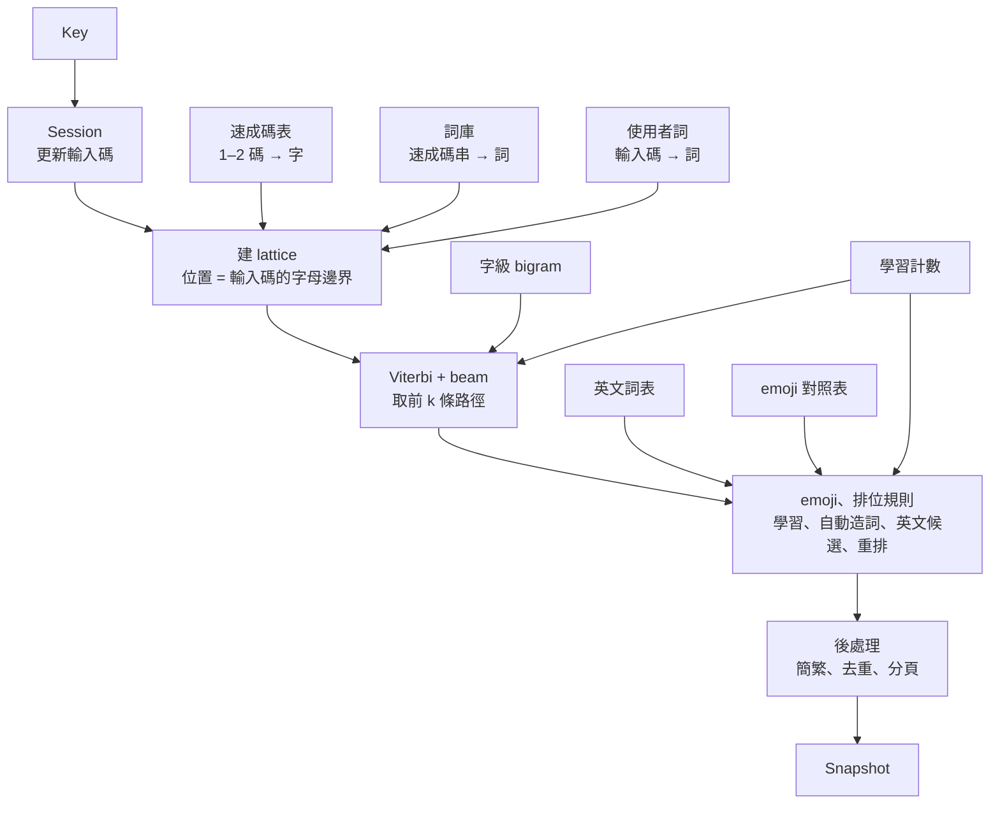

# QIM 實作計劃

> 狀態：M0–M3 完成（`.scratch/m0/spec.md`–`.scratch/m3/spec.md`，封存 `docs/archive/M0.md`–`docs/archive/M3.md`）；M4 進行中（還沒拆票）；還沒開工的里程碑只有目標、範圍與完成標準。本檔只寫現況：決定改了就直接改寫，不留「原寫」「取代原」「某日改」；舊版與理由記在 progress〈偏差與決定〉，影響架構的寫 ADR。里程碑開工時，它在〈里程碑任務〉的那一節細化成 `.scratch/<里程碑>/spec.md`，這裡縮成一行連結；拆票後以票為準。需求與決定見 `docs/design-brief.md`，名詞見 `GLOSSARY.md`。

## 0. 工程慣例

- Rust edition 2024，toolchain 用 stable（寫本檔時 1.99.1），`rust-toolchain.toml` 釘版本。
- 核心的新功能與修 bug 走 `mattpocock-skills:tdd`；一個 session 一張票（`CLAUDE.md`）。
- 程式碼識別符用英文，對應 `GLOSSARY.md` 的詞：

| 名詞 | 識別符 | 名詞 | 識別符 |
| --- | --- | --- | --- |
| 輸入方案 | `Scheme` | 候選 / 首選 | `Candidate` / `top` |
| 輸入碼 | `input` | 組字 | `Composition` |
| 速成碼 / 倉頡碼 | `QuickCode` / `CangjieCode` | 上屏 | `commit` |
| 碼表 / 詞庫 | `CodeTable` / `Lexicon` | 字根提示 | `RadicalHint` |
| 連打 | `continuous` | 英文候選 | `EnglishCandidate` |
| 使用者詞 / 觸發詞 | `UserWord` / `Trigger` | 聯想 | `Association` |
| 自動造詞 | `AutoPhrase` | 無痕模式 | `Incognito` |
| 常用語 | `Phrase` | 詞表匯入 | `import_word_list`（`WordList…`） |
| 個人 bigram / 學習（開關） | `Bigrams` / `Options::learning` | 記住的字串 | `remembered_strings`（`Options::remembered_strings`） |
| 核心 / 平台殼 | `core` / `Shell` | 佈局 / 資料包 | `Layout` / `…Pack`（方案資料包 `SchemePack`） |
| 首選字基準 | `TopChoiceBench` | 修正次數 | `correction_count` |
| 分段 | `Segment` | 佈局版本 | `LayoutVariant` |
| 個人模型 | `UserModel` | 空間模型 | `SpatialModel` |
| 重排 | `Rerank` | 譯詞 | `Gloss` |
| 容錯 | `Correction` | 萬用鍵 | `Wildcard` |
| 連打字集 / 擴展區 | `continuous` / `extension` | 目前分段 | `focus` |
| 英文直通 / 臨時英文 | `ascii` / `inline` | 分隔記號 | `SEPARATOR` |
| 簡體模式 / 簡體字排後 | `Options::simplified` / `simplified_after_traditional` | 簡體字（碼表的標記） | `CodeEntry::simplified` |
| emoji 候選 | `emoji_candidates`（對照表 `EmojiTable`） | manifest / 資料包種類 | `Manifest` / `PackKind` |
| 使用中的資料包 | `active`（網頁 `activeIds`） | 更新索引 | `PackIndex`（一項 `IndexEntry`） |
| 線上更新 | `update`（網頁 `updatePacks`） | 資料包的來源（內建、匯入、線上更新） | `PackOrigin`（`builtin`、`imported`、`downloaded`） |
| 粵典詞庫 / 粵典的詞頭 | `quick-lexicon-words-hk`（`WORDS_HK_LEXICON_ID`）/ `headwords`（`words_hk.rs`） | 預設詞庫 | 方案 `[packs] lexicon` 指名的那份（`quick-lexicon`） |
| 停鍵層模型（資料包） | `ModelPack`（種類 `model`，id `zh-hant-neural-rerank`） | 神經重排 | `qim_neural::Reranker` |
| 最後使用的日期 / 今天的日期 | `last_used` / `UserModel::set_today`（型別 `Date`） | 裝置 id | `device`（`UserModel::set_device`） |
| 學習的時限 / 最後整串上屏的日期 | `EXPIRY_DAYS` / `last_commit_date` | 條目上限 | `Limits`（`UserModel::set_limits`） |

## 1. 架構總覽

### 1.1 執行形態

核心是 Rust 函式庫，各平台殼把它連進自己的程序（ADR 0002）：網頁經 WebAssembly，Apple 與 Android 經 uniffi 產生的 Swift / Kotlin 綁定，Windows 與 Linux 經 C ABI。Windows 依成熟做法把核心放在獨立程序，TSF DLL 只轉傳（`docs/research/platform-frameworks.md` §6），到 M10 再定。


### 1.2 目錄結構

| 路徑 | 內容 |
| --- | --- |
| `crates/qim-core/` | 純邏輯：方案、資料包讀取、lattice、排序、學習、`Session` |
| `crates/qim-layout/` | 佈局模型、JSON Schema 驗證、點擊判定、按鍵幾何計算 |
| `crates/qim-databuild/` | CLI：取得來源、建資料包、訓練 bigram、產生基準語料 |
| `crates/qim-bench/` | 首選字基準 runner，量正確率與每鍵延遲 |
| `crates/qim-wasm/`、`crates/qim-ffi/` | 綁定層，不放邏輯；`qim-ffi` 由 M2 票 07 建，Swift 綁定由 `cargo xtask ffi` 產生 |
| `xtask/` | 閘門與開發指令（`cargo xtask check`、`data`、`pack-release`、`neural-import`、`web`、`ffi`、`bench`、`commit-msg`） |
| `data/` | 自己維護的方案檔、佈局檔、粵語詞表、來源清單 `sources.toml`、進資料包的授權全文 `licenses/`，與停鍵層採用的模型 `neural-rerank/`（訓練不是決定性的，重訓分數會變，所以採用的那份進 git，§2.7）；不放其他第三方原始檔與建置產物 |
| `bench/` | `fixed.tsv`、`corpus/`、`colloquial/`（都含授權與署名）、`baseline.json` |
| `web/` | 網頁 prototype（Vite + TypeScript）、`web/editor/` 佈局編輯器、Playwright 測試 |
| `platforms/` | 各平台殼，M7 起逐一建立 |

建置產物不進 git：`target/`、`build/packs/`、`build/layouts/`、`build/ffi/`、`web/public/packs/`、`web/public/layouts/`。下載的來源放在 repo 外的使用者快取目錄（`QIM_CACHE_DIR` 可改），各 worktree 共用（`docs/development.md`〈資料建置〉）。

### 1.3 依賴規則【決定】

| crate | 可以依賴 | 不可以 |
| --- | --- | --- |
| `qim-core` | `serde`、`postcard`、`serde_json`、`sha2`、`semver`（後三個給資料包 manifest，§4.6）；之後要加的依賴先改本表 | 任何 workspace crate（含綁定與平台 crate）；`std::fs`、`std::net`、`std::thread`、`std::time::SystemTime`（時間由殼傳入：上屏次數與今天的日期，§2.4） |
| `qim-layout` | `serde`、`serde_json`、`jsonschema` | `qim-core`；同上的 I/O |
| `qim-neural` | `candle-core`、`candle-nn`（停鍵層的神經重排，M3 票 11 採用；模型由殼以位元組傳入，執行緒由殼開） | 任何 workspace crate；同上的 I/O |
| `qim-wasm` | `qim-core`、`qim-layout`、`qim-neural`、綁定工具 `wasm-bindgen` | 被 `qim-core` 或 `qim-layout` 依賴 |
| `qim-ffi` | `qim-core`、`qim-layout`、`qim-neural`、綁定工具 `uniffi` | 同上 |
| `qim-databuild` | `qim-core`（資料包格式）、`qim-layout`（算出預設佈局）、`qim-neural`（匯入停鍵層模型時核對分數、量化，§2.7）；外部 crate 不限（I/O 套件） | 被 `qim-core` 或 `qim-layout` 依賴 |
| `qim-bench` | `qim-core`（資料包格式）；外部 crate 不限（I/O 套件） | 被 `qim-core` 依賴 |
| `web/`、`platforms/*` | 只透過綁定呼叫核心與 `qim-layout` | 重寫排序、查碼或點擊判定邏輯 |

強制：`cargo xtask check` 的 `deps` 步驟（M0 票 02 接上）。

- 白名單在 `xtask/src/deps.rs` 的 `RULES`。改上表時兩邊同一 commit 改；`cargo test` 比對兩邊的「可以依賴」與「不可以」欄。「不可以」欄以「；」分子句，每句要是反引號包住的禁用路徑或 crate、`被 … 依賴`、`任何 workspace crate`、`同上`、`同上的 I/O` 之一，其他寫法測試會紅（`web/` 那類非 crate 的列不比）。
- 讀 `cargo metadata`：一般與 build 依賴照「可以依賴」欄；dev 依賴不受白名單限制，但 workspace crate 不論哪種依賴都只能是欄內列的。
- workspace 成員不在上表就紅，要先改表；`xtask` 是開發工具，例外。表上的 crate 還沒建立時跳過。
- 掃 `qim-core`、`qim-layout`、`qim-neural` 的 `src/`（含 `#[cfg(test)]` 模組）找禁用路徑：斷詞後比對，註解與字串不算，`use` 的 `{..}` 與 `*` 會展開，`SystemTime` 這個名字出現就算。`build.rs`、`tests/`、`benches/`、`examples/` 不編進函式庫，不掃，整合測試可以讀檔。已知漏洞：把 `std` 本身改名（`use std as s`）後的路徑抓不到。
- 測試做雙向變異：在暫存副本加入違規依賴或 `use std::fs` 會紅；改無關的格式或命名不紅。

鍵盤擴充不做 Schema 驗證（M2 票 09）：佈局在主 App 與編輯器存檔時驗過，擴充只讀，驗一次 footprint 多約 3 MB、執行檔多 3.1 MB（Mac）。M8 iOS 殼要讀佈局、`qim-ffi` 加佈局介面時要做：`qim-layout` 的 `jsonschema` 改成預設開的 feature，關掉時只留型別與引用檢查的讀法；`qim-ffi` 給 iOS 鍵盤擴充的建置關掉它。上表不用改（關掉時 `jsonschema` 仍是可選依賴）。

### 1.4 主要依賴

版本為寫本檔時的 stable，開工時以 `cargo add` / `npm install` 取當時 stable 並更新本表。

| 依賴 | 版本 | 用途 | 理由 |
| --- | --- | --- | --- |
| Rust | 1.99.1 | 核心與工具 | ADR 0002 |
| `serde` / `postcard` | 1.0.229 / 1.1.3 | 資料包序列化 | `no_std` 友善、體積小；資料包格式是內部格式，可換 |
| `toml` | 1.1.8 | 方案檔、`data/sources.toml` | Rust 生態標準格式，可寫註解 |
| `ureq` / `sha2` | 3.5.1 / 0.11.1 | `qim-databuild` 下載來源並核對 sha256；`sha2` 另給 `qim-core` 核對資料包的 manifest（§4.6） | 同步 API、不必帶 async runtime |
| `semver` | 1.0.28 | `qim-core` 比 manifest 的 `min_core_version` 與核心版本（§4.6） | dtolnay 維護、Cargo 用的同一套；不自己寫版本比較 |
| `zip` | 9.3.0 | `qim-databuild` 讀 Unihan.zip、HKCanCor 的 zip | Unicode 只發 zip；只開 deflate 解壓 |
| `dirs` | 7.0.0 | `qim-databuild` 找平台的使用者快取目錄，放下載的來源 | 各平台的快取目錄慣例（macOS `~/Library/Caches`、XDG、Windows `LocalAppData`）不必自己寫 |
| `bzip2` / `quick-xml` | 0.6.1 / 0.42.0 | `qim-databuild` 讀維基 dump（`pages-articles.xml.bz2`） | `bzip2` 預設用純 Rust 的 libbz2-rs-sys；串流讀 XML，不必整份載入 |
| `serde_json` / `jsonschema` | 1.0.154 / 0.60.2 | 佈局檔與驗證、`qim-core` 讀寫資料包 manifest（§4.6）、`qim-databuild` 匯入停鍵層模型時讀 `reference.json`、`train.json`（§2.7）；`jsonschema` 關掉預設 features（不要網路與檔案的 `$ref` 解析）；iOS 鍵盤擴充不帶 `jsonschema`（M2 票 09，§1.3） | 佈局要給 TS、Swift、Kotlin 直接讀 |
| `wasm-bindgen` / `wasm-bindgen-cli` | 0.2.130 | WebAssembly 綁定 | 直接用 CLI，不依賴 wasm-pack |
| `uniffi` | 0.32.2 | Swift / Kotlin 綁定（M2 票 07 確認）；proc-macro 宣告介面，`uniffi-bindgen-swift` 從靜態函式庫產生綁定（library mode），它要的 `cli` feature 只在 `qim-ffi` 的 `bindgen` feature 開 | 一份介面產生兩種語言 |
| `ferrous-opencc` | 0.4.0 | 只給 `qim-databuild` 前處理語料的 `s2hk`、`t2hk`（用它內建的字典） | 純 Rust、Apache-2.0。簡體模式不用它：編得進 WebAssembly，但只能用編進 crate 的字典、不能從資料包載入，改由簡繁資料包加 `qim-core` 的轉換（§4.4，M1 票 16） |
| `rustc-hash` | 2.1.3 | `qim-databuild` 數詞級 trigram 的次數（兩千萬種 trigram 的雜湊表，§4.3） | rustc 自己用的雜湊，比標準庫的 SipHash 快得多；建置端不必防碰撞攻擊；票 08 的實驗也用它 |
| `strsim` | 0.11.1 | `qim-bench` 算字正確率的編輯距離（以字計的 Levenshtein） | 維護中、無依賴；不自己寫 |
| `candle-core` / `candle-nn` | 0.11.1 | `qim-neural` 的推論（q8 GGUF 權重、CPU；網頁經 `qim-wasm` 編成 WebAssembly、開 SIMD128，§3.1）與量化（`qim-databuild` 匯入模型時經 `qim-neural`） | M2 票 11 驗過能編進 iOS 鍵盤擴充、沒有完整取用也能跑；M3 票 09 的 1.4M 用它在 iPhone 量 p95 11 ms、+2 MB；Hugging Face 維護、純 Rust |
| `proptest` | 1.12.0 | 核心與 `qim-layout` 點擊判定的性質測試（dev） | — |
| Vite / TypeScript | 8.3.5 / 7.0.2 | 網頁 prototype | — |
| Biome | 2.6.4 | TS lint 與 format | 一個工具包辦兩件事 |
| `idb-keyval` | 6.3.0 | 網頁把匯入的資料包存進 IndexedDB（§4.6） | Jake Archibald 維護、無依賴，只包一層 Promise；不自己寫 IndexedDB 的樣板 |
| `@playwright/test` | 1.64.1 | 網頁 e2e 與驗收 | 使用者指定 |
| `@types/node` | 26.6.6 | `web/bench/` 的 Node 腳本（WebAssembly 每鍵延遲）、`web/test/` 單元測試（Node 內建的 `node:test`，不另加測試框架）與 Playwright 設定、e2e 的型別 | 跟 Node 26 同主版本；只給 `web/bench/tsconfig.json` 與 `web/tsconfig.node.json`，網頁的程式碼（`src/`）看不到 Node 的 API |

## 2. 核心

### 2.1 介面

參考 librime 的 `RimeApi`（`process_key`、`get_context`、`select_candidate`）與 fcitx5 的 InputContext：殼把事件交給 session，拿回一份完整快照，殼只負責畫。

```rust
pub struct Engine;      // 不可變：方案 + 資料包，多個 Session 共用
pub struct UserModel;   // 可變：使用者詞、學習計數；export() / import() 給殼存檔
pub struct Session;     // 一個輸入框的組字狀態

pub enum Key { Letter(char), Punct(char), Space, Enter, Backspace, Escape, Digit(u8), PageUp, PageDown, Left, Right, ToggleAscii(ShiftKey), Other, Modifier }
pub enum ShiftKey { Left, Right }
impl Key { pub fn parse(kind: &str, value: Option<&str>) -> Result<Key, KeyError>; } // 綁定收「種類 + 值」
pub enum ShiftSwitch { Rime, CommitText, InlineAscii } // 組字中單按 Shift，預設 Rime

pub struct Options { pub simplified: bool, pub incognito: bool, pub learning: bool, pub english_candidates: bool, pub digit_separators: bool, pub emoji_candidates: bool, pub shift_switch: ShiftSwitch, pub simplified_after_traditional: bool, pub remembered_strings: bool, pub association: bool }

pub struct Snapshot {
    pub handled: bool,              // 核心吃下這個鍵；為假時殼交還宿主（librime process_key 的回傳值）
    pub composition: Composition,   // 輸入碼、各分段（碼、字根、字與原文、是否已選定）、目前分段
    pub candidates: Vec<Candidate>, // 目前頁；每個候選是字（`text`）與原文（`original`）
    pub page: usize,
    pub has_more: bool,
    pub commit: Option<String>,     // 這次事件要上屏的文字
    pub commit_original: Option<String>, // `commit` 的原文
    pub ascii: bool,                // 英文：沒有組字時是英文直通，鍵都交還宿主；組字中是臨時英文
    pub generation: u64,            // 每次候選變動 +1（翻頁不算），非同步重排用
}

impl Session {
    pub fn handle(&mut self, engine: &Engine, user: &mut UserModel, key: Key) -> Snapshot;
    pub fn select(&mut self, engine: &Engine, user: &mut UserModel, index: usize) -> Snapshot;
    pub fn text(&mut self, engine: &Engine, user: &mut UserModel, text: &str) -> Snapshot; // 觸控鍵盤的 `text` 動作
    pub fn focus_segment(&mut self, engine: &Engine, user: &mut UserModel, segment: usize) -> Snapshot;
    pub fn set_options(&mut self, options: Options);
    pub fn options(&self) -> Options;                                 // 殼改一項時讀出來改，不另存
    pub fn composing(&self) -> bool;                                  // 有還沒上屏的輸入碼（臨時英文也算）
    pub fn refresh(&mut self, engine: &Engine, user: &UserModel) -> Snapshot; // 換選項後依新選項重列候選
    pub fn all_candidates(&self) -> Vec<Candidate>;                  // 不分頁，候選展開面板用
    pub fn rerank_request(&self, engine: &Engine) -> Option<RerankRequest>; // generation + 前文（最多 RERANK_CONTEXT 字，簡體模式用 engine 的簡繁資料包轉回繁體）+ 前 RERANK_PATHS 條路徑
    pub fn apply_rerank(&mut self, engine: &Engine, generation: u64, order: &[usize]) -> Option<Snapshot>; // order 是路徑的序號
    pub fn paths(&self, limit: usize) -> Vec<ScoredPath>;            // lattice 蓋滿沒選定輸入碼的前 limit 條路徑：文字、分段、路徑分
    pub fn inspect(&self, engine: &Engine, user: &UserModel) -> Inspection; // 只給網頁的 debug 面板（§3.1，M4 票 01），不進 Snapshot
}
```

- 分隔記號（`qim_core::SEPARATOR`，`'`，brief §4.3，M1 票 28）：組字中的 `Key::Punct('\'')` 不上屏組字，而是接在剩下的輸入碼後面（已經以它結尾時吃下不動作）；沒有組字時照其他沒有全形的標點交還宿主。它留在 `Composition.input` 與分段的碼裡，算在前一段的碼尾（`mi'r` 的分段是 `mi'` 與 `r`），跨過它的詞的分段碼中間含它（`an'r` 的「門口」是一段 `an'r`，M1 票 28b），所以「各分段的碼接起來是 `input`」照舊成立；字根照原字元顯示。觸控鍵盤組字中的「'詞」送同一個鍵，不另加 `Key`：實體鍵盤的 `'` 本來就是 `Punct`，殼不必知道哪個字元是分隔記號。各方案共用一個、不放進方案檔（Rime 是方案的 `speller/delimiter`），要換時再加欄位。
- `Letter` 含大寫與方案以外的字母，`Punct` 是其餘的可見 ASCII 字元，`Other` 是殼不轉成其他種的鍵（Tab、Delete、↑ ↓…）；`Modifier` 是只改鍵盤狀態、不送字元的鍵（單按 Ctrl、Cmd、Alt、CapsLock 這類修飾鍵，觸控的切頁、⇧、換鍵盤），組字中同 `Other` 吃下，沒有組字時交還宿主但不結束數字（M1 票 26b）；全形對照與組字中各鍵的行為在核心（brief §4.3）。只改殼的畫面、不動組字的鍵由殼攔下、不轉給核心：組字中 Tab 開關字根提示、↓ / ↑ 開關展開面板（§3.1）。組字中每個鍵都 `handled`，所以 `handled` 為假時組字是空的、`commit` 也是空的，殼不必處理「交還宿主又要上屏」。
- `text`：直接輸入一段文字、不經組字（佈局的 `text` 動作，§2.6）。沒有組字時上屏它（英文直通也是）；組字中和標點相同，先上屏整個組字再接它；臨時英文中和實體鍵盤的可見字元一樣接在英文後（M1 票 27b）。文字照原樣，不轉全形、不套數字後半形（M1 票 20、27b）；簡體模式下文字也轉簡體，原文留繁體（使用者決定，M1 票 23）。觸控的標點鍵也走這裡，照鍵上的字輸出（使用者決定，M1 票 27b）。
- `ToggleAscii`（單按 Shift，brief §4.3）：沒有組字時切英文直通，`Snapshot.ascii` 跟著變；英文直通下每個鍵都 `handled` 為假，沒有組字。組字中照 `Options.shift_switch`：`commit_text` 先上屏整個組字再切；`inline_ascii` 進臨時英文，`ascii` 為真而組字還在，最後一段是 `Segment.raw` 的分段（Rime 的 `raw` 標記），各鍵的行為照目前發佈版 librime（≤ 1.17.0，空白接進英文，M1 票 25b），見 brief §4.3。預設 `Rime` 是左 Shift `inline_ascii`、右 Shift `commit_text`（M1 票 25，推翻票 23 的左右相同）。單按的判定（按下到放開 500 ms 內、中間沒有按下或放開別的鍵，librime 同值）與分辨左右在殼；網頁用 `KeyboardEvent.code`，觸控鍵盤的中英鍵（佈局動作 `toggleAscii`）當右 Shift；觸控的 ⇧ 是另一個動作 `shift`（§2.6），是大寫鍵，不送 `ToggleAscii`。臨時英文中 `-` / `=` 是字元，殼不轉成翻頁。
- 英文候選：`Engine::with_english` 掛上英文資料包（不由方案指名，各方案共用）；`Options.english_candidates`（預設開，brief §7）開著時套用排位規則 4（§2.4）。組字中換這個選項同簡體模式，殼呼叫 `refresh`（M1 票 15）。
- 詞級 trigram（M3 票 11b，§2.3、§4.3）：`Engine::with_word_trigram(WordTrigramPack)` 掛上，方案 `[packs]` 的 `word_trigram` 指名預設那份，`Engine::open` 照方案要不要核對（`WordTrigramMismatch`，同詞庫、語言模型只核對有沒有、不核對 id）。核心內建的打分、不經 `dyn` 介面：lattice 的邊與整串字詞的靜態機率改用它，前面兩段是部分路徑的最後兩段，組字開頭的前一段是選定的分段、前文剛上屏的那段，或前文的最後一字、句首（`Preceding::segment`）；β、γ、`personal` 照舊，聯想仍用字級 bigram。沒掛上時打分照字級 bigram。
- emoji 候選：`Engine::with_emoji` 掛上 emoji 資料包（不由方案指名，各方案共用，§4.4）；`Options.emoji_candidates`（預設開，brief §7）開著時，整串的字詞後面接它的 emoji（§2.4）。組字中換這個選項同英文候選，殼呼叫 `refresh`（M3 票 16）。
- 記住的字串（M3 票 15，名詞表）：`Options.remembered_strings`（預設開，brief §7）開著時，`Session` 記下經核心送出去的 email，之後中文組字打它開頭的字母時給候選（§2.4 規則 5）。組字中換這個選項同英文候選，殼呼叫 `refresh`。
  - 從哪裡記：只記使用者經 QIM 打的字，也就是核心送出去的字（同前文，下面〈上下文〉）：上屏的字（含臨時英文 Enter 上屏的英文、選了的英文候選與記住的字串、`text` 動作的 `@` `.`），以及英文直通交還宿主的可見字元。英文直通時鍵雖然交還宿主，殼仍先把每個鍵交給 `handle`（`handled` 為假才交還，§2.1 開頭），所以核心看得到英文直通打的字；看不到的是換成別的鍵盤或輸入法打的、貼上的、autofill 填的與輸入框原有的字，這些不記（殼給的前文不當來源：回信引用的別人地址不該被記）。成熟做法：LatinIME 與 SwiftKey 都學上屏的字、不讀欄位原有的文字，LatinIME 另載入裝置帳號的 email；QIM 不讀通訊錄與剪貼簿（要平台權限，百度輸入法也因此拿掉通訊錄詞庫）。查證見 `docs/research/remember-strings.md`。
  - 怎麼認：`Session` 記送出去的字結尾連續的 email 字元（英文字母、數字與 `. _ % + - @`），遇到其他字元（空白、中文、全形標點）、交還宿主的 Enter、Tab、方向鍵這類鍵，或離開欄位（`clear_context`）就是打完一串；去掉結尾的 `.` 後是 email（`local@domain`，網域至少兩段、最後一段至少兩個英文字母，同 HTML `type=email` 再要求頂層網域，最長 254 字元）就記。交還宿主的退格刪掉最後一個字元（打錯改過的照記改過的）；殼給的前文不以正在打的那串結尾時（游標移走、宿主改了字）那串丟掉不記。開頭不是使用者經 QIM 打的那串打完也不記，到下一個分隔的字元才重新算（`remembered::TypedRun`）：殼給的前文去掉那串後最後一字還是 email 字元（接在貼上、autofill 的字後面）、退格刪到那串前面、交還宿主的方向鍵這類鍵之後（Enter 之後照常重新開始）、有一段是無痕或學習關掉時打的、長過上限。email 不分大小寫，再記一次同一個地址的另一種寫法時換成新的寫法、只留一條。打 1 次就記，同 LatinIME 每次上屏都學（Gboard 黑箱 T5 打 3 次內學到但不穩）。網址不記：LatinIME 也不學網址（它把 `.` `/` 當分隔），網址很少整串重打，要時另開票。
  - 無痕不記（brief §8）、學習關掉不記（已記的照給，同其他學習）、選項關掉時不記也不給。存在個人模型、各方案共用（同個人 bigram），匯出見 §2.4；殼用 `UserModel::remembered_strings` 列出、`forget_remembered_string` 逐條刪（同 Gboard、Rime 能刪單條），清空學習資料時一起清。最多 20 條、超過時淘汰最久沒用的（§2.4 規則 5）；一年沒打的停用、不刪（M4 票 13，§2.4〈學習的時限〉），衰減決定先後。`clear_context(user)` 因此要收個人模型：離開欄位是登入表單最常見的打完方式（打完 email 直接點密碼欄）。
- 簡體模式：`Engine::with_simplifier` 掛上簡繁資料包（不由方案指名，各方案都輸出繁體）；`Options.simplified` 開著時，候選在排序之後轉簡體、轉換後重複的只留第一個，組字的分段與上屏也轉。轉換的單位是一個分段：多段的候選各段分開轉換再接起來，選了之後組字與上屏也是各段分開轉換，所以看到的就是上屏的；學習記繁體原文。組字中換選項時殼呼叫 `refresh`，同 librime 換選項後重算組字（M1 票 16）。殼只呼叫 `set_options` 時，下一個 `handle`、`select`、`focus_segment` 或 `text` 先依新選項重列候選，重列前 `all_candidates` 是空的、不給重排要求、也不套用重排結果（M2 票 01）。`qim-ffi` 加換選項時，綁定的 `set_options` 同時呼叫 `refresh` 回快照（同網頁的 `setSimplified`），殼就碰不到這個待生效狀態（票 01 的建議，M2 票 07 延後到需要它的票）。
  - 原文：候選、分段與上屏都另帶後處理前的原文（`original`、`commit_original`，簡體模式以外和顯示的字相同）。字根提示查原文，「回報」記原文：要提示的是打得出的繁體字，`fixed.tsv` 的期望首選是繁體（協調者決定，M1 票 16）。
- 簡體字排後：`Options.simplified_after_traditional`（預設開，brief §4.1、§7）開著、又不是簡體模式時，碼表標成簡體字的字排在同碼的其他候選之後（§2.3）；關掉時照分數混排。組字中換這個選項同簡體模式，殼呼叫 `refresh`（M3 票 19）。
- 聯想（M3 票 13，brief §7、名詞表）：`Options.association`（預設開）開著時，上屏組字（空白、數字鍵、點候選選完，或移到某一段時按空白）或選了一個聯想之後，`Snapshot.candidates` 是接下來可能要打的字詞（最多一頁 `ASSOCIATION_LIMIT` 個），組字是空的；排法見 §2.3。打標點、大寫字母、Enter、英文候選或 emoji、`text`、切到英文直通的上屏不出聯想（同 librime-predict 遇到 `punct`、`raw`、`thru` 的上屏就停）。聯想顯示中的鍵照 macOS 速成（黑箱 T8，brief §12.4）：
  - 數字鍵 1–9、`Session::select`（點選）選那個聯想：上屏它，接著出下一輪，可一直接下去（同 iOS）；沒有那個聯想的數字收起聯想後照打。不學 Microsoft 的 Shift＋數字：實體鍵盤的 Shift＋數字是全形標點。代價是上屏中文後緊接著打數字要先按 Esc（或關掉聯想），同 macOS。
  - 空白不選，收起聯想後照打空格（macOS 沒有預選）；Esc 與退格只收起聯想、吃下不交還（librime-predict；Gboard 的第一下刪除也是），退格第二下才刪字。
  - 字母收起聯想、開始新的組字；其他鍵（標點、Enter、方向鍵、翻頁鍵、Shift…）收起後照沒有聯想時處理；不送字元的 `Modifier` 不動它。
  - 聯想不給重排（`rerank_request` 是 `None`）。`refresh` 依新選項重列（簡體模式轉換，關掉時收起）；只呼叫 `set_options` 關掉時，下一個鍵或 `select` 照沒有聯想處理、收起。`clear_context`（換欄位、失焦）與不以剛上屏的字結尾的 `set_context`（殼點了別處、移了游標）也收起；殼在交還宿主的鍵、給前文與失焦之後照樣重畫候選列（網頁看 `all_candidates` 是不是空的）。
  - 聯想看剛上屏的各段（原文），不讀殼給的更早的前文；簡體模式顯示、上屏轉簡體，接下一輪照原文。剛上屏的字就是下一個字的前文，所以無痕時不出聯想（brief §8）。
- 數字後半形：`Options.digit_separators`（預設開，brief §4.7、§7）。沒有組字、游標前的字是半形數字時，`.` `:` 直接上屏半形，不進組字；逗號照舊全形（使用者決定，M1 票 26）。「游標前的字」是 `Session` 記的前文的最後一字（下面〈上下文〉，M3 票 05 起）：殼給的前文，接上之後核心送出去的字。會上屏的三個方法回傳前都經過同一處接上（`Session::finish`）：`handle`（含交還宿主的鍵）、`select`（點候選）、`text`（觸控的文字鍵：數字列、符號頁與數字鍵盤的數字、常用頁）；`refresh`、`focus_segment`、`apply_rerank` 不上屏、不改它。觸控的標點鍵是 `text`、照鍵上的字輸出，不套這條（使用者決定，M1 票 27b，推翻票 27 的觸控標點送 `Key::Punct`）。
- 殼負責：鍵碼轉 `Key`、欄位類型轉 `Options.incognito`、保存 `UserModel.export()`、畫候選與鍵盤。
- 按鍵的入口（M2 票 03）：綁定收不了帶資料的列舉時（WebAssembly）用 `Key::parse` 收「種類 + 值」，種類是 `Key` 各種的 camelCase 名字（`letter`、`digit`、`toggleAscii`、`space`…），值是字元、`0`–`9` 或 `left` / `right`；網頁的按鍵都經綁定的同一個 `press`，加一種鍵只改核心與網頁的按鍵對照（`web/src/keys.ts`）。同 librime 能從字串讀按鍵（`KeyEvent` 的文字表示）。`qim-ffi` 也收「種類 + 值」（M2 票 07）：uniffi 沒有 `char` 型別，收不了 `Key::Letter(char)`，另寫一份鏡像列舉又讓加一種鍵多改一處。觸控鍵盤的組字狀態也問 `Session::composing`，綁定不另存。
- `qim-ffi` 的物件（M2 票 08）：`Engine` 是獨立的 uniffi 物件，殼建一個，各輸入框的 `Session` 共用它，換輸入框不重載資料包。資料包的位元組先各自解開成 `SchemePack` 等物件，再交給 `Engine`；交出時是移交、不複製，所以每份只能給一個 `Engine`，殼也能逐份量記憶體。`UserModel` 暫時放在各 `Session` 裡，學習資料存檔由需要它的票拆出來共用。字根提示的 `RadicalHintPack` 目前只能解開、不交給 `Engine`（M2 票 09 在鍵盤擴充量記憶體用），查詢與顯示的介面由殼要顯示字根提示的票加。
- 上下文（M3 票 04、05）：`Session::set_context(before: &str)` 收輸入框游標前的文字（前文），組字開頭的字接它（§2.3 的規則），開頭的一段也接它給的前一個字詞的個人 bigram（§2.3，M3 票 12），數字後半形看它的最後一字。殼在聚焦、移動游標、上屏之後給；組字中給的存起來，下一次從頭建組字時才用。`set_context("")` 是輸入框的開頭，接句首。
  - `Session` 記一份前文（殼給的前文接上核心送出去的字，名詞表），最多 `CONTEXT_LIMIT`（200）字（比用到的長：bigram 只看最後一字，重排取最後 `RERANK_CONTEXT` 字）：`set_context` 取代它，之後上屏的字、交還宿主的可見字元與空白（`Letter`、`Punct`、`Digit`、`Space`）接在後面；交還宿主的其他鍵（退格、Enter、方向鍵、`Other`…）改了游標前的字或移走游標，記的就作廢（不知道前文、用 unigram），等殼再給；`Modifier` 不動它。換欄位或失焦而沒有前文可給時，殼呼叫 `Session::clear_context(user)` 忘掉（上一個欄位上屏的字不會變成前文；正在打的 email 這時算打完，上面〈記住的字串〉）；有前文可給時 `set_context` 同樣整份取代，自己記的不留。數字後半形另記一個布林「游標前的字是半形數字」，和前文同時更新、但不記文字（M3 票 05）。
  - 殼沒給前文時（宿主不提供、iOS 的 `documentContextBeforeInput` 是空的，brief §12.3）就用這個輸入框上屏過的字（M3 票 05 決定）。殼給了前文就整份取代，iOS 只給一兩句時不拿記著的較長歷史補長度：bigram 只看最後一字，補長度只對停鍵層與雲端的模型有用；票 11、25 量過送 200 字不比 50 字好，雲端不做（票 22 wontfix），所以不補。成熟做法：librime 根本不讀宿主文字，組字從頭開始時的前文就是自己的 commit history（`Translator::GetPrecedingText` 取 `commit_history().latest_text()`，最多 20 筆；退格、Enter 清掉；數字後半形也看它，`punctuator.cc` 的 `is_after_number`），fcitx5 的標點模組平時靠自己記的狀態、宿主有 SurroundingText 時在聚焦後用游標前一字校正。QIM 合起來：殼給的前文優先（每次給都取代），沒給時靠自己記的；和 librime 不同，方向鍵也作廢（游標已移走）。不採用 AOSP LatinIME 的做法（宿主回 null 就當沒有前文、不用自己的歷史）：bigram 只要最後一字，自己上屏的字就是游標前的字。來源：librime `c95c0d2` 的 [`script_translator.cc` L325–329](https://github.com/rime/librime/blob/c95c0d2390c827bf44e5eb8989704ba723ec0d0c/src/rime/gear/script_translator.cc#L325-L329)、[`commit_history.cc` L14–26](https://github.com/rime/librime/blob/c95c0d2390c827bf44e5eb8989704ba723ec0d0c/src/rime/commit_history.cc#L14-L26)、[`punctuator.cc` L78–86](https://github.com/rime/librime/blob/c95c0d2390c827bf44e5eb8989704ba723ec0d0c/src/rime/gear/punctuator.cc#L78-L86)；fcitx5-chinese-addons `e8d930f` 的 [`punctuation.cpp` L217–247](https://github.com/fcitx/fcitx5-chinese-addons/blob/e8d930f402e359cfd76a101ee3e46815d1331d83/modules/punctuation/punctuation.cpp#L217-L247)；AOSP LatinIME `127336e` 的 [`RichInputConnection.java`](https://android.googlesource.com/platform/packages/inputmethods/LatinIME/+/127336e9f29d69607eab55982324b210279ae8c5/java/src/com/android/inputmethod/latin/RichInputConnection.java)（`reloadTextCache`）。
  - 無痕（brief §8：不讀上下文、不送雲端，硬限制）：打開時核心丟掉前文；無痕期間一個字都不記，上屏的字不接進前文，殼給的前文也不收，所以關掉無痕後第一次打字的前文不含無痕期間打的字（殼還沒給時是不知道前文）。數字後半形的布林不含文字，無痕時照記，無痕欄位一樣打得出「3.5」。網頁無痕時不給前文、失焦時呼叫 `clear_context`（無痕時連殼給的前文是不是數字結尾也不看，所以無痕時用滑鼠把游標移到中文後面，核心仍當是數字後，M3 票 23 記為代價）；網頁只有一個輸入框，關掉無痕後會照常讀輸入框游標前的文字（含畫面上無痕時打的字），等同換到一般欄位。選開頭一段或改選某一段後，剩下的輸入碼接選定分段的最後一字，同一個機制（M1 票 21 留下的現狀改掉）。
- 組字中修改：`Left`、`Right` 或 `focus_segment` 移到某一分段，候選改列該段的碼的字詞（和不知道前文時單打那個碼相同，不接前文與前一段；只是沒有英文候選與 emoji：它們只給剩下的整串，§2.4）；選定後該段固定，其餘分段用同一把尺重算。參考 librime 的 caret 與 Mozc 的分段轉換。
  - `Composition.focus` 預設是分段數（像 librime 的 caret 在最後）：候選列剩下沒選定的整串；← 從最後一段往前，→ 走過最後一段回到整串；打字、退格回到整串。`select(index)` 的 `index` 是全部候選的位置（librime `select_candidate`）。
  - 改選第 i 段時，前面的分段照顯示的字固定、不重算（使用者確認）：重算的輸入碼從頭建 lattice，開頭的字接最後一個選定分段的最後一字（和選開頭一段時相同，M3 票 04），單獨重算前面只會丟掉跨段 bigram 選出、使用者看過的字。目前分段的候選照舊和不知道前文時單打那個碼相同，不接前一段。選的只蓋住第 i 段開頭時，那段剩下的碼和後面的分段一起重算；否則後面已選定的不動、沒選定的重算。都選定了就上屏。所以選定的分段永遠在開頭（M1 票 21）。
  - 移到某一段時空白上屏整個組字，和組字中按標點相同。
- 觸控機率（M4）：`Key` 加 `Weighted(Vec<(char, f32)>)`，由 `qim-layout` 依點擊位置與按鍵幾何算出，殼轉交；`qim-core` 不知道佈局。當時平台殼還沒開工，只改網頁綁定。
- 欄位類型（M4）：`Options` 加 `field: FieldKind`（一般、email、網址、數字），由殼依平台的欄位資訊給。
- 重排：`apply_rerank` 只接受目前的 `generation`，過期結果丟棄；重排過的候選最高只到第 2 位（afm-ime 做法，brief §1.3）。M1 只有介面與網頁的假實作；M3 階梯定停鍵層用小型神經模型、雲端不做（§2.7）。
  - 以路徑為單位（M3 票 11c）：`RerankRequest` 帶 `generation`、前文與 `paths(RERANK_PATHS)`（9 條，`ScoredPath` 的文字、分段、路徑分），不帶候選列。候選列只放 `ranking.sentences` 條多段路徑，答案常在 lattice 裡卻不在候選列（口語 dev：候選列 57%、前 9 條路徑 68%）；只在第一頁內排時 1.4M 的增益從 8.5 點剩 2.3～6.3 點（票 09、10，`docs/research/model-ladder.md`）。
  - 前文：`Session` 記的前文（下面〈上下文〉）接上選定的分段（路徑前面的字，原文），只留最後 `RERANK_CONTEXT`（50）字（brief §8，票 11 量過 200 字不比 50 字好）。不知道前文、無痕時只有選定的分段。
  - `order` 是路徑的序號、好的在前：取第一條和首選文字不同的路徑（超出路徑數的序號不算），放在第 2 位；排位規則 3、4、5 排在第 2 位起的候選不讓位，它排在那些後面最前的位置（§2.4）。候選列有同樣文字的就移上來（已排在那個位置之前的不動），沒有就插入，其餘照原順序往後接、不重複。插入的候選是那條路徑本身：選了照它的分段上屏與學習，同選一條多段的整句（§2.4）。首選不動（ADR 0005）。
  - 不給要求（`None`）：沒有組字、聯想、臨時英文、換了選項還沒重列、沒有蓋滿的路徑，以及移到某一段改字時（候選是那一段單打的字詞，整句插不進去；使用者決定，票 11c）。
  - 名次真的變了才算候選變動、`generation` +1：同一份要求的其他結果照舊順序排，要作廢；原樣回傳不作廢。殼只在按鍵等事件之後要求，不因套用了重排結果再要求。
  - 翻頁不是候選變動，`generation` 不加（M1 票 23）。翻到後面的頁時收到的結果先記著、名次不變：插入會把第一頁最後一個擠到下一頁，看得到的那頁會變。回到第一頁時候選沒變（`generation` 相同）才套用，那次翻頁的快照帶新的 `generation`（票 11c）。
  - `apply_rerank` 要 `Engine` 才回得出快照（組字的簡繁與字根），比原本的簽章多一個參數。
  - `paths(limit)`（M3 票 07）：lattice 蓋滿沒選定的輸入碼的前 `limit` 條路徑（最多 beam 條）：文字、各段的字詞、同步層的路徑分，繁體原文、不套排位規則；模型階梯也讀它。

### 2.2 資料流



- 已知限制：簡繁後處理逐個分段轉換（§2.1），跨兩段的詞可能轉錯，例如「乾」「隆」分在兩段時成了「干隆」。常見詞在詞庫裡本身就是一段，所以罕見。等使用者回報再改：整串一起轉換，再依字數切回各段（M1 票 16）。

### 2.3 排序：同一把尺

所有候選，不論是一個長詞條、拼出來的句子，還是單字，都用同一個函式打分。不採用 Rime「有精確詞條就不造句」的規則（ADR 0001、`docs/research/rime.md` §5）。

```
score(path) = Σ 每段 [ log P_bigram(段的第一字 | 前一段的最後一字) + log P_段內 ]
            + β × (路徑中屬於詞庫的段數)
            − γ × (路徑的段數)
            + Σ personal(段)

P_段內 = 1（單字）
       = P_詞頻(詞) ÷ P_unigram(詞的第一字)（詞庫的詞）
```

- `P_bigram`：字級 interpolated Kneser-Ney bigram（§4.3），只看文字，所以「問」和「門口」、「一台」和「歹口」都在同一把尺上比；同樣的文字當成一個詞或拆成單字，段內的分數不同（詞用詞頻）。方案沒指名語言模型時每個字都是 0 分。
- 詞級 trigram（M3 票 11b，§4.3）：方案指名詞級 trigram 時，每段的靜態機率 `log P_bigram + log P_段內` 換成 `log P_詞(段 | 前兩段)`：留下的 trigram 直接用；沒留下、前兩段有列時乘 α 退到詞級 bigram，前兩段沒有列時直接用詞級 bigram；詞級 bigram 同樣退到上面的現行打分。前一段不在詞表時整個照現行打分，所以沒有統計的地方和只有字級 bigram 時一樣；不在詞表的段（使用者詞、並存寫法的另一種）前一段有列時乘 α。`personal` 的靜態機率 `P` 也換成它，β、γ 照舊。段由建置端用現行打分切訓練句（§4.3），和解碼時的切法一致。詞表查文字用載入時建的雜湊索引：lattice 每條邊都查一次，用二分搜尋時每鍵比只有字級 bigram 慢一倍（p50 31 → 64 µs），雜湊後 45 µs（票 11b Comments）。
- 組字開頭的字的「前一字」（M3 票 04，`Engine::context_char`）：有選定的分段時是最後一段的最後一字，和 lattice 裡路徑的下一段一樣，沒有統計的字照退回式算；否則看前文（§2.1）。bigram 只在句內訓練（§4.3 照標點、空白、符號切句），所以照切句的規則：前文以字結尾時接那個字（簡體模式下殼給的前文是簡體字，最後一字轉回繁體：前文以剛上屏的那一段結尾時取那段原文的最後一字，否則照停鍵層逐字轉回，§2.7；M4 票 04）；以標點、空白或符號結尾，或是空的時接句首（`CLAUSE_START`，§4.3）；結尾的字在語言模型裡沒有統計（英文、數字、罕用字）或資料包沒有句首時、不知道前文時（殼沒給、也還沒上屏過，或交還宿主的鍵讓它作廢，§2.1）、無痕時，用字頻的 unigram。先試過略過結尾的標點、接上一句的最後一字：「有前文」集合給前文反而比不給答錯多 1–5%、修正多 0.3–4%（四個語料都是），bigram 接不過標點；改接句首後給前文較好（票 04 Comments）。規則先在 test 的「有前文」集合上看出，之後在 dev 切分的同樣題目上重比三種規則，結論相同（`scripts/experiments/context-rule/`）。「有前文」集合的前文都以標點結尾（題目是整句），所以首選正確率量到的是句首的增益；「接前文的最後一字」只在模擬上屏一段後重打剩下的字時走到，只影響修正次數。
- 詞的段：`P(詞 | 前一字) ≈ P(第一字 | 前一字) × P_詞頻(詞) ÷ P(第一字)`，前後文由字級 bigram 接，詞內由 rime-essay 的詞頻估（每個詞算一次的詞頻總和當分母）。詞內也用字級 bigram 時，同碼的詞分不出常用度，個人集答錯多 27%（M1 票 11 Comments）。
- `β` 鼓勵詞庫裡的詞，`γ` 抑制過度切碎；由首選字基準的 dev 切分調出（`cargo xtask bench --dev`），寫進方案檔。方案檔、`bench --set` 與載入資料包都經 `Ranking::check` 驗：beam 至少 1，β、γ 是有限的數（M3 票 03）。速成是 β = 1、γ = 1（M1 票 12）：dev 偏好更小的 β，但個人集（多是兩字詞）答錯變多，個人集只當守門、不拿來調。
- `personal`：學過的段在任何長度的連打裡都加分，只加不減。參考 libime 的 `max(靜態分, log((1−w)·靜態機率 + w·個人機率))`，`w` = 0.05（libime 用 0.2，`docs/research/libime-user-model.md` §1；M1 票 12 調）；沒學過的段為 0。所以 `personal(段) = max(0, ln((1−w)·P + w·P_personal) − ln P)`，`P` 是這一段接在前一字後的靜態機率：首字 bigram 乘詞內機率，不含 β、γ。個人機率由這一段的學習計數與個人 bigram 合成（下面兩條）。
  - 個人機率 `P_personal = d_now ÷ D_max`：`d_now` 是（方案, 碼, 字詞）的衰減值衰減到這個方案現在的 tick（`d · e^(−(tick − 最後 tick)/200)`），`D_max = 1 / (1 − e^(−1/200)) ≈ 200.5` 是每次上屏都是它時衰減值的上限，所以 `P_personal` 在 (0, 1]。分母取常數，照 libime 除以滿載歷史的總量：學過一次的段 `P_personal ≈ 0.005`，不會因為才學幾次就壓過所有詞。
  - 個人 bigram（M3 票 12）：記「前一個字詞 → 這一段」的衰減值（§2.4），`P_bigram` 是這一段接在前一個字詞後面的條件機率：這組的衰減值 ÷ 前一個字詞後面各段的衰減值總和（都衰減到現在，照 libime `HistoryBigram` 除以前一詞的計數，`docs/research/libime-user-model.md` §2）。兩者合成 `P_personal = P_unigram + (1 − P_unigram)·λ·P_bigram`，λ = 0.8。libime 是 `(1 − λ)·P_unigram + λ·P_bigram`，沒有前一個字詞時學過的段只剩兩成的個人分，`a_learned_word_also_scores_in_longer_continuous_input` 就紅；這裡 bigram 只往上加。λ 在 dev 切分的學習模式掃 0–1，0.8 八個集合合計修正最少（票 12 Comments）。
  - 前一個字詞：lattice 裡是部分路徑的最後一段；組字開頭是最後選定的分段，沒有時看前文：前文以上一次上屏的組字的最後一段結尾時是那一段（原文；簡體模式的前文是轉換後的字，也認），否則是前文的最後一字（字母或數字才算，標點、空白之後沒有；簡體模式同上轉回繁體，個人 bigram 記的是原文，讀寫都用轉回的字，M4 票 04）。沒給前文、無痕時沒有。前文只是一串字、分不出詞，所以接得上整個詞的只有剛上屏的那一段（同 libime 由上層傳入上一次上屏的詞）。
  - 分母改用實際上屏的段數衰減總和時，`bench --learning` 四個公開集合的修正次數都較多（M1 票 13 Comments，當時是 unigram），所以用常數。
- 詞內在詞頻與字級 bigram 之間內插（權重 0.4–0.6）在 dev 上口語略好、維基答錯少約 3–5%，但個人集答錯多 5–16%，不採用（M1 票 12 Comments）。
- `personal` 的 w：票 13 換上 bigram 後 w 0.2 讓 zh-wiki 學習開變差，票 12 換上口語權重與新 β、γ 後連 common-voice-yue 也變差。學習模式改讀 dev 切分掃 0.01–0.2，0.05 對口語與維基都最好；test 上口語兩集、個人集與 yue-wiki 學習開較少，zh-wiki 持平（票 12 Comments）。
- 每個位置保留 beam 寬 20（libime 預設，`docs/research/ranking-techniques.md` §4），同文字的部分路徑只留最高分；下一段的分數看部分路徑的最後一個字，所以 beam 剪掉的路徑可能本來會勝出，beam 夠寬才等於窮舉。每個起點的每個碼只取字頻最高的 beam 個字進 lattice（詞全進），另加使用者學過的字（它們有 `personal`）；前文再支持第 21 名以後沒學過的同碼字也進不來；票 12 量過全收或 beam 40，dev 只差 1 題，不放寬。每按一鍵只補算新增的位置，選定一段後其餘的輸入碼從頭建（`docs/research/libime-lattice.md`）。
- 分隔記號（§2.1）是「這裡一定要斷字」（brief §4.3，M1 票 28b 照 Rime 速成）：它的一欄照抄前一欄，邊不從它開始。邊的碼中間有分隔記號時去掉它再查碼表、詞庫與使用者詞，但沒有字，只留每個分隔記號都落在詞內兩字的碼之間的詞（`Engine::splits_at` 照碼表把詞一字一碼地對齊，字有幾個碼時任一種拆法都算；碼不是由字的碼組成的使用者詞不跨）；往回找邊的上限算字母數。其餘照上面打分（bigram 照樣跨過它接前一字）。結尾的分隔記號算在最後一段裡：候選列查碼時去掉它，`mi'` 的候選同 `mi`、蓋住整串。只蓋住開頭一段的字詞後面緊接分隔記號時連它一起蓋住，選了之後剩下的輸入碼不以分隔記號開頭；觸發詞只比對整串（去掉結尾的分隔記號），中間有分隔記號時沒有。
- 聯想（M3 票 13，§2.1）也用這把尺：分數是接上那個聯想的路徑比不接時多出多少。四種來源取聯集，同文字取高的：
  - 補完詞庫的詞：剛上屏的最後 k 段（最多蓋 8 字，`ASSOCIATION_TAIL`）接起來是詞庫某個更長的詞的開頭時，給那個詞剩下的字（「門」→「口」；選了「日」「本」兩段後「日本」→「人」）。分數是那 k 段換成整個詞的差：靜態機率照上面的邊算（詞接在第 k+1 段前面的字後面；詞的 unigram 讀另存的 f32，和邊現算的只差捨入），加上 `β − γ − Σ 那 k 段的（是詞庫的詞 ? β : 0 − γ）`，所以把單字補成詞多 β、把幾段併成一個詞省 γ。只從分段的邊界補、不拆開剛上屏的詞（拆了要扣 γ 又丟 β，很少贏）。
  - 字級 bigram 裡留下的、接在最後一字後面的字（連打字集的字），以及以其中前 9 個字開頭、詞頻最高的 9 個詞庫的詞；個人 bigram 在最後一段後面學過的字詞。這些當新的一段，分數同 lattice 的邊：首字 bigram、詞內機率，詞庫的詞加 β，扣 γ。
  - 每個都加 `personal`：個人機率只有個人 bigram（`P_personal = λ·P_bigram`），沒學過是 0。取前 9 個，同分依文字。
  - 詞庫的詞另依文字排序存一份（文字接成一串、記位移與 f32 的 ln unigram），查「以某串字開頭的詞」用；載入時建，約 26 萬詞多約 4 MB 常駐、峰值多約 7 MB，載入多約 20–30 ms（票 13 Comments）。
  - 做法參考 macOS／iOS 速成看前一個詞、iOS 可一直接下去（黑箱 T8）；librime-predict 查預先建好的「上一次上屏 → 下一個詞」資料庫，這裡不另建資料包，直接由詞庫、bigram 與個人 bigram 算。
- Unicode 擴展區的字不進 lattice；整串輸入碼就是一個字的碼時，排在一般字之後（brief §4.1）。
- 候選列：蓋滿整串的字、詞與分數最高的幾條多段路徑（方案檔 `ranking.sentences`，速成 3 條）依分數排 → 繁體模式的簡體字（§4.1 的標記）依分數 → 擴展區的字 → 只蓋住開頭一段的字詞，蓋得長的在前、同長依分數（繁體模式的簡體字排在同長的最後）；文字重複的只留第一個。排位規則在這之後套用，簡體字選兩次照樣成首選（brief §4.1，M3 票 19）；簡體模式或 `Options.simplified_after_traditional` 關掉時不分（§2.1）。簡體字照樣進 lattice、在多段路徑裡照分數比，不另扣分：它們在語料裡只有零星殘留，字頻極低。多段路徑放多：維基集修正次數降、口語集升（票 07 Comments）。

### 2.4 學習與排位（brief §4.5）

- 學習計數以「(輸入方案, 輸入碼, 候選文字)」為鍵，同一串碼在不同方案互不影響（速成與倉頡都有 `ab`）；M1 用第二份測試方案驗證。個人 bigram（§2.3，M3 票 12）只看文字，跨方案共用，有自己的 tick（各方案學習過的上屏次數合計，加上記住字串的次數，§2.1）；每次上屏記「前一個字詞 → 第一段」（前一個字詞見 §2.3）、相鄰兩段各一次，有兩段以上時「前一個字詞 → 整串」也記（整串可能是自動造詞），同一組只記一次，衰減同下面的衰減值。計數記：整串上屏的次數與最後一次的 tick、衰減值與它最後更新的 tick。tick 是學習過的上屏次數，每個方案各自累加，由 `UserModel` 自己算，不讀系統時間；一個方案的使用者詞與計數在核心內部經 `UserModel::for_scheme` 取用，查詢與學習的方法不逐一帶方案（M2 票 02）；無痕與 Enter 原樣上屏輸入碼不算。衰減值照 librime `formula_d`：每次上屏 `d ← 1 + d · e^(−(tick − 最後 tick)/200)`（時間常數 200 次上屏，brief §12.2）。
- 上屏時記兩種，用途不同（使用者決定）：
  - 整串上屏：整串輸入碼就是那個碼、上屏的就是那個候選，記一次上屏次數。只有它算排位規則 2 的門檻與「最近」；句中用過的字詞不會因此搶到單打時的首選。
  - 衰減值：整串和路徑的每一段各加一次（同一組鍵在一次上屏裡只加一次），只給 §2.3 的 `personal`，所以學過的詞在更長的連打裡也有效。選了開頭一段的，每個選定的分段算一段；選的是多段路徑的，路徑的每一段各算一段。標點、大寫先上屏組字時照樣學，但有沒有字的輸入碼原樣上屏時整次不學。
- 排位規則依序套用在 Viterbi 結果上，前面的規則排定的位置後面的規則不動；只移動候選列裡已有的候選。比對的是整串輸入碼，也就是候選列的那串：選定開頭一段之後是剩下的輸入碼。次數不衰減，用來判斷門檻；衰減值只決定個人分高低，不參與門檻（衰減後選兩次只有約 1.995，永遠到不了 2）：
  1. 觸發詞完全符合的使用者詞 → 首選。
  2. 一年內整串上屏 ≥ 2 次，且距最後一次整串上屏不超過 10,000 次上屏（初值）的候選 → 首選（M4 票 13：整串上屏距上一次超過 365 天就從 1 重算，最後一次整串上屏過了 365 天時次數當作 0；兩個時窗都要符合）；多個符合時取最近整串上屏的。沒有這樣的候選時，整串上屏不到 2 次的候選不靠學到的分數成首選：分數排第一的是整串上屏剛好 1 次的候選，或 0 次但只有一段（就是單打這串碼）、這段有學習計數或接在前一個字詞後的個人 bigram（只在句中用過，句中用過的只在連打裡加分，M3 票 12），而不學習時（空白的個人模型）的首選不是它，就改回不學習時的首選；多段的候選是連打，學過的段照樣加分；本來就是首選的上屏一次仍是首選，不學習時的首選不是蓋滿整串的候選時不動；首選已由規則 1 排定時，排第一的不是它，也不動（M3 票 03：原本會把不學習時的首選多移到第 2 位）。學過一次的個人分（約 0.05 × 0.005）常勝過兩字以上候選的靜態機率（多在 10⁻⁶ 以下），不擋就違反「選兩次才成首選」（brief §4.5，M1 票 14）。
  3. 一年內整串上屏過的使用者詞（含自動造詞）→ 至少第 2 位；多個符合時取最近整串上屏的。本來就在前 2 位的釘在原位。最後一次整串上屏過了 365 天的不再釘住，回到一般排序（仍在 lattice，M4 票 13）。
  4. 英文候選：輸入碼剛好是完整英文單字時放第 2 位（brief §4.3）；第 2 位已由規則 1–3 排定時放它後面最前的空位，不往前移、不搶首選。只給剩下的整串輸入碼（目前分段的候選列沒有），輸入碼要長過方案一個字的最長碼（速成 3 碼起，同 macOS 速成，黑箱 T7），沒有任何中文候選時不出。拼法查英文資料包（§4.4）：比對小寫，同一個小寫拼法有幾種大小寫時取全小寫的，沒有就取專有名詞的大寫（`english` → English，T7 的 macOS 也出 iPad、GitHub）。選了它和 Enter 一樣：選定的分段上屏字詞、其餘上屏英文字，整次不學、不造詞，所以選幾次都不會變首選（M1 票 15）。
  5. 記住的字串（M3 票 15，§2.1）：剩下的整串輸入碼去掉分隔記號後，是記住的字串裡方案打得出的字母（轉小寫，去掉數字、符號與方案沒有的字母如速成的 `z`，組字裡打不出它們；`zz98765@example.org` 打 `exa` 起有）的開頭時，接在候選列最後，最多 3 個（`REMEMBERED_LIMIT`，同 emoji），衰減值大的（最近常打的）在前，再依序排在第 2 位起的空位：英文候選在第 2 位時排在它後面，不往前移、不搶首選。輸入碼要長過方案一個字的最長碼（速成 3 碼起，同規則 4）：1–2 碼是單字的碼，第 2 位最常用；常見 email 開頭的前 3 個字母約每 1 萬次組字撞一次，2 個字母約每 500 次（`scripts/experiments/remembered-prefix/`）。目前分段的候選列沒有，沒有任何中文候選時不出。選了和 Enter 一樣：選定的分段上屏字詞、其餘上屏它，中文整次不學、不造詞；上屏的字照樣是送出去的字，接著打完時再記一次。沒有一家公開觸發字數與位置，數字與位置是 QIM 的決定（`docs/research/remember-strings.md` §8）。最多記 20 條（`REMEMBERED_STRINGS_MAX`），再記一條時淘汰最後 tick 最小（最久沒打也沒選）的；匯入的檔超過時整份不收（匯出的不會超過）。理由：誤觸率是每條各算一次，記越多越常撞上，20 條合計約 0.3% 的組字（每條約 0.014%），和只記一條卻 2 個字母就給時（約 0.19%）同一級；一個人常打的 email 是自己的幾個加上常寄的對象，20 條夠用，用過的照最近使用留著。成熟做法：LatinIME 的使用者詞典有詞數上限（`MAX_UNIGRAM_ENTRY_COUNT`），百度輸入法自動清掉最不常用的自造詞；M4 票 13 起也照 LatinIME 移除一年沒用的（下面〈學習的時限〉）。重排要求只帶 lattice 的路徑，不含它（同 emoji，M3 票 11c）；但前文含使用者打過的字，可能有 email，送雲端前的遮蔽由雲端重排票（M3 票 22）做。
  - 排定的候選釘在它的位置，其餘的依原本的順序填進空位；「至少第 n 位」移到不超過第 n 位的空位裡最後面的一個，那些位置都排定了才移到最前面的空位。
  - 停鍵重排（§2.1、§2.7）在排位規則之後套用：規則排在第 2 位起的候選（規則 3 的使用者詞、規則 4 的英文、規則 5 的記住的字串）不讓位，重排的路徑排在它們後面最前的位置；第 2 位沒有規則排定的候選時就在第 2 位。首選被規則 1 佔走時規則 2 移到第 2 位的候選照同一條處理（實作照「規則排定在第 2 位起」判斷，票 11c 的延伸）。規則 3、4、5 優先是使用者決定（M3 票 11c）：使用者記得「英文在第 2 位」，停鍵後換掉會按錯；代價是有英文與記住的 email 時重排的路徑最遠到第 5 位。M1 留下的「重排把規則 3、4 擠到第 3」由此定案。
- emoji 候選（M3 票 16，照 rime-emoji：librime 的 `simplifier` 把 OpenCC 轉出的另一種寫法接在原候選後面，brief §12.4）：排位規則之前，蓋滿整串的字詞依候選列的順序，後面各接 emoji 資料包裡它的 emoji（§4.4，短名是它的在前），整列最多 3 個（`EMOJI_LIMIT`），和候選列裡其他候選文字重複的不接；查的是繁體原文，簡體模式也照原文對。只蓋住開頭一段的字詞、目前分段的候選列不接：emoji 和英文候選一樣只給剩下的整串，選了和 Enter 一樣，選定的分段上屏字詞、其餘上屏 emoji，整次不學、不造詞，所以選幾次都不會變首選。它在規則之前接上、又沒有學習計數，規則排定的位置照舊（英文候選仍在第 2 位，emoji 往後挪），首選也不會是 emoji；代價是規則移動或釘住的候選可能夾在字詞和它的 emoji 之間，emoji 也不跟著被規則移到首選的字詞走（名額已用掉時那個詞沒有 emoji）。規則的保證優先於緊鄰。重排要求只帶 lattice 的路徑，不含 emoji（M3 票 11c）。Rime 每個候選都接、不設上限；這裡設上限，第一頁（9 個）大半仍是字詞。`Options.emoji_candidates` 關掉時不接。
- 使用者詞像詞庫的詞一樣進 lattice（§2.2），蓋滿整串時就是候選；它沒有詞頻，詞內由字級 bigram 一字接一字估，不加 β，只算一段（所以比拆成單字的路徑少扣 γ），`personal` 照 §2.3。
  - 手動加詞（`UserModel::add_word`）：輸入碼是各字的碼接起來（一個字有幾個碼時取它排得最前的那個碼），連打裡也打得出；有字沒有碼（英文、數字）時改用觸發詞當輸入碼。觸發詞只能用方案的鍵；詞不能空、不能含控制字元。手動加詞是使用者明確的操作，無痕模式也收。
  - 觸發詞剛好是整串時，那個詞加進候選列再由規則 1 移到首選；有幾個時取這串觸發詞最近整串上屏的。上屏時照打的碼學（記在「觸發詞, 詞」）。
  - 常用語（`UserModel::add_phrase`、`phrases`、`remove_phrase`，M3 票 14）：來源 `phrase` 的使用者詞，文字可以長、可以含換行與 Tab（其他控制字元不收），觸發詞可有可無。碼是空字串，所以不進 lattice、不出現在連打裡，只靠觸發詞（規則 1，同手動加詞）或從殼的清單選；清單選了走 `Session::text`，組字中先上屏組字，簡體模式照樣轉簡體。同一個方案裡同文字只存一條，再存一次換觸發詞；換觸發詞與刪除時，舊觸發詞學到的計數一起刪，匯出檔不留刪掉的字。和手動加詞的分工照成熟產品：手動加詞是 Gboard 個人字典的「字詞」（各字的碼打得出、進連打），常用語是 iOS／macOS 文字替代的「短語 + 可不填的快捷鍵」加上搜狗、微信輸入法的常用語面板（點了上屏、可含換行）。
  - 詞表匯入（`UserModel::import_word_list`，M3 票 17）：把別的輸入法匯出、或自己整理的詞表加進目前方案的使用者詞，來源 `manual`、碼照手動加詞由字推出，檔裡的碼不看（多半是別的方案的）。收三種，由開頭判斷（brief §12.4）：
    - Rime 碼表 `.dict.yaml`：開頭的註解之後是 `---`；YAML 檔頭到 `...` 止，只讀 `columns:`（區塊清單或 `[code, text]`），字詞在 `text` 欄，沒寫時是第一欄；其餘鍵（`import_tables`…）不看。
    - Gboard 個人字典匯出的 `dictionary.txt`（要先解壓 zip）：第一行以 `# Gboard Dictionary` 開頭，每列「快捷鍵<Tab>詞<Tab>語言」。快捷鍵預設不設成觸發詞，詞照加、碼由字推出：快捷鍵是在英文或拼音鍵盤上設的，同一串字母在速成多半正是常用字詞的碼，設成觸發詞會搶走那個碼的首選，而且選別的字也改不回來；手動加的觸發詞是使用者在速成裡親手選的碼，語意不同。匯入前的確認列出快捷鍵是方案的鍵、能設成觸發詞的列，並標出打那串碼時現在的首選不是這個詞、設了會搶走首選的列；使用者勾「把 Gboard 快捷鍵設成觸發詞」才設（`Shortcuts::AsTriggers`），有字沒有碼的詞這時也用快捷鍵當碼。快捷鍵不是方案的鍵的照加詞、另外列出。
    - 其餘當純文字，一行一詞，Tab 之後的欄不看（相容沒有檔頭的 Rime 列與「詞<Tab>碼」）。三種都去掉開頭的 BOM、收 `\r\n`，`#` 開頭的行與空行是註解，詞前後的空白去掉。
    - 和匯入學習資料不同，是加進去不是取代，所以壞列略過、其餘照加（同 librime、libime 讀使用者詞庫），結果列出加了幾個與每個略過的行號、原因：讀不出詞（含詞欄空白）、含控制字元（詞前後的空白去掉，但同時是控制字元的照報）、推不出碼（有字沒有碼，又沒有設成觸發詞的快捷鍵）、和前面加過的行重複（Gboard 同一詞的第二個快捷鍵也不收）、已是使用者詞（原本的與觸發詞不動）、碼表或詞庫已有同碼同字（沒有觸發詞時；加了也一樣打得出，免得一份大詞表把詞庫的詞都複製進使用者詞）。整份讀不了（Rime 檔頭沒有 `...`、`columns:` 沒有 `text`）時回錯誤、什麼都不加。殼先在個人模型的複本上匯入，給使用者看結果再確認。
    - macOS／iOS 文字替代的 plist 不收：它是短語加快捷鍵，對應常用語不是使用者詞；要收時另開票匯入成常用語。
- 自動造詞：一次組字分兩次以上選定（選過開頭一段再選蓋滿剩下的，或移到第 2 段以後的分段改選，前面的分段照顯示的字固定）後上屏，把「整串輸入碼 → 上屏文字」記成使用者詞；上屏次數由同一次上屏的學習記成 1。碼表或詞庫已有同碼同字的不記（libime 也略過已有的詞）；標點、大寫先上屏組字與 Enter 不算選定，不造詞；無痕不造詞。
- 分隔記號（§2.1）不進學習資料：每段、整串、自動造詞的碼都去掉它，排位規則比對的碼也去掉它（同 Rime 使用者詞典的碼由音節組成，brief §12.2）。所以 `mi'r` 選兩次「歹口」，記的是 `mir` → 歹口，不分隔打 `mir` 也成首選；分隔過的組字照舊要分兩次以上選定才自動造詞（M1 票 28）。
- `Options.incognito` 為真時不寫任何學習資料、不用前文。學習總開關 `Options.learning`（brief §4.5、§7，預設開，M3 票 12）關掉時也不寫任何學習資料（計數、個人 bigram、自動造詞），但已學的照用、前文照用；手動加詞與常用語是使用者明確的操作，照收（同無痕）。
- 選了聯想（§2.1，M3 票 13）只記個人 bigram「剛上屏的最後一段 → 這個聯想」（`UserModel::learn_association`，tick 同上），聯想沒有輸入碼，不記學習計數；它也成了下一次組字前面的字詞（§2.3）。無痕、學習關掉時不記。
- 今天的日期（M4 票 12，殼的日期契約）：核心不讀系統時間（§1.3），殼用 `UserModel::set_today` 給使用者當地的日曆日（`qim_core::Date`，`YYYY-MM-DD`）。殼必須在第一次學習前給（含匯入存檔之前，v1、v2 的列取匯入那天），之後每次使用者操作前再給一次，過了午夜才不會記成前一天；網頁在 `window` 捕獲 `keydown`、`pointerdown` 時給。學到或改到的每個條目（學習計數、使用者詞、個人 bigram、記住的字串）記最後使用的日期，同一組（方案, 輸入碼, 詞）的計數與使用者詞是同一個日期；手動加詞、常用語記加進來（或改觸發詞）的那天。殼沒給過日期時學到的條目沒有日期（`None`，匯出時日期欄留空），不寫假日期：之後的一年時限（M4 票 13）跳過沒有日期的條目，免得殼漏給時資料被當成很久沒用而停用。
- 學習的時限（M4 票 13，使用者 2026-11-12 決定，產品決定、不由基準調）：一年是 365 天，比較殼給的今天與條目的日期，任一個不知道（`None`）時不算過期。整串上屏另記最後一次的日期（`last_commit_date`，句中用過不延長它）：整串上屏距上一次超過 365 天從 1 重算，規則 2、3 只看一年內的整串上屏（上面）。最後使用的日期距今超過 365 天的條目停用、不刪（使用者 2026-11-12 決定；LatinIME 是 GC 時移除 300 天沒用的，`docs/research/learning-forgetting-sync.md` §2.2）：學習計數不給個人分、不算規則 2、3，自動造詞不進 lattice，個人 bigram 與記住的字串當作沒學過；手動加詞與常用語一直有效（打觸發詞學到的計數是另一列學習計數，照樣停用）。理由：核心分不出殼給的日期是真的還是時鐘錯了（重開機後亂掉、被改到幾年後），收到新日期就刪的話，時鐘改回來也救不回；停用的條目在時鐘改回來後恢復作用，一年多前的備份匯入也照收。查詢都經 `UserModel::for_scheme` 回的 `SchemeUser`（帶著今天），過期與否在查詢時算。實體刪除只在到條目上限時淘汰（下一段），最舊的（多半就是停用的）先刪。
- 條目上限（M4 票 13，照 LatinIME 的結構，`docs/research/learning-forgetting-sync.md` §2.3）：分兩個上限（`Limits`，LatinIME 也分 unigram 與 bigram），（方案, 輸入碼, 詞）的列（學習計數與自動造詞，各方案合計；手動加詞與常用語不算、不刪）預設 2 萬（`ENTRY_LIMIT`）、個人 bigram 預設 3 萬（`BIGRAM_LIMIT`，同 LatinIME）：學完全部公開集合（約 9,700 句）是約 1.9 萬列、2.8 萬組，「學過」的每鍵延遲就是量這個大小，使用者的 Rime 資料約 4,600 條；量法見票 13 的 Comments。每次學習後數條目，到上限的 1.2 倍（LatinIME 的 `getEntryCountHardLimit`）才清到上限，不必每次學習都淘汰。淘汰順序：先刪沒到出現門檻的（中文條目沒有出現門檻、都算過了；英文使用者詞的門檻由 M4 票 14 接上），再刪最後使用的日期最舊的（停用的條目日期最舊，所以先刪；沒有日期的排在有日期的後面，同時限跳過它們），同一天的刪衰減值衰減到現在較小的（最近用得少的），再依鍵的順序（LatinIME 依 timestamp、count、key）。殼可用 `UserModel::set_limits` 改上限（LatinIME 由字典檔頭的 `MAX_UNIGRAM_ENTRY_COUNT` 覆寫），不進匯出檔；記住的字串照舊另有 20 條的上限。
- 匯出格式（對外，M1 票 14 定稿 v1；M3 票 23 定稿 v2；M4 票 12 起是 v3 草稿，M4 收尾票定稿前 M4 的票可以往裡加種類與欄位，brief §5.3、M4 spec〈共同規則〉）：純文字 UTF-8、Tab 分隔、`\n` 換行（匯入也收 `\r\n`）：
  - 第一行 `# qim-userdict v3`；匯入也收 v1、v2（見下面〈v1、v2〉）。接著 metadata 行，照 librime userdb 文字檔的 `#@/key<Tab>value`：裝置 id `#@/device\t<id>`（殼給過才寫，`UserModel::set_device`：英數、`-`、`_`，1–64 字；網頁第一次載入時用 `crypto.randomUUID()` 產生、存 `localStorage` 的 `qim.device`，照 librime 每次安裝一個 `installation_id`；跨裝置合併時分辨各台，M4 票 17）、個人 bigram 的 tick `#@/tick\t<tick>`（各方案共用，所以不帶方案；tick 是 0 時不寫）、每個方案一行 `#@/tick/<方案>\t<tick>`。其餘 `#` 開頭的行與空行是註解；匯出時每種列前寫一行欄名註解（`entry` 那行一定寫，其他種類有列時才寫）。
  - 每列第一欄是種類；不認得的種類（之後的版本加的）略過，匯入回警告帶行號（`Imported::warnings`），其他列照收；已知種類照舊嚴格，一列不合格式就整份不收、錯誤帶行號。種類欄空的也不收。每列都有最後使用的日期欄 `last_used`：`YYYY-MM-DD` 的真實日期，或空的（不知道，見上面的日期契約）。日期只到日、不帶時區與時刻：一年時限只要日，也少洩漏打字的時刻；LatinIME 每個條目存最後使用的時間戳（300 天沒用的條目在 GC 時移除，淘汰也先刪最舊的，`docs/research/learning-forgetting-sync.md` §2.2–§2.3），librime 沒有日曆時間只有 tick。
  - `entry`：每個（方案, 輸入碼, 詞）一列、12 欄，依方案、輸入碼、詞排序：`entry  方案  詞  輸入碼  整串上屏次數  最後整串上屏 tick  衰減值  最後 tick  最後使用的日期  最後整串上屏的日期  來源  觸發詞`。最後整串上屏的日期（M4 票 13，學習的時限用）在整串上屏次數是 0 時要留空，殼沒給日期時也是空的；v1、v2 整串上屏過的列取匯入那天。來源是 `learned`（只有學習計數）、`manual`、`auto`、`phrase`（常用語）；觸發詞只有 `manual` 與 `phrase` 有，沒有時是空字串；手動加了還沒用過的詞計數都寫 0。衰減值用最短而能讀回同一個 f64 的十進位（Rust `Display`），`export` 後 `import` 等價。常用語那列的輸入碼是空的、計數都是 0，觸發詞學到的計數另是一列 `learned`（碼是觸發詞）；其他列的輸入碼不能是空的。
  - `bigram`：個人 bigram（M3 票 12）每組一列、6 欄，接在 `entry` 之後，依前一個字詞、這一段排序：`bigram  前一個字詞  這一段  衰減值  最後 tick  最後使用的日期`。前一個字詞與這一段照詞欄跳脫，不能是空的，衰減值是正的有限數。沒有 `#@/tick` 行時 tick 取最大的最後 tick（同方案的 tick）。
  - `string`：記住的字串（M3 票 15）每條一列、5 欄，接在 `bigram` 之後，依字串排序：`string  字串  衰減值  最後 tick  最後使用的日期`。字串照詞欄跳脫、要是 email（同打字時記的規則），衰減值是正的有限數。它用個人 bigram 的 tick（`#@/tick`，各方案共用的時間），每記一次 tick 加一。
  - 詞欄跳脫（v2 起，M3 票 14，常用語含換行與 Tab）：反斜線、換行、Tab 寫成 `\\`、`\n`、`\t`，反斜線後是其他字或在結尾時整份不收；照 PostgreSQL `COPY` 的文字格式與 Linear TSV。
  - v1、v2（M3 spec〈共同規則〉，一直要收）：沒有種類欄、日期與裝置 id，每列的最後使用日期取匯入那天（殼還沒給日期時沒有日期）：v1、v2 的資料是使用者正在搬過來的，取匯入那天給它們一年，不會一升級就被時限停用；不知道日期就留空，同上面的契約。v2 的列依空的欄分種類：一般列 9 欄 `方案  詞  輸入碼  整串上屏次數  最後整串上屏 tick  衰減值  最後 tick  來源  觸發詞`；方案欄空的是個人 bigram（`（空）  前一個字詞  這一段  衰減值  最後 tick`），方案欄與前一個字詞欄都空的是記住的字串（`（空）  （空）  字串  衰減值  最後 tick`）；`#@/tick` 是共用的 tick。v1 只有一般列、沒有 `phrase`，詞欄照字面讀不跳脫，`#@/tick` 行是註解。
  - 參考：librime userdb 文字檔（第一行註解、`#@/key<Tab>value` 的 metadata 含 `/tick` 與裝置的 `/user_id`、每列記衰減值 `d` 與最後 tick `t`）；libime 使用者詞庫分手動詞與 `[Auto]` 段，這裡收成「來源」欄。和兩者不同：第一行帶格式版本（兩者都沒有）；統計用固定欄，不用 librime 的 `c= d= t=`，因為要多記整串上屏的次數與 tick（規則 2），升版本時本來就要改 parser；多個方案放同一檔；每列有明確的種類欄，未知種類略過（librime 靠 parser 略過壞列與未知的 `key=value` 相容，`docs/research/userdict-text-formats.md` §1.8），已知種類仍嚴格；刪除記號（librime 負的 `c`、libime `[Delete]`）與各台分開的次數等 M4 票 17 定合併規則時加成新的種類或欄位。查證在 `docs/research/userdict-text-formats.md`。
- 匯入取代整個個人模型（殼存檔、換機都是整份），已知種類有一列不合格式就整份不收、錯誤帶行號：取代時收一半等於丟資料（librime、libime 兩者都是合併、壞列略過）。`UserModel::import(text, today)` 把檔讀成一份新的個人模型，殼取代時留著自己的今天與裝置 id（檔可能是別台匯出的）。改成合併在 M4 票 17。

### 2.5 輸入方案（brief §6）

方案檔是 TOML，欄位命名參考 Rime `schema.yaml`：

```toml
id = "quick"
name = "速成"
version = "1"
alphabet = "abcdefghijklmnopqrstuvwxy"
max_code_length = 2

[radicals]            # 鍵 → 字根，組字與鍵盤標籤用
a = "日"
b = "月"
# …

[packs]               # 另外的資料包（預設的那份，殼可換成同種的別份，§4.6）；碼表和方案一起編進方案自己的資料包
lexicon = "quick-lexicon"
language_model = "zh-hant-bigram"
radical_hint = "cangjie-hint"   # 字根提示用的倉頡碼，不進 lattice（ADR 0003）；Engine 不載入，殼用 RadicalHints::for_scheme 另外載入

[ranking]
word_bonus = 0.0      # β，M1 由基準調出
segment_penalty = 0.0 # γ
beam = 20
sentences = 3         # 候選列最多放幾條多段路徑
```

核心只認方案檔與資料包。新增輸入方案時，各部分這樣處理：

| 部分 | 處理 |
| --- | --- |
| 語言模型、重排模型、雲端 LLM | 共用，不重訓：它們評的是輸出文字。例外是吃輸入碼的自由生成模型（青簡 P2C），要逐方案訓練 |
| 空間模型、佈局 | 共用：看的是按鍵位置；字根標籤來自方案檔（§2.6） |
| 碼表 | 每個方案一份（ADR 0003） |
| 詞庫 | 詞與詞頻共用同一來源，每個方案各建一份碼索引 |
| `β`、`γ`、首選字基準 | 每個方案各自調、各有 baseline，品質不能只靠共用模型保證 |
| 學習 | 計數分方案（§2.4），個人 bigram 共用 |
| 容錯 | 機制共用：修正過的讀法帶懲罰進 lattice，按鍵位置來自空間模型或實體鍵盤鄰鍵表。允許哪些修正（鄰鍵替換、漏碼、多碼、對調）、懲罰、啟動條件寫在方案檔，各用含打錯碼的基準調（brief §4.8）。速成不做單字容錯；青簡對形碼與雙拼不糾錯 |

發佈方式（brief §5.3）：方案檔由 `qim-databuild` 和它的碼表一起編進方案自己的資料包（`<方案 id>.pack`，ADR 0003 讓碼表每個方案一份），`qim-core` 不讀 TOML。內建的資料包隨 App 發佈；可選的由主 App 下載或從檔案匯入，校驗後放進鍵盤讀得到的位置（iOS 是 App Group，沒有完整取用權限時鍵盤唯讀即可，brief §12.3），擴充不做編譯（Hamster 的分工）。資料包要求較新的核心時拒絕安裝，提示更新 App。手寫純文字方案檔在裝置上匯入要把編譯搬進主 App，等第一個使用者要自訂方案時再做。

方案之間怎麼切換由殼負責，每個方案一個 `Engine`。依方案類型，工作量不同：

- 形碼（倉頡）：`max_code_length = 5`，碼表來自已在用的 libcangjie。排序和查碼不必改；長碼連打的切分歧義多，開工時定預設連打或逐字。
- 音碼（拼音、粵拼、注音）：多兩件事。一是字與詞的讀音資料，含多音字，來源與授權在開工時查（rime-cantonese 授權鏈未查明，brief §12.1）。二是查碼：分隔符、簡拼、懶音不是查一份碼表能做的，要加一種查碼方式。排序和學習不動，所以 lattice 只經一個查碼函式取得候選邊，方案檔再加欄位選查碼方式；現在不先抽象，加第一個音碼方案時才做。

### 2.6 佈局：畫布模型（ADR 0004）

佈局是一張畫布，每個按鍵各自記位置、大小、旋轉、形狀和上下層順序，不靠「第幾排」決定位置。Gboard 預設佈局也只是一份資料，由 `qim-databuild` 依排列算出來。

格式 `qim-layout/1` 在 M1 票 19 定稿：JSON Schema 是 `crates/qim-layout/schema/qim-layout-1.schema.json`（draft 2020-12），型別在 `crates/qim-layout/src/model.rs`，兩邊同時改。之後改格式要加版本（`qim-layout/2`）並提供轉換；讀到別的版本時錯誤訊息直接講「只讀得懂 qim-layout/1」。

採用的慣例：

- Delta skin：設計尺寸（`canvas`，同 `mappingSize`）、每鍵 `frame`、可擴大的觸控範圍（`extendedEdges`，同名同義：正數往外擴、負數往內縮）、依裝置與方向分開的佈局版本（brief §12.4）。
- Trime：組字中改用的行為（`composing`）、JSON Schema 驗證、圓角欄位（`radius`，同 `round_corner`）。
- FlorisBoard keyboard3：長按清單（`longPress`，第一個是預設，同 `longPressKeyIds` 加 `longPressDefaultKeyId`）、切頁鍵（`switchPage`，同 `layerId`）、四向滑動（`swipe`，同 `<flicks>`；Trime 的 `swipe_up` 等也是四向）（`docs/research/open-source-imes.md` §4）。
- 自己定的（開源格式都只有矩形、以排為單位）：`rotate`、`z`、`shape` 的橢圓與多邊形、淺色與深色成對的顏色、編輯器的 `grid`。鍵盤底色不在格式裡，由殼依淺色或深色決定；外觀主題是之後的功能（brief §4.6）。

```jsonc
{
  "format": "qim-layout/1",
  "variants": [{
    "when": { "device": "phone", "orientation": "portrait" }, // device: phone | tablet；orientation: portrait | landscape
    "canvas": { "width": 390, "height": 216 },   // 設計尺寸，等比例縮放到實際鍵盤寬度
    "grid": { "columns": 40, "rows": 24, "snap": true },  // 可省略；只給編輯器，不影響鍵盤
    "initialPage": "letters",                    // 可省略，預設第一頁
    "pages": [{
      "id": "letters",
      "keys": [{
        "id": "a",                                 // 同一頁內不重複
        "frame": { "x": 12, "y": 80, "w": 36, "h": 48 }, // 旋轉前的矩形，w、h > 0
        "rotate": 0,                               // 可省略；以 frame 中心順時針的度數（同 CSS rotate）
        "z": 0,                                    // 可省略；大的在上，同一層時陣列裡後面的在上
        "shape": { "type": "rect", "radius": 6 },  // 可省略（直角矩形）；rect | ellipse | polygon（points 以 frame 為 0–1）
        "extendedEdges": { "top": 0, "bottom": 0, "left": 0, "right": 0 }, // 可省略；正數往外擴、負數往內縮
        // "label": "日",                         // 可省略：字母鍵用方案的字根，沒有字根的方案用字母；有寫就固定顯示
        "hint": "a",                               // 可省略；角標
        "a11yLabel": "日，英文 a",                  // 可省略，預設「顯示的標籤，hint」（「日，a」），沒有標籤的鍵用動作的說法（「空白」）
        "style": {                                 // 可省略，每項也都可省略；顏色 #rrggbb 或 #rrggbbaa，淺色與深色成對
          "fill": { "light": "#ffffff", "dark": "#3a3a3c" },
          "labelColor": { "light": "#000000", "dark": "#ffffff" },
          "opacity": 1, "labelSize": 18, "labelOffset": [0, 0] // 字級與位移是設計尺寸
        },
        "tap": { "letter": "a" },
        "longPress": [{ "text": "a" }],            // 可省略；第一個是預設
        "swipe": { "up": { "text": "1" } },        // 可省略；up | down | left | right，M6 才有作用
        "composing": { "label": "確定", "a11yLabel": "確定", "tap": "enter" } // 可省略或 null；組字中改用的標籤、無障礙標籤與動作，各自可省略
      }]
    }]
  }]
}
```

- 佈局版本的選法（`Layout::select`，傳入要的 `when`）：裝置與方向都符合的版本；其次方向符合的；再其次第一個版本等比例縮放（給警告）。網頁以螢幕短邊 600 px 為手機與平板的界線（Android `sw600dp` 的慣例）。
- 動作（`tap`、`composing.tap`、`longPress` 的項目、`swipe` 的四向）：不帶資料的寫名字 `"backspace"`、`"space"`、`"enter"`、`"nextKeyboard"`、`"toggleAscii"`、`"shift"`；帶資料的寫單一鍵的物件 `{ "letter": "a" }`（`a`–`z`）、`{ "punct": "," }`（ASCII 的可見標點，同實體鍵盤按那個鍵：綁定轉成 `Key::Punct`，全形、半形、組字中與臨時英文的處理都由核心決定；M1 票 27 加，只加不改；預設佈局只用在組字中的分隔鍵）、`{ "text": "，" }`（照原樣直接輸入，不經組字；組字中先上屏組字、臨時英文中接在英文後，經 `Session::text`）、`{ "switchPage": "symbols" }`（同一個版本的頁 id；組字留著）。預設佈局的字母鍵長按是 `text`（英文字母直接上屏，不含數字）。逗號、句號、符號、數字、表情、常用語與長按清單都是 `text`，鍵上寫什麼就打什麼（使用者決定，M1 票 27b，同 Gboard）：字母頁的「，」「。」全形；符號頁 Gboard 實測打全形的 `：；！？（）［］` 標全形、打全形，其餘 ASCII 標點半形（使用者決定，以 Gboard 實測為準；英文直通時觸控打不出這幾個半形符號是已知限制，見 brief §4.4）；`databuild` 的測試檢查每個 `text` 鍵的標籤等於它打的字。打完都留在符號頁。數字列（brief §4.4）是另一份佈局檔 `gboard-quick-number-row.json`：畫布每個版本只有一個高度，多一排就要換畫布，所以不放進同一份。
- 殼上的狀態（M2 票 03）：`qim_layout::Keyboard` 記選到的佈局版本、目前頁與觸控 Shift，各平台共用；`Keyboard::tap(index, composing, quick_repeat)`、`long_press(index, choice)` 做完切頁與 Shift，回傳交給核心的 `Output`（字母、標點、文字、空白、刪除、Enter、中英鍵，切頁、⇧、換鍵盤都是 `Modifier`）。綁定只把 `Output` 一對一轉成 `Key`（中英鍵是 `ToggleAscii(Right)`）或 `Session::text`，`composing` 取自 `Session::composing`。
- `"shift"`（M1 票 27 加，格式還沒發佈、只加不改所以不升版本）：狀態 `qim_layout::Shift`（關、開一次、鎖定）由 `Keyboard` 記著，轉換規則在 `qim-layout`（`Shift::after_shift_tap`、`Shift::after_other_key`）。Shift 開著時字母鍵（`tap` 是 `letter` 的）顯示大寫字母、不顯示角標、讀屏不念角標，點一下改成 `{ "text": "A" }`；大寫字母的字級是 `labelSize` 的 1.85 倍，照 Gboard 實測（`Key::tap_action`、`display_label`、`display_hint`、`display_label_size` 收 `KeyState`，M1 票 27b）；開一次的點或長按了任何別的鍵（字母、標點、空白、刪除、切頁）就解除，鎖定的不解除，照 Gboard 實測（M1 票 27b）。核心收到 `Key::Modifier`（同切頁），不是 `ToggleAscii`：觸控 ⇧ 不切中英，和 `Options.shift_switch`（實體鍵盤的左右 Shift，§2.1）無關。預設佈局的 ⇧ 寫了 `composing`：組字中標籤「'詞」、讀屏念「分隔」、動作 `{ "punct": "'" }`，送核心的分隔記號（brief §4.4，M1 票 28）。
- `composing.a11yLabel`（M1 票 28 加，只加不改、不升版本）：`composing` 換了標籤時，組字中讀屏念它，沒寫就念顯示的標籤；鍵本身的 `a11yLabel` 說的是沒在組字時的動作，組字中換了標籤就不用（`Key::accessibility_label` 收 `KeyState`）。
- 殼的觸控行為（網頁在 M1 票 20 先做，平台殼照做）：放開時才做動作，按住 400 ms 出長按清單、橫向滑動換選項、放開做選到的（第一個是預設）；會輸入字的鍵按住時顯示放大預覽；長按清單一排最多 8 個、多的換排，手指移到哪個選項取最近的；同一個鍵 300 ms 內點第二下算快速點兩下（Shift 鎖定用，Android 的雙擊門檻）；Shift 鍵依狀態畫空心、實心、鎖定三種圖示；前一指還沒放開就按下一鍵時，前一鍵先當點一下做掉（長按清單開著時不理新的手指）。轉向時重選佈局版本，新版本有同 id 的頁就留在那頁。顏色依淺色或深色取佈局的那一半。
- 點擊判定在 `qim-layout`（`Page::hit`）：依 `z` 由上往下，落在形狀內（含 `extendedEdges`）的第一個按鍵；都沒有時取距離最近的按鍵，一樣近時取上層的。旋轉前的左、上邊算在內，右、下邊不算；圓角外的角落不算。橢圓與多邊形的判定在 M6，現在當矩形。各平台共用同一份。
- 容錯與滑動輸入用按鍵的實際位置算鄰近關係，不假設有「排」。佈局亂排時準確度下降但不會壞。
- 驗證分兩級（brief §4.6，`qim_layout::validate`）：先過 JSON Schema，再查 Schema 表達不了的。
  - 錯誤（不能存檔），每個佈局版本各自檢查：檔案壞掉（不是 JSON、不符合 Schema、頁或鍵的 `id` 重複、`initialPage` 或 `switchPage` 指到不存在的頁）；從一開始的頁面切得到的頁中，有頁切不回有字母的頁面（頁面之間只算點一下的 `switchPage`；長按、滑動、組字中的動作不是隨時都在，只靠它們回去的頁仍算切不回；「有字母」也只看 `tap`）；需要切換鍵盤鍵時（iOS `needsInputModeSwitchKey`，由殼傳入），有頁切不到有 `nextKeyboard` 鍵的頁面。
  - 警告（可存檔）：按鍵重疊（畫出來的旋轉矩形重疊面積大於 0，只碰到邊不算，不計圓角）、完全被蓋住（觸控範圍 16 × 16 的取樣點含貼邊的點全落在上層的鍵裡；比格距窄的空隙抓不到，觸控範圍縮成 0 的鍵不算）、超出畫布、缺字母（`a`–`z`，只算 `tap`）、有這種裝置卻缺直向或橫向的版本、橢圓與多邊形還不支援、滑動還沒有作用、`composing` 只寫 `a11yLabel` 沒寫 `label`（讀屏不會念，M1 票 27b）。

### 2.7 模型分層（ADR 0005）

候選要跟手，慢的模型只能在停鍵後補強，不能改動使用者正要按下的首選。

| 層 | 時機 | 內容 | 能動到 |
| --- | --- | --- | --- |
| 同步 | 每按一鍵，在 Viterbi 內 | 碼表、詞庫、詞級 trigram（M3 票 11b）、個人模型、空間模型 | 首選 |
| 停鍵 | 停鍵後在背景執行 | Gboard 級 1.4M 神經模型（`qim-neural`，M3 票 11d） | 最高第 2 位 |
| 雲端 | 停鍵後，非同步 | 雲端 LLM，標示來源；M3 階梯沒過門檻，暫不做 | 最高第 2 位 |

- 停鍵層和雲端層都走 `rerank_request` / `apply_rerank`，只認目前的 `generation`，同一串輸入碼的舊結果留快取（青簡做法；網頁還沒做，退格回到同一串碼會再等停鍵、再跑一次，留給 M4，M3 票 23）。要求帶前文（最多 50 字）與 lattice 的前 9 條整句路徑，結果是路徑的名次，排出的路徑放第 2 位（規則 3、4、5 排在第 2 位起的在它前面），候選列沒有就插入（§2.1，M3 票 11c）；`Reranker::rank` 的輸入就是要求的前文與各路徑的文字、路徑分。
- 重排結果只決定名次，不寫回分數：神經分數只在同一串按鍵內可比（青簡踩過，`docs/research/open-source-imes.md` §5）。
- `cargo xtask bench` 只跑同步層，不跑停鍵層的重排：`bench --check` 的個人集 baseline 守不到重排把哪些詞翻好或翻壞。換掉或重訓停鍵層的模型時，要跑 `scripts/experiments/model-ladder/` 的 `neural --split test` 與 `compare`（README〈怎麼重跑〉），報口語、維基、個人集的前 2 名與翻盤數；個人集只列數字與題號、只報不擋（`.scratch/m3/spec.md`〈採用門檻〉，M3 票 25）。1.4M 在新基線上個人集前 2 名 85.76% → 85.23%（`docs/research/model-ladder.md`〈停鍵層在新基線重量〉）。
- `qim-core` 不能開執行緒（§1.3），所以推論不放在 `qim-core`，放 `qim-neural`（§1.3、§1.4）：收前文與 `rerank_request` 的路徑、回名次，不碰檔案也不開執行緒，殼在背景執行緒或 Web Worker 呼叫它。殼經 `ModelPack::open` 核對模型資料包（§4.6），把欄位交給 `Reranker::new(權重, 字表, 字表外的字數, λ)`，再呼叫 `Reranker::rank(前文, 路徑的文字與路徑分)` 拿到路徑序號（好的在前）；前文只取最後 50 字（`CONTEXT_CHARS`），標點、空白、符號連續的收成 `<sep>`，字表外的字母數字連續的收成 `<unk>`；路徑裡字表外的字當 `<unk>`、另扣 `ln(字表外的字數)`；前文只算一次、各路徑共用（前綴快取），路徑補齊成一樣長一批算、補的位置遮掉；空字串的路徑神經分是 0。這台 Mac 上重排一次（9 條 × 18 字、前文 50 字，2 條執行緒）p95 約 6 ms（M3 票 11d，`cargo run --release -p qim-neural --example latency`）；網頁在 Web Worker 裡單執行緒、開 SIMD128 是 p95 27 ms（M3 票 11e，§3.1）。
- 簡體模式下殼給的前文是簡體字，模型的字表是繁體：`rerank_request` 把前文逐字轉回繁體（反查簡繁資料包的表，一對多取語言模型 unigram 最高的，`Simplifier::traditional_chars`），選定的分段本來就是繁體原文（M3 票 11e，使用者決定）。只看單字、不看詞，「头发」會轉成「頭發」。同步層的前文也轉回繁體，另外前文以剛上屏的那一段結尾時取那段原文（「幹」顯示「干」仍接「幹」）；停鍵層只逐字轉（M4 票 04，§2.3）。
- 模型的來源：`scripts/neural-rerank/train.py` 用 PyTorch 訓練（不是決定性的），`cargo xtask neural-import` 用 `reference.json` 核對 PyTorch 與 candle（f32 差 ≤ 0.0001 nat）後量化成 q8、寫進 `data/neural-rerank/`（進 git），`cargo xtask data` 只把它包成模型資料包（`docs/development.md`〈停鍵層的模型〉）。
- 各層的模型由 M3 模型階梯定（票 11，`docs/research/model-ladder.md`）：同步層用詞級 trigram 預算版（票 11b 在 iPhone 實量放寬版的峰值增量 +71 MB，超過 60 MB，不改用，§4.3）；停鍵層用 1.4M q8（重排前 9 條路徑，前文 50 字，`路徑分 + 2·神經分`，λ 2 在 dev 定），在詞級 trigram 的新基線上口語 +5.5 點（票 11d；個人集 −0.53 點，模型階梯的個人集改成只報不擋後採用，票 25）；23M、Foundation Models、雲端 LLM 沒過門檻，不做（票 25 對新基線重量：23M 卡在 iPhone 峰值 +75 MB、flash 比 1.4M 只多 2.4 點）。

## 3. 平台殼

### 3.1 網頁 prototype（M0–M4）

- 目的：手感驗證核心與佈局，並在平台殼開工前驗完所有核心功能；核心是真的，網頁 UI 不隨產品發佈，只有 `web/editor/` 佈局編輯器隨產品發佈（ADR 0002、ADR 0004）。但觸控鍵盤（候選列與工具列、各面板、鍵盤內設定頁）是平台殼照做的樣板（使用者 2026-11-12 決定，M5，§7.9）：使用者在手機瀏覽器確認過的樣子，平台照做，免得到平台才發現和想像的不同。
- 限制：只是測試頁，不能在其他 App 打字；手機上的手感用區網開在手機瀏覽器試，和真正的鍵盤仍有差距。
- 兩種模式：
  - 實體鍵盤：照 brief §4.3 的鍵位。
  - 觸控模擬：行動裝置尺寸的觸控鍵盤，照 brief §4.4。按鍵幾何由 `qim-layout` 算，網頁只畫。
- 候選列、展開面板、無痕開關、簡繁開關；按鍵放大預覽、深色模式、直向與橫向的佈局版本。
  - 改候選與組字行為的開關（核心選項與重排）集中在頁面下方的設定區，由 `web/src/settings.ts` 的一張表產生，新開關在表裡加一列；之後的設定（常用語、詞庫匯入、資料包管理）也放在這一區。畫面與觸控鍵盤的開關（觸控鍵盤、深色、數字列、字根提示版本）留在候選列下方（M3 票 01）。
  - 資料包（M3 票 20，§4.6）：設定區的「資料包」一段列出種類、名稱、版本、大小、授權與來源，每種有兩份以上時可切換，匯入與下載的可刪，從檔案匯入（一起選 `manifest.json` 與 `.pack`）；「線上更新」開關與「檢查更新」鍵（M3 票 21，§4.7）。`web/src/packs.ts` 管儲存，`pack-update.ts` 管線上更新，`pack-settings.ts` 管畫面。
  - 展開面板：候選列右側的展開鍵，桌面組字中 ↓ 打開、↑ 收起；Microsoft 速成的 ↓ 進候選窗、Tab 與 → 展開成表格，Tab 與 → 這裡已給字根提示與分段。選了字就收起（M1 票 23）。
  - 匯入詞庫（M3 票 17）：設定區的「匯入詞庫」一段選詞表檔（`web/src/word-list.ts`），先在頁面上列出格式、會加幾個詞、略過的列與原因，確認後才加；沒有可加的詞時不問。
  - 常用語（M3 票 14）：設定區的「常用語」一段新增、編輯、刪除（`web/src/phrases.ts`）；候選列右側在沒有組字時有「常用語」鍵，叫出清單點一條就上屏，組字中藏起（和展開鍵不同時出現）。觸控與桌面共用，照 Gboard 工具列在沒有候選時給功能鍵、微信輸入法的常用語面板。
  - 記住的 email（M3 票 15）：設定區的「記住的 email」一段列出核心記住的字串、可逐條刪（`web/src/remembered.ts`），開關「記住 email」在設定表裡。學習資料除了上屏後存，交還瀏覽器的空白、標點、Enter、Tab 與失焦之後也存：核心這時可能剛記住打完的 email。
  - 上下文（M3 票 05，`web/src/context.ts`）：輸入框聚焦、`input`、`selectionchange` 時把游標前最多 `contextLimit()` 字交給 `setContext`、失焦時 `clearContext`，另外每個實體鍵送進核心前（沒有組字時）再給一次：交還瀏覽器的鍵讓核心作廢前文，游標沒動（結尾按 End）時不會有 `selectionchange` 補給。無痕時不給，改完設定區的開關後重給一次。
  - 候選列左邊顯示中英狀態；「重排」選單是停鍵重排的開關（brief §7，預設開）：神經模型（預設）、關，與測試用的兩個假實作：原樣、最後一條路徑提前（測插入與上限用：最後一條路徑多半不在候選列，核心把它插到第 2 位，M3 票 11c）。「組字中單按 Shift」選單對應 `Options.shift_switch`（M1 票 25）。
  - 停鍵層（M3 票 11e，§2.7）：`web/src/rerank.ts` 在停鍵 80 ms（青簡在 macOS 的值，brief §12.4）後取 `rerankRequest` 交給模型，同時只有一個在算，算的時候又停鍵了就等它回來再取最新的；結果經 `applyRerank` 套用，過期的由核心丟掉。神經模型在 Web Worker（`rerank-worker.ts`）裡跑，和主執行緒用同一份 `qim-wasm`（`Reranker` 包 `qim-neural`），各自一個 WebAssembly 實例。模型資料包（種類 `model`）不交給 `Session`：主執行緒先建一次 `Reranker` 核對（不收就照 §4.6 退回），再把 manifest 與位元組交給 Worker；沒有模型時不重排、打字與候選照常。candle 讓 WebAssembly 多 1.84 MB（gzip 多 0.40 MB）；開 SIMD128 後 Chrome 裡重排一次，9 條 × 18 字、前文 50 字 p95 27 ms，實打口語集 p50 25 ms、p95 45 ms（數字與量法在票 11e 的 Comments）。
- debug 面板（M4 票 01，使用者 2026-11-12 要求）：工具列的「debug」開關，預設關；開著時每次重畫、給前文、改設定之後問核心 `Session::inspect`，關著時不問（每鍵不多花時間；`#debug` 的 `data-inspect-count` 是問過幾次，e2e 守它）。核心給前文的三種狀態（有前文、不知道前文、無痕不讀）、組字開頭接的前一字與前一個字詞、切段、每個候選的種類（字詞、英文、emoji、記住的字串、聯想）、各段的來源（碼表、詞庫、使用者詞）與有沒有學習計數、個人 bigram，路徑分（各段照 lattice 接前一段重算，`Engine::inspect_path`）與其中的學習加分、排定它的排位規則、停鍵重排放上來的是第幾條路徑（插入或移上）；不進 `Snapshot`，`qim-ffi` 沒有。停鍵重排的要求（前文、各路徑與路徑分）、模型總分（`Reranker::rank_scored`，`路徑分 + λ·神經分`）、毫秒與結果（套用、名次沒變、作廢、沒有結果）由網頁記（`web/src/debug-panel.ts`）。面板最高半個畫面、在裡面捲。之後的票加了新的排序原因（容錯修正、空間模型的機率），在 `Inspection` 與面板加一欄，測試用面板讀回原因。
- 使用者資料存 `localStorage`；提供匯出、匯入。匯入會覆蓋全部學習資料（§2.4），所以先檢查格式，再在頁面上寫出會覆蓋幾筆、請使用者確認，不用瀏覽器原生對話框（使用者決定，M1 票 14）。
- LLM：M1 只有 `rerank_request` / `apply_rerank` 的介面，加一個延遲後原樣回傳的假實作；M3 的模型階梯沒讓雲端 LLM 過門檻、暫不做（§2.7），停鍵層改接 1.4M 神經模型（上面的「停鍵層」）。瀏覽器呼叫不了 Apple Foundation Models，端上 LLM 到平台殼才接。雲端重評後要在網頁接時（票 22 的重評條件）：API key 只放開發機環境變數、由 Vite 開發伺服器轉發（同線上更新，§4.7），不寫進瀏覽器儲存空間。
- 驗證：Playwright。實體鍵盤用 `page.keyboard.type`，觸控用行動裝置 viewport 加 `tap`；讀回輸入框文字與候選列並截圖。

### 3.2 macOS（M7）

InputMethodKit，Swift，經 `qim-ffi`（uniffi）呼叫核心。使用者資料存在輸入法自己的 Application Support。用 `orca computer` 在「文字編輯」與一個瀏覽器實打驗證（`CLAUDE.md`〈驗收輸入行為〉）。沒有付費帳號，先用本機簽章（brief §10）。

### 3.3 之後的平台

iOS（M8）、Android（M9）、Windows（M10）、Linux（M11）各在里程碑開頭補一節：框架、安裝與註冊、怎麼接核心、怎麼實跑驗證。iOS 的硬限制見 brief §12.3。

## 4. 碼表與資料管線

`data/sources.toml` 列出每個來源：URL、釘住的版本（git 來源填 commit）與每個檔的 sha256、授權、取用的檔案。`cargo xtask data` 依序執行下列步驟，產物放 `build/packs/`，每個資料包一個目錄，旁邊放它的 `LICENSE` 與 `NOTICE`（brief §5.1）；不同資料包不共用授權檔，一個資料包用到幾個來源，`LICENSE` 就逐一寫進各來源的授權（照抄上游聲明、上游釘住的授權檔整份，或上游授權檔沒有版本化網址時用 `data/licenses/` 裡存的全文）、`NOTICE` 逐一列出來源與取用的內容。

資料包是 postcard 整份解開進記憶體，不改 mmap 友善格式（M2 票 09）：iPhone 18 Pro Max 的鍵盤擴充上限 177 MB，六份資料包加 `Engine` 載入後 79 MB（詞庫 41.5 MB、字根提示 14.3 MB），放進 M3 的模型（§7.8）後仍在記憶體警告線（約 142 MB）以下。低階機的上限量出來放不下時，先把詞庫改成 mmap 友善的格式（例如 `fst` 存碼、詞放成一整塊字串加位移索引），見 §8 與 `docs/research/ios-feasibility.md`〈記憶體上限〉。

### 4.1 速成碼表

1. 取 libcangjie `data/table.txt`（freedesktop GitLab，`346026b`）。
2. 只取 Big5 或 HKSCS 旗標為 1 的漢字當連打字集；其他漢字標成擴展區（只在單字查詢時出現）。
3. 由倉頡三代與五代碼推導速成碼，取聯集（brief §4.2）。
4. 字的排序先用字頻；再來是 Unihan `kGradeLevel`，有年級的字依年級排前面；都沒有的退回 libcangjie 的 Big5 排序值。資料包裡的碼表只排到年級 → Big5，字頻在詞庫資料包（§4.2），`Engine` 載入兩份資料包時才依字頻重排：速成資料包不含語料衍生的資料，授權只有 libcangjie、Unihan 與判定簡體字用的 OpenCC（M1 票 06、M3 票 19）。
   - 簡體字（brief §4.1，M3 票 19，`simplified.rs`）：碼表的每個字多一個標記，不影響字序；繁體模式排在後面是核心的事（§2.3）。只標連打字集裡 HKSCS 旗標為 1、Big5 不是的字，再要 OpenCC（`fae2a0a`，同簡繁資料包）認定它只是簡體寫法：`STCharacters` 簡轉繁一定換掉它（值裡沒有它自己：「叶 → 葉 叶」不算）、`TSCharacters` 不把它對到自己（「麽」不算）、不是 `HKVariants` 的香港寫法（温、户、囱）、不是香港《常用字字形表》的標準字形（Unihan `kHKGlyph` 有它，`STCharacters` 給的繁體寫法卻沒有一個和它同一個序號：够；和繁體寫法同序號的叙、携、烟是同一條列的異體，照算）、不是前處理保留的粵語用字（`CANTONESE_KEPT` 的吓、响）。現在 278 字，全表在票 19 Comments。只看「OpenCC 簡體那邊有它」不行：台（臺）、后（後）、里（裡）這類正規繁體字也在簡體那邊，Big5 就有 59 字 `STCharacters` 一律換掉（峰、床、群）；Big5 的字一律不標。
5. 另產一份字根提示資料包（字 → 倉頡三代 / 五代碼，id `cangjie-hint`），只給字根提示用：每個漢字合併各列的碼、各代依列序去重；授權只有 libcangjie。核心的 `RadicalHints` 不在 `Engine` 裡，倉頡碼結構上進不了 lattice（ADR 0003）；殼查候選每個字的碼，用方案的 `[radicals]` 換成字根顯示（M1 票 22）。

### 4.2 詞庫

- rime-essay（`054920d`）：只收兩字以上的詞；先設最低詞頻門檻，初值 100，與 rime-quick 舊版相同，由基準調整；再丟掉含連打字集以外字的詞；同一個詞列了幾次取最大詞頻。詞的寫法和語料一致（brief §4.1，M1 票 17c）：rime-essay 是 OpenCC 標準寫法（「羣組」「觀衆」「喫飯」），每個詞照粵語語料的轉法經 `t2hk` 再套字形對照表（§4.3），門檻與字集看換完的詞；口語詞表也經同一套轉換。換完撞成同一個詞的合併：詞頻相同的是 essay 把同一份計數列在兩種寫法下（「巔峯／巔峰」都是 9448，14 組），只算一次；不同的是各自的計數（「才是／纔是」，261 組），相加（M1 票 17d）。並存寫法（§4.3）的詞每種寫法都收（「這裏」「這裡」、「隨着」「隨著」、「臺灣」「台灣」各在自己的碼上），碼不同，不互搶：雙向的詞頻相同；單向的只從前一個字生出後一個字的寫法，生出的詞撞上 essay 本來就有的詞時照上面的規則合併（「刻着」與 essay 的「刻著」是同一個詞），「著名」不生出「着名」、「台州」不生出「臺州」。生出的寫法是別的詞時不生出、也不併（`ONE_WAY_DISTINCT`：「合着」≠「合著」合寫的書、「所着」穿的 ≠「所著」寫的、「舊着」≠「舊著」舊作；M1 票 17d 查 essay 會被併的「X着」7 個，「顯着」是錯字照票 17c 併進「顯著」，其餘「刻着／張着／親着」同義照併）。已知限制（使用者決定詞頻共用，2026-11-05，M1 票 17c）：另一種寫法生出的詞和同碼的詞搶，例如「到底幾時」打成「到底綫時」（「底綫」共用「底線」的詞頻 6616，壓過「到底｜幾時」）；不修，靠學習分。改成照字頻比例打折時，打少見寫法的碼反而出不了詞（「開啓」→「開船」），沒採用。每個字的速成碼展開成詞的碼，一個詞最多 8 個組合，依換掉主碼（轉碼用的五代第一碼）的字數由少到多取（M1 票 06：門檻以上的詞 99.4% 不超過 4 個組合）。詞庫是獨立資料包（方案檔 `[packs] lexicon`），`LICENSE` 寫 LGPL-3.0 全文與字頻用到的語料授權。
- 粵語口語詞表：`data/lexicon/yue-colloquial.tsv`，CC0，自行整理（不從 rime-cantonese、粵典複製），使用者審過才進資料包（M1 票 17：197 詞，2026-11-04 審過；票 17c 拿掉「車仔麵」：essay 的「車仔麪」換成常見寫法後已收，現在 196 詞）。格式同 `essay.txt`，一行「詞<TAB>詞頻」，`#` 開頭是註解；詞頻同 rime-essay 的尺度，分 3000、1000、300 三級。只收 essay 沒有或低於門檻的兩字以上口語詞，essay 低於門檻的詞改用詞表的詞頻。詞表是人工整理的，單字、詞頻低於門檻、含連打字集以外的字、重複、essay 已收的詞都讓建置失敗，不默默濾掉。授權在詞庫資料包的 `LICENSE`、`NOTICE` 另列一段（CC0 1.0，`NOTICE` 記檔案 sha256）。
- HKCanCor 的詞（M3 票 18）：HKCanCor 已分詞，取 train 切分裡兩字以上的詞與次數（`hkcancor.rs` 的 `TrainWords`）。切句、切分與丟句同語料管線、看轉換後的話輪，所以基準題（test）與 dev 句子裡的詞不數；人名（詞性 `nr`）不收；轉換改了字數的話輪對不上詞的位置，整句略過（現在 0 個）。詞照語料的轉換寫，再經同一套寫法轉換；只補 essay（達門檻）與口語詞表都沒收、出現 ≥ 2 次（`CORPUS_MIN_COUNT`）的詞，詞頻是次數乘 300（`CORPUS_WORD_FREQUENCY`：兩邊都有的詞，essay 詞頻是次數的 310–3,770 倍（四分位），取下四分位；dev 掃 300、1,000、3,000 差不多，1,000 時只出現 3–5 次的詞壓過 essay 詞頻一兩千的常用詞，個人集多錯 4 題），essay 低於門檻的改用這個詞頻；機器抽的，含連打字集以外的字的詞默默略過。現在補 383 詞。首選字基準的 hkcancor 集與這份詞表同源（題目是 test 切分、詞取 train，但同一批對話、用詞接近），增益以無關的 common-voice-yue 為準（修正 3964 → 3906，票 18）。授權不另加：HKCanCor 的字頻本來就在詞庫資料包，`NOTICE` 另寫取了詞。rime-cantonese 授權鏈不明，不用；粵典只進下一條的可選詞庫（brief §12.1）。
- 粵典的詞頭（M3 票 24）：另建一份可選的詞庫資料包 `quick-lexicon-words-hk`，是預設詞庫的詞再補粵典的詞頭，預設詞庫不收粵典的詞；網頁內建兩份、預設用 `quick-lexicon`，設定區切換（§4.6，不改核心）。來源是粵典「細數據」頁的 `wordslist`（詞頭）與 `existingwordcount`（詞在粵文庫的次數），`words_hk.rs` 讀：去掉結尾的 `*`（含異體字的記號）、去重，單字不收。網址沒有版本、內容隨詞典更新：`sources.toml` 的 version 填下載日期、sha256 釘那天的內容，上游一改，沒有快取的建置 sha256 就對不上：這時（或下載失敗）只略過粵典詞庫、刪掉上次建出的那份，其他資料包照建、結束碼仍是 0，警告與重釘步驟印在 stderr，`--verify` 列出略過的那份、不算失敗；網頁把它當可以缺的內建資料包，沒有時照樣載入（`web/src/packs.ts` 的 `OPTIONAL_IDS`）。可選資料包的來源不能擋預設資料包；不改用 Wayback Machine 的存檔（最新只到 2025-04，存新的要在別人的網站留紀錄）。詞照同一套寫法轉換；只補前面各條都沒收的詞，而且詞的任一種並存寫法已收就算收了（粵典的「開臺」不收：它生出的「開台」essay 已有，兩者撞成同一個詞時詞頻會相加、改到預設詞庫的詞；HKCanCor 的詞不這樣比：撞上的只有台北、台灣、電視台，改了 zh-wiki 多錯 1 題、common-voice-yue 修正多 1，預設詞庫維持原樣）；含連打字集以外的字（英文、數字、標點）的默默略過。詞頻是粵文庫次數乘 50（`HEADWORD_FREQUENCY`），至少門檻 100（粵文庫沒見過的詞頭也收）；dev 切分掃 0、25、50、100、200、400 與上限 300／1,000／3,000，50、不設上限最好，見票 24 Comments。`existingwordcount` 是沒分詞的原始出現次數，短詞偏高，只當粗略排序。現在補 20,556 詞（兩字以上的詞頭 57,860 個，含英文、數字或標點的 1,819 個略過；brief §12.1 的 56,037 只數全是漢字的）。授權照較嚴的非商業條款（brief §12.1）：`LICENSE` 多一段 `data/licenses/words-hk-NCODL-1.0.txt`（授權頁的英文版權告示、免責聲明、授權全文與〈關於我哋〉的特別鳴謝，授權頁沒有版本化網址，全文存 repo），`NOTICE` 寫官網連結、§1(b)(iii) 的單一網址告示（兩個檔各用自己的網址）與「粵典的部分不得再授權、不得商業使用，商用改用 `quick-lexicon`」；manifest 的 `license` 多 `LicenseRef-words-hk-NCODL-1.0`。首選字基準用 `cargo xtask bench --lexicon quick-lexicon-words-hk` 換詞庫（`docs/development.md`〈首選字基準〉）。
- 字頻：由 §4.3 各語料的 train 切分統計（`build/corpus/<名>/chars.tsv`，M1 票 03），與詞頻放同一個資料包；各語料的次數乘上和 bigram 同一個語料權重再相加（§4.3，M1 票 12）。雙向並存寫法的兩個字共用兩者的和。

### 4.3 字級 bigram 與詞級 trigram

- 語料：中文維基與粵語維基。用 Wikimedia 的 `pages-articles` dump 自己抽內文（`qim-databuild` 的 `wikitext` 模組：模板、表格、註腳、檔案連結、標題與列表整個丟掉；繁簡轉換標記取繁體那個變體），dump 日期與 sha256 釘在 `sources.toml`。CirrusSearch 內容 dump 雖是純文字，但只留最近約 5 週，釘了很快就下載不到（brief §12.1）。
- 中文維基只取 Internet Archive 存檔的 `zhwiki-20220501` 第一個分片（page id 1–187712，約 204 MB），分片內每篇都用：dumps.wikimedia.org 對大站只留約 7 個月，archive.org 是唯一能長期重現的取法（brief §12.1）。
- 口語語料：維基偏書面語，另加 HKCanCor 與 Common Voice 的粵語句子（GitHub 上 Sentence Collector 的句子檔，CC0；brief §5.2）。量遠小於維基，訓練時乘上權重，權重由口語集的開發切分調出。Tatoeba 沒有版本化的下載、要逐句署名，M1 不用；LIHKG、OpenSubtitles 權利來源不清，不用。
- 前處理：轉成香港繁體 → 在標點、空白、符號處切句 → 含連打字集以外字元（英文字母、數字、擴展區的字）的句子整句丟掉，不拿掉個別字，免得拼出原文沒有的相鄰字。
- 轉香港繁體（M1 票 17b，`corpora.rs` 的 `Conversion`）：中文維基混有簡體，用 OpenCC `s2hk`；粵語維基、HKCanCor、Common Voice 原文已是繁體，只用 `t2hk` 換香港寫法。`s2hk` 把繁體裡也是簡體的字再轉一次（「晒」→「曬」、「吓」→「嚇」、「郁」→「鬱」、「布」→「佈」），粵語維基換錯約 6.8 萬字；`t2hk` 不碰這些字，但留下粵語維基約 0.005% 的簡體字。字形用常見寫法，不用香港寫法（brief §4.1，使用者決定）：兩種轉完都照字形對照表（`common_forms.rs`）換回常見寫法。對照表用轉語料的同一套 OpenCC（ferrous-opencc 內建的字典）逐字查碼表裡的每個字：`t2hk` 給香港寫法，反過來是香港 → 常見（「説→說」「温→溫」「揾→搵」）；`t2tw` 給 OpenCC 標準 → 台灣常見（「羣→群」「峯→峰」，`s2hk` 的簡轉繁出的是前者）。不用釘住的 OpenCC `fae2a0a` 字典：它和 ferrous-opencc 內建的版本不同，查出的表會和實際轉換對不上；只收常見寫法在連打字集、而且香港寫法不在連打字集（不換回來，含它的句子整句丟掉）或兩字同碼的組，現在 34 組。不同碼的不收進對照表，免得把「吃」換成「喫」、「才」換成「纔」；但 `t2hk` 自己會把不同碼的字換掉（「臺→台」「菸→煙」「鉤→鈎」「溼→濕」，essay 與語料都是），其中兩種都常見的另列為並存寫法（下一點：雙向的「户」換成代表寫法「戶」，單向的「臺」「菸」照原文放回）。essay 被 `t2hk` 換掉、不同碼的字全表在票 17d Comments（`GAPS=1` 跑 `scripts/experiments/lexicon-forms/`）。統計見票 17b Comments，實驗在 `scripts/experiments/s2hk-diff/`。
- 並存寫法（M1 票 17c，使用者 2026-11-05 決定，`common_forms.rs`）：不同碼、兩種寫法都常見的字兩種都收、打哪個碼出哪個。不改核心、不改資料包格式，照抄在建置端做。實驗在 `scripts/experiments/lexicon-forms/`。
  - 雙向（`TWO_WAY_FORMS`，兩種寫法同義）17 組：線綫、啟啓、麵麪、床牀、戶户、敘敍、臥卧、裏裡、污汙、泄洩、枱檯（票 17c），鈎鉤、濕溼、抬擡、粽糉、枴柺、囱囪（票 17d，`t2hk` 換掉 essay 的寫法，代表寫法是它換成的那個；「囪」使用者 2026-11-05 決定），前一個是代表寫法。計數歸到代表寫法：前處理照對照表把另一種換成代表寫法（基準題目也寫代表寫法），字頻、詞頻與 bigram 都在代表寫法上數；建資料包時把代表寫法的 unigram、含它的 bigram（前後字各換或不換）與詞照抄給另一種寫法，兩種寫法的機率相同。bigram 另抄 10,121 對（剪枝後的 0.7%，票 17d 後）。
  - 單向（`ONE_WAY_FORMS`）：「着→著」「臺→台」「菸→煙」。「着」的用法都能寫成「著」，「著」的 zhù 義項（著名、著作、土著，rime-essay 有 103 詞）不能寫成「着」；「臺灣」「香菸」可寫成「台灣」「香煙」，「台州」「煙霧」不能寫成「臺州」「菸霧」（票 17d）。只在詞庫照抄（「隨着」另收「隨著」、「臺灣」另收「台灣」）；語料照原文，`t2hk` 換掉的「臺」「菸」前處理放回去（`BothForms::as_written`），兩字的字頻與 bigram 各算各的。義項不同的例外見 §4.2。17c 的 11 組雙向在 rime-essay 裡查過，另一種寫法的詞都同義。
  - 罕用的「蔘／參」「痹／痺」等不動。
  - 已知限制（M1 票 17d，使用者 2026-11-05 決定不修）：簡體模式打單向生出的寫法（`nbta`「隨著」）出「随著」，不是「随着」。簡繁轉換照 OpenCC `hk2s`，沒有「著→着」；OpenCC 的 `tw2s` 有，但它的保護詞只 17 個，「土著」「原著」會變成「土着」（brief〈查證過的事實〉）。要修得讓簡繁資料包帶一份 essay 的詞表（多 LGPL、依賴詞庫），不做；打「隨着」的碼出「随着」。
- 切分：依句子的 sha256 分 train 90%、dev 5%、test 5%，同一句永遠在同一個切分；test 取雜湊最小的 2,000 個不重複句進基準。
- 每份語料都切 train / dev / test：test 給首選字基準，不參與訓練。
- 訓練：字級 interpolated Kneser-Ney bigram（M1 票 11，`qim-databuild` 的 `bigram` 模組）：
  - 只數同一句內的相鄰字，不加句尾記號：不知道前文時組字多半不在句首，開頭的字用字頻 unigram `(c + 1) ÷ (N + V)`。
  - 句首（M3 票 04）：每句的第一字接在句首記號 `qim_core::CLAUSE_START`（U+0002）後面，算成語言模型裡一個前一字的一列，同樣的 KN 式子、`D` 與接續機率用句內的；它的次數不算進字次數、`N1+(•w)` 與 `D`，所以其他字的機率和沒有它時相同。前文以標點結尾時組字開頭的字接它（§2.3）。資料包格式不變：句首只是一個多出來的字與它的一列，舊的核心讀到也只是一個打不出的字。
  - 單一折扣 `D = n1 ÷ (n1 + 2 n2)`；退回用接續機率 `(N1+(•w) + 1) ÷ (N1+(••) + V)`，`V` 是連打字集的字數。`n1`、`n2` 與 `D` 都在乘上語料權重後的次數上算：口語字對次數至少 64，進不了 `n1`、`n2`，口語前一字的退回權重近 0，口語幾乎不平滑；dev 上撐得住（M1 票 24 code-review）。M3 票 08 比照標準 KN 重訓（各語料在原始次數上算 `D`、次數依權重相加）：字級 bigram 沒有好處（test 口語首選 −0.1 點、修正 +2.0%），照舊；高一階的 trigram、詞級 n-gram 用現行做法比標準 KN 口語首選低 1.6–3.5 點（dev），所以下面的詞級 trigram 用標準 KN（`scripts/experiments/model-ladder/` README〈同步層〉）。
  - 剪枝：只留乘上語料權重後次數 ≥ 2 的相鄰字（2.9 MB；不剪約 4.6 MB），剪掉後重算每個前一字的退回權重，讓機率加總仍為 1。口語權重 64，口語的相鄰字都留下，剪掉的只有維基只出現一次的；不剪在 dev 上口語答錯只少約 1%（M1 票 12）。資料包 ≤ 8 MB（Gboard 文獻的 5–10 MB 預算，brief §12.4）。
  - 資料包存 ARPA 式的退回形式：留下的 bigram 機率量化成 `u8`（每級 1/12 nat），unigram 與退回權重存 `f32`。
  - 各語料的次數乘上權重再相加（`crates/qim-databuild/src/corpora.rs`），維基 1、口語 64：口語 train 只有維基的約 1/127 句。M1 票 12 在 dev 切分上掃 1–256，口語集修正次數隨權重一路降、維基集在 32 以上開始退，64 之後口語只再好一點；權重屬於共用的語言模型，不寫在方案檔（§2.5）。
- 詞級 trigram（M3 票 11b，`qim-databuild` 的 `word_trigram.rs`；做法與 dev / test 數字在 `scripts/experiments/model-ladder/` README〈同步層〉，票 08 量過）：
  - 段：用現行打分（預設詞庫的詞與詞頻、字級 bigram、方案的 β、γ）把四份 train 切分的每句切成段（文字已知的 Viterbi，前一字固定是句中的前一字），和解碼時的切法一致；每句前面接句首當一段。換了詞庫、bigram 或 β、γ 要重建，`cargo xtask data` 每次都重切。
  - 機率：interpolated KN，折扣照標準 KN：每份語料在自己的原始次數上算 `D_k = n1 ÷ (n1 + 2 n2)`，一種 n-gram 扣 `Σ D_k × w_k`（出現在語料 k 的才算，權重同字級 bigram）。trigram 退回詞級 bigram（剪枝、量化後的那份），詞級 bigram 退回現行打分。剪枝只留乘上權重後次數 ≥ 門檻的，重算 α 讓機率加總為 1，α 夾在 1 以下（罕用的前文分母近 0，α 會爆大，票 08）。機率 `u8` 量化同字級 bigram、α 存 `f32`；詞表照第一次出現的順序編號（常見的段在前，差值的 varint 小；照文字排序重編時預算版大 0.35 MB、加上字級 bigram 超過 8 MB），只留留下的表用到的段。
  - 兩份都建、都進資料包清單：預算版 `zh-hant-word-trigram`（門檻 bigram 8、trigram 8，4.82 MB（4.60 MiB），加上字級 bigram 7.84 MB ≤ 8 MB，`--verify` 擋），方案指名的預設；放寬版 `zh-hant-word-trigram-large`（2、4，14.56 MB（13.89 MiB）），設定頁可以切換。
  - iPhone 18 Pro Max（M3 票 11b，`docs/research/ios-feasibility.md`〈詞級 trigram 的記憶體〉）：核心加六份資料包載入後 79.4 MB，再載入放寬版 footprint 留下 +23.4 MB、峰值 +71.3 MB（到 150.7 MB，那個程序收到兩次記憶體警告），超過 M3 的 60 MB 上限，所以預設留預算版；預算版留下 +5.6 MB、峰值 +20.4 MB。峰值比留下的多 48 MB，推論是解開途中的暫存（檔案位元組、`qim-ffi` 複製進 Rust 的那份、差值格式的中間陣列，沒逐項量）；要改用放寬版得先把解開改成就地轉換、再在 iPhone 量一次。
  - 和預設詞庫綁在一起：詞表的「段」是用方案指名的預設詞庫（`quick-lexicon`）與當時的打分參數（字級 bigram、β、γ）切出來的。改預設詞庫、調 β、γ 或重訓字級 bigram 時，詞級 trigram 要一起重建（`cargo xtask data` 一起建，所以本機永遠對得上）；線上更新（§4.7）各資料包各自發版，更新詞庫或語言模型時詞級 trigram 也要同一批重建、一起發，不然切法對不上。對不上不會打錯：模型沒見過的段照退回式乘 α 或整個退回現行打分，只是首選的進步變小。設定區換成粵典詞庫時就是這樣：口語集首選 37.8% → 45.4%（+7.5 點），比預設詞庫的 +8.2 點小 0.6 點（M3 票 11b Comments）。manifest 要不要記訓練用的詞庫 id 與版本、讓殼或建置端擋掉對不上的組合，留給之後（同票）。
  - 建置：四份語料切段、數一次，兩種門檻各建一份，這台 Mac 多約 30 秒、峰值約 5 GB（`cargo xtask data` 約 75 秒）。
- 授權：語料是 CC BY-SA 4.0，這份模型隨 App 發佈是否要以相同授權散布，與 LGPL 資料並列 brief §11 的待決項，由使用者判斷。詞級 trigram 另用 rime-essay（LGPL-3.0）的詞與詞頻切段，`LICENSE`、`NOTICE` 列四份語料、rime-essay 與粵語口語詞表（切段用的預設詞庫的來源）。

### 4.4 英文、簡繁與 emoji

- 英文：ESDB（舊名 SCOWL，`en-wl/wordlist`）release `rel-2026.02.25` 的 `hunspell-en_US` zip，就是官方 size 60、美式、預設變體的拼字字典，建成英文資料包 `scowl-en-us`。`qim-databuild` 照 `en_US.aff` 的字首、字尾規則展開 `en_US.dic` 的詞幹（`english.rs`），標 NOSUGGEST 的禁忌詞整個不收，只留轉成小寫後全是 a–y 的詞（`z` 不在速成字母表，撇號、重音也打不出），同一個小寫拼法只留一種大小寫（§2.4 規則 4）。不從 repo 的 `data/` 自己組：要跑 ESDB 的 Python + SQLite 工具，release 是同一份資料、釘得住 sha256。只有 size ≤ 60 一級、沒有逐詞的 size：英文候選只看是不是完整單字，用不到常見度；英文模式的預測（M4）要詞頻，開工時另查（M1 票 15）。
- emoji：CLDR（`release-49`）`common/annotations/` 的 `yue.xml`、`zh_Hant.xml` 建成 emoji 資料包 `cldr-emoji-yue-hant`（M3 票 16，`emoji.rs`）。每個 emoji 的短名（`type="tts"`）與每個關鍵字（` | ` 分隔）各是一個字詞。短名一律收；關鍵字是給 emoji 選單搜尋的、收得很寬（粵語標註裡 😄 的關鍵字有「嘴」「眼」「打開」「臉」），只在它對到的 emoji 不超過 6 個（兩份標註合計、不重複，`MAX_KEYWORD_EMOJI`）時收，「臉」「動物」這類分類詞自然濾掉；門檻由抽查定（「笑」剛好對到 5 個、要留著，「打開」「眼」「嘴」後面不再接笑臉），首選字基準在 4–不限之間幾乎不變，見 `docs/research/emoji-candidates.md` §3（M3 票 16）。一個字詞的 emoji 依序是短名是它的、再來關鍵字有它的，兩種之內粵語在繁中前（brief §1.3 粵語字序以 iOS 為準）、檔內照檔的順序。字詞照詞庫的寫法換（`t2hk` 再換回常見寫法，§4.2），有字沒有速成碼的不收。CLDR 的 `cp` 拿掉了 U+FE0F，照 Unicode 18.0 的 `emoji-test.txt` 換回 fully-qualified 的寫法，否則 ❤ 這類字顯示成文字。膚色與組合序列（`annotationsDerived/`）不收，免得候選塞滿同一個 emoji 的變體；方框漢字（🈶🈚🈷 等 U+1F200–1F2FF 與 ㊗ ㊙）也不收，它們的標註只是框裡的字，全收時打「有」「無」「月」這些常用字第 2 位就是它。CLDR 的關鍵字覆蓋不均（「笑」在繁中只對到 🤣🥰😼、粵語是 😆🤣😂，「哈哈」「開心」粵語沒有），要補口語叫法時另加 repo 裡自行整理的詞表（同粵語口語詞表，CC0），等使用者回報。
- 簡繁：OpenCC（`fae2a0a`）的字典建成簡繁資料包 `opencc-hk2s`，`qim-core` 照 OpenCC 的規則轉換（`simplifier.rs`）：照 `hk2s.json` 先正規化 CJK 相容表意文字、用 TSPhrases 分段，再經 HKVariantsRevPhrases + HKVariantsRev、TSPhrases + TSCharacters 兩組，每組第一張有匹配的表勝出、表內取最長的鍵。`@tofu-risk` 的罕用簡體字不用、保留原字（多數字型顯示不出）。不用 `ferrous-opencc`：它的公開 API 只能用編進 crate 的字典（版本不是 `fae2a0a`），不能從資料包載入（M1 票 16 Comments）。

### 4.5 驗證（`cargo xtask data --verify`，M0 起每次改資料管線或來源都跑）

- 不掉字：連打字集的字數等於來源中旗標符合、且有倉頡碼的字數。
- 速成碼表的每個鍵長度都是 1 或 2；不存在長度 3 以上的鍵（ADR 0003 的守門測試）。
- 抽查：`anr` 查不到「問」；「問」的速成碼含 `ar`；「丟」同時有 `hi` 與 `mi`；`a` 的首選是「日」；`anr` 的候選有「門口」；簡體模式 `anr` 的第一頁有「门口」、沒有「門口」；中文狀態打 `the` 第 2 個候選是 `the`；`hk` 的「笑」後面緊接 emoji 資料包裡它的第一個 emoji。「日」「門口」經 `Engine` 查，含字頻排序；「门口」、`the` 與 `hk` 經 `Session` 打。
- 詞庫：每個詞的碼都由詞裡每個字的一個速成碼接成；報告列詞數、被門檻與字集濾掉的數量、HKCanCor 補上的詞數與對不上而略過的話輪數。
- Unihan `kCangjie` 交叉比對，差異清單輸出成報表，不擋建置。
- bigram 資料包 ≤ 8 MB（§4.3）；詞級 trigram 預算版加上 bigram ≤ 8 MB（M3 票 11b，spec〈採用門檻〉的預算版）。
- 前處理保留的粵語用字（`corpora.rs` 的 `CANTONESE_KEPT`：晒、搵、吓、郁、喂、涌、咸、响、仆）在 train 的字頻都大於 0；字形對照表換掉的香港寫法與雙向並存寫法的另一種在 train 都不出現（§4.3，M1 票 17b）；詞庫沒有對照表換掉的寫法與「着名」這類反向的錯字，雙向並存寫法的詞每種寫法都在、詞頻相同、兩字字頻相同，含單向前一個字的詞都另收後一個字的寫法（§4.2，M1 票 17c）；雙向兩字的 unigram、詞庫裡含它的相鄰字每種寫法的 bigram 都相同（M1 票 17d）。
- 簡體字（M3 票 19）：繁簡同形與本身是正規繁體字的人、日、台、后、里、干、面、系、云、松、只、范、谷、斗、制、准、几都沒標成簡體字，報告列簡體字的字數；繁體模式 `ls` 的「门」排在碼表裡 `ls` 每個沒標簡體字的連打字集的字之後（經 `Engine` 查）。
- 字根提示：碼表的每個字（含擴展區）都有至少一個倉頡碼；抽查「丟」三代 `hgi`、五代先列 `mgi`，「問」兩代都是 `anr`。
- 英文：報告列詞幹數、禁忌詞數、展開的詞形數、打不出而不收的數量與收的詞數。
- emoji：報告列 CLDR 標註數、太泛而不收的關鍵字數、方框漢字數、有字打不出而不收的字詞數、收的字詞數與 emoji 數。
- 決定性：同樣的來源建出 sha256 相同的資料包（速成、詞庫、粵典詞庫、bigram、詞級 trigram 預算版與放寬版、字根提示、簡繁、英文與 emoji 十份；第二次建置把詞級 trigram 也重切重訓）。
- 粵典詞庫（M3 票 24）：收了預設詞庫的每個詞條（同碼、同詞頻），也多了詞；報告列粵典的詞頭數與補上的詞數。粵典的來源對不上而略過時不做這項，報告列「略過 quick-lexicon-words-hk」與原因，不算失敗（§4.2）。
- 方案指名：建出的詞庫、語言模型、詞級 trigram、字根提示的 id 是方案 `[packs]` 指名的那份（核心接受別份，§4.6，所以由建置端擋）。
- manifest（§4.6）：每份資料包旁的 `manifest.json` 讀得回，照殼的路（`Pack::open`）讀回寫出的檔核對得過。

### 4.6 資料包 manifest（M3 票 20）

每份資料包是一個目錄 `<id>/`：資料包檔 `<id>.pack`、`manifest.json`、`LICENSE`、`NOTICE`。manifest 是對外格式，`qim-databuild` 寫出（`crates/qim-core/src/manifest.rs` 的 `Manifest`）。慣例查證見 `docs/research/pack-manifest.md`（2026-11-11）。

```json
{
  "manifest_version": 1,
  "id": "quick-lexicon",
  "kind": "lexicon",
  "version": "1.0.0",
  "min_core_version": "0.0.0",
  "size": 5201789,
  "sha256": "25d53b1d…",
  "license": "LGPL-3.0 AND CC-BY-SA-4.0 AND CC-BY-4.0 AND CC0-1.0"
}
```

| 欄位 | 內容 | 採用的慣例 |
| --- | --- | --- |
| `manifest_version` | manifest 格式的版本，現在 1；欄位的意思改了才加，加欄位不加 | WebExtension `manifest.json` 的 `manifest_version`、Cargo index 的 `v` |
| `id` | 等於資料包裡的 id；小寫英數與 `-`，資料包檔名是 `<id>.pack` | Cargo `name` 的字元限制 |
| `kind` | `scheme`、`lexicon`、`language-model`、`word-trigram`（M3 票 11b 加）、`radical-hint`、`simplifier`、`english`、`emoji`、`model`（停鍵層的神經模型，M3 票 11d 加），一種對應一個 `Pack` 型別；加種類不加 `manifest_version`，舊核心讀到不認得的種類拒絕載入 | — |
| `version` | semver；同一個 id 的新版較大。內容改了就加，現在由 `pipeline.rs` 的 `build_packs` 每份各寫一個，全是 `1.0.0` | Cargo `vers`、npm、VS Code |
| `min_core_version` | 讀得了它的最舊核心（`qim-core` 的 crate 版本），`MAJOR.MINOR.PATCH`，單一下限、不寫範圍；建置端寫建它的核心版本 | Cargo `rust-version`、Firefox `strict_min_version`、LibreOffice minimal-version |
| `size` | 資料包檔的位元組數 | Flatpak `extra-data` 的 `size` |
| `sha256` | 資料包檔整份的 sha256，64 位小寫十六進位 | Cargo `cksum`、Homebrew、Flatpak；GitHub Releases asset 的 `digest`（`sha256:<hex>`）只當交叉檢查 |
| `license` | SPDX 運算式：各來源 `sources.toml` 的 `license` 依序以 ` AND ` 接起、不重複；SPDX 沒有的用 `LicenseRef-`。全文在同目錄的 `LICENSE` | npm `license` |

- 不認得的欄位略過（給之後加欄位）；少欄位、`manifest_version` 不是 1、`id`、`version` 或 `sha256` 不合格式時拒絕（`InvalidManifest`，不報成檔案損壞）。
- 載入：殼交一組 manifest 加位元組給 `Engine::open`（依各自的種類放好，同種兩份、給了字根提示或模型、沒有方案資料包時拒絕），字根提示經 `RadicalHintPack::open`，模型經 `ModelPack::open`（核心只核對、解開，權重原樣交給 `qim-neural`，§2.7），不知道種類時用 `Manifest::verify`（匯入前檢查）；底下都是 `Pack::open(manifest, bytes)`，依序核對欄位格式、`min_core_version ≤ CORE_VERSION`、種類、大小、sha256，解開後再核對 id；不合時回 `PackError`（`CoreTooOld`、`ChecksumMismatch`…），訊息說明原因。`Pack::from_bytes` 不核對，給建置端與測試讀剛建好的檔。網頁經 `qim-wasm` 的 `Pack`，模型資料包另交給 Web Worker 的 `Reranker`（§3.1）；`qim-ffi` 還是只收位元組，M7 起的平台殼接資料包管理時改成同一條路。
- 不照研究建議把 manifest 塞進 `.pack` 檔頭：那要改資料包格式、每份 sha256 都換，而且檔內放不了自己的 sha256；匯入改成 manifest 與 `.pack` 一起選。放上 GitHub Releases 時改名成不撞名的 asset（§4.7），安裝都走 manifest 加位元組這條路（brief §5.3）。
- 使用中的資料包：方案 `[packs]` 指名的是預設；同一種可以裝好幾份，殼選一份交給核心（設定頁的切換）。所以 `Engine::new` 與 `RadicalHints::for_scheme` 只核對方案要不要那種資料包、不核對 id（推翻 M1 的「要剛好是指名的那份」）；建出的預設那份是不是指名的由 `--verify` 擋（§4.5）。
- 網頁（plan §3.1）：內建的從 `/packs/<id>/` fetch，匯入的存 IndexedDB（`idb-keyval`，庫 `qim-packs`、表 `packs`、鍵是 id），每種用哪份存 `localStorage` 的 `qim.packs.active`。`localStorage` 每個網域約 5 MB、只能存字串，詞庫一份就 5 MB，所以用 IndexedDB。和內建同 id 的匯入取代內建那份，刪掉就回到內建的；內建的不能刪。匯入後那一種改用它（同 Firefox 裝字典後即可用）。換資料包時核心換掉 `Engine`，學習資料、選項與組字留著。匯入、刪除先在記憶體換、核心收下了才寫進 IndexedDB，切換也是核心收下才算，不收就退回原本的樣子；和已有的資料包同 id 但種類不同的匯入直接拒絕。載入時選的或匯入的資料包核心不收（例如 IndexedDB 裡的檔壞了），這次只用內建的、在狀態列說明，IndexedDB 裡的不刪。
- e2e 匯入的小詞庫 `web/e2e/fixtures/e2e-lexicon/` 進 git，`crates/qim-core/tests/web_fixture.rs` 比對它和現在的格式一致；格式改了照測試訊息重產。

### 4.7 線上更新（M3 票 21）

資料包不等 App 發版就能換新版（brief §5.3）。來源是 GitHub Releases（`1morr/QIM`，使用者 2026-11-11 決定）的 tag `packs` 那個 release：上面放每份資料包的檔與一份更新索引 `index.json`，殼讀索引、比出裝著的資料包有沒有新版、下載、照 manifest 核對後換上。格式與規則在核心（`crates/qim-core/src/pack_index.rs` 的 `PackIndex`），殼只做 HTTP 與儲存。照研究（`docs/research/pack-manifest.md` 第 6、7 點）：外部索引記每個檔的 sha256，同 Cargo index、Homebrew、Flatpak；檔案本身不帶索引資訊。

release 的 asset（`cargo xtask pack-release` 由 `build/packs/` 產生到 `build/pack-release/`）：

| asset | 內容 |
| --- | --- |
| `index.json` | 更新索引，見下 |
| `<id>.pack` | 資料包檔 |
| `<id>.manifest.json` | 同目錄的 `manifest.json`；網頁的「從檔案匯入」也認這個檔名 |
| `<id>.LICENSE`、`<id>.NOTICE` | 同目錄的 `LICENSE`、`NOTICE`（asset 名字不能重複，各份的 `LICENSE` 會撞名，所以加 id 前綴；不打包成 zip：`.pack` 本來就是單檔，殼也不必多一個解壓縮依賴） |

```json
{
  "index_version": 1,
  "packs": [
    { "manifest_version": 1, "id": "quick-lexicon", "kind": "lexicon", "version": "1.1.0", "min_core_version": "0.0.0",
      "size": 5201789, "sha256": "25d53b1d…", "license": "LGPL-3.0 AND …", "url": "quick-lexicon.pack" }
  ]
}
```

- `index_version`：索引格式的版本，規則同 `manifest_version`（§4.6）。`packs` 每項是一份 manifest 的欄位攤平、多一個 `url`，所以一項原樣就是一份合格的 manifest（核心略過不認得的欄位）。`url` 是相對於 `index.json` 網址的相對參照（RFC 3986），release 上就是 `<id>.pack`；同一份索引放本機伺服器或 GitHub 都能用。
- 讀索引（`PackIndex::from_json`）時核對：`index_version` 是 1、每項的 manifest 欄位合格式（同 §4.6）、id 不重複；不合回 `PackError::InvalidIndex`。
- 要下載的（`PackIndex::updates`）：裝著的每份資料包，索引裡同 id、同種類、版本（semver）較大、`min_core_version` 不比這個核心新的那項。沒裝的不裝：線上更新只換新版（同 Firefox 的字典更新）。下載後照 §4.6 經 `Pack::open` 核對大小與 sha256，不合就不換、照用舊版。GitHub asset 的 `digest` 不用：索引自己有 sha256。
- 發新版要加 `version`：`cargo xtask pack-release --previous <上一版的 index.json>` 拿上一版索引比（`PackIndex::check_successor`），同 id 的 sha256 變了而版本沒變大、或版本變小時失敗，release 目錄不動。這補上 §4.6「`version` 靠人加」沒有的檢查；不給 `--previous` 時不比（第一次發佈），發佈步驟見 `docs/development.md`〈線上更新的 release〉。
- 固定用 tag `packs` 的 release、換新版時換掉它的 asset（同 Neovim 在 GitHub 上的 `nightly` 滾動 tag），不用 `releases/latest`：App 也會在同一個 repo 發 release（brief §10 的 APK），`latest` 會指到 App 的那個。換 asset 時先傳資料包、最後傳 `index.json`；中間讀到舊索引的殼下載的檔核對不過、這次不換，下次再試。
- 網頁（§3.1）：設定區「資料包」一段的「線上更新」開關（預設開，存 `localStorage` 的 `qim.packs.update`，關掉存 `off`）與「檢查更新」鍵。開著時每次開網頁在背景檢查一次（`web/src/pack-update.ts`），不擋載入與打字；失敗、斷網或來源不回應時照用現有的，狀態列說明（brief §8）。索引 15 秒、每份資料包 120 秒讀不完算失敗，「檢查更新」鍵才能再按。關掉就不送任何請求，「檢查更新」也停用。下載的新版經 `PackLibrary.install` 存 IndexedDB（同匯入那條路），來源欄寫「線上更新」；它取代同 id 的那份，但不改每種用哪份。下載期間那份被刪掉或換掉的不裝回來。
- 網頁讀不了 GitHub 的 release：github.com 的轉址與 release-assets.githubusercontent.com 都不帶 `Access-Control-Allow-Origin`（2026-11-11 用 curl 帶 `Origin` 標頭實測）。所以網頁一律向自己的 `/pack-updates/<檔名>` 要，由 Vite 開發伺服器轉發（`web/vite.config.ts`），來源預設 `https://github.com/1morr/QIM/releases/download/packs/`，環境變數 `QIM_PACK_UPDATE_URL` 可換。`vite build` 出的靜態頁沒有轉發，也就沒有線上更新。平台殼（M7 起）沒有 CORS，直接讀 release。
- e2e 用 Playwright 起的本機靜態伺服器（`web/e2e/static-server.ts`）扮演 release，放 `web/e2e/fixtures/pack-release/`：`qim-databuild` 的 `tests/release.rs` 照 `cargo xtask pack-release` 的路（`release::write`）寫出，不手寫索引。
- `pack-release` 收 `build/packs/` 的每一份，停鍵層的模型資料包 `zh-hant-neural-rerank`（M3 票 11d）也一起進索引；殼裝著它時照樣線上更新。
- 還沒在 GitHub 建 release：票 21 時使用者不在、只授權推 `main`，M3 只驗本機流程；真的建 release 前先問使用者。
- 同一個 id 的內建版與下載版：每次列出時取版本（semver，核心的 `Manifest::is_newer_than`）較高的那份；同版用內建的：內建的隨 App 發佈、已知可用，同版號照理內容相同，不同就是發佈出錯，以 App 帶的為準。比下去的下載版不刪、只是不列也不交給核心；之後 App 內建版又比它舊（例如回退）時它會回來。所以 App 內建了更新的版本時，使用者不會卡在舊的下載版（`web/src/pack-choice.ts` 的 `listPacks`）。從檔案匯入的不比版本，照 §4.6 一律取代內建的：那是使用者自己選的。

## 5. 測試策略

### 5.1 核心

- 單元測試與性質測試（`cargo test`），新功能與修 bug 先寫會紅的測試。
- 性質測試例：任何 Snapshot 的候選都能由目前輸入碼打出；無痕模式下 `UserModel` 不變；`export` 後 `import` 等價。

### 5.2 首選字基準【決定】

| 檔案 | 內容 | 授權 / 位置 |
| --- | --- | --- |
| `bench/fixed.tsv` | 固定必過題：`輸入碼<TAB>期望首選<TAB>來源`；起始為 M0 已過的 `a 日`；`anr 門口` 由 M1 票 06（詞庫整串查詢）加入，`mir 一台` 由 M1 票 07（unigram 連打）加入；輸入碼可含分隔記號（`an'r 門口`，M1 票 28），基準照實體鍵盤的 `'` 鍵按 | 進 git |
| `bench/corpus/` | 維基 test 切分的句子，機械轉成速成碼（多碼字取五代第一碼）；每個語料一個 `<名>.tsv`，一行「逐字速成碼（空格分隔）<TAB>句子」，由 `cargo xtask data` 產生 | CC BY-SA 4.0，附 `ATTRIBUTION.md`，進 git |
| `bench/colloquial/` | 口語語料 test 切分的句子，轉碼方式與格式同上（HKCanCor、Common Voice）；口語集的開發切分只用來調參 | 依來源（CC BY 4.0、CC0），附 `ATTRIBUTION.md`，進 git |
| `bench/corpus/context/`、`bench/colloquial/context/` | 「有前文」的題（M3 票 04）：test 切分的句子，前文是來源同一行裡它前面的兩句與中間的標點（原樣，可含英文、數字）；每個語料取雜湊最小的 1,000 句，段落第一句沒有前文、不收。一行「前文<TAB>逐字速成碼<TAB>句子」，由 `cargo xtask data` 產生。基準把同一批題打兩次：給前文（集合名 `<名>·前文`）與不給前文（`<名>·前文·不給`），報告並列兩者與合計；兩個都進 baseline。給前文時每次從空的組字打起都先 `set_context`（前文接著這題已上屏的字），同殼在上屏後給游標前的文字 | 同所在目錄的授權，`ATTRIBUTION.md` 說明，進 git |
| `bench/personal/rime-userdb.txt` | 使用者 Rime 的學習資料（brief §12.2 的 `.userdb.txt`；拿到的是 `quick5.userdb` 資料庫目錄時，複製到暫存目錄用 Homebrew librime 的 `rime_dict_manager -b quick5` 轉出）：取上屏次數 `c` ≥ 1 的詞當題目，期望首選是詞本身 | 只在本機，`.gitignore`，存在就一起跑 |
| `bench/personal/rime-userdb.tsv` | 個人集的題目：`cargo xtask data` 從上一列轉出的速成碼、詞、上屏次數 | 同上 |
| `bench/personal/sentences.txt` | 選填：使用者提供的真實句子，一行一句，由 `qim-databuild` 轉碼；英文段落切開不算 | 同上 |
| `bench/baseline.json` | 各集合（`personal` 除外）的答錯數、修正次數與答錯的題號（翻盤清單用） | 進 git |
| `bench/personal/baseline.json` | 個人集的答錯數、修正次數與答錯的題號 | 只在本機 |

- 個人集（Rime 資料）：
  - 輸入碼由 `qim-databuild` 從詞轉成速成碼，轉法同 `bench/corpus/`。Rime 記下的碼是詞典的倉頡全碼，不是使用者按的鍵（brief §12.2），不能用，也看不出使用者打不打全碼。
  - 同時報不加權與依上屏次數加權的結果。
  - 偏差：使用者只選得到 Rime 給的候選，所以這份資料偏向 Rime 詞庫已有的詞；QIM 的詞庫也來自 rime-essay，個人集的分數可能偏高，判斷時要和口語集一起看。
  - 隱私：個人集的內容不寫進 repo 的任何檔案、commit、票，只報數字；不送雲端 LLM（§7.8 的雲端部分不跑個人集，除非使用者同意）。
- 指標：固定題通過數、整句首選正確率、字正確率、修正次數、每字按鍵數、首選跳動、每鍵延遲 p50 / p95（原生與 WebAssembly 各量一次，WebAssembly 用 Node 跑網頁同一份綁定；另報組字第 20 碼起的按鍵與「選開頭一段」那一鍵：選定後剩下的輸入碼從頭重建 lattice，M2 票 07 加；空白的學習資料與學過的〔一個 `UserModel` 依序學完全部公開集合〕各量一組，M4 票 05 加）。原生的 p95 由 `--check` 擋，上限在 [M4 spec〈每鍵延遲上限〉](../.scratch/m4/spec.md#每鍵延遲上限)；WebAssembly 只報。
- 依長度分組：正確率與修正次數另按目標的字數分組（1、2、3–4、5–8、9 以上）。熟手多半打幾個字就上屏，長句的整句正確率低且雜訊大，分組才看得出變化。
- 翻盤清單：和 baseline 比，列出由錯變對、由對變錯的題目（個人集只列題號）。只看總數會把一處變好、一處變壞看成沒變。
- 學習模式（`--learning`）：照檔案的順序打每個語料集合、「有前文」的題（給前文）與個人集，模擬使用者選字（同修正次數的模擬）並讓整個集合共用的 `UserModel` 學習，和同一順序、每題空白的 `UserModel` 比修正次數。只報不擋，不讀也不寫 baseline。基準其他模式都用空白的 `UserModel`（每鍵延遲另量學過的一組）。
- 修正次數：模擬使用者打完整句輸入碼，首選能接上目標句就按空白，否則選能接上的最長候選，第一頁沒有就翻頁。每次選非首選或翻頁算一次，以每句平均回報。每字按鍵數把這些動作和輸入碼都算進去（文字輸入研究常用的 KSPC）。卡住（翻完都接不上）時按 Esc 清掉（算一次修正）改成一個字一個字打；一個字一個字也打不出就算「打不出」，`--check` 紅。細節見 `docs/development.md`〈首選字基準〉。
- 首選跳動：逐碼打字時，首選開頭已打完的字被下一鍵改掉的次數，每句平均。先只回報，不擋 commit。
- `cargo xtask bench --check`：固定題全過，且各集合答錯數與修正次數 ≤ baseline、沒有打不出的題、原生每鍵延遲的 p95 在上限內，否則失敗；集合沒有 baseline、或 baseline 的集合沒跑到也算失敗。改核心或資料包時必跑。
- 更新 baseline 要用 `--update-baseline`，並在同一個 commit 說明原因。
- dev 切分也有「有前文」的題（`build/corpus/<名>/dev-context.tsv`，取法同 test 的），`--dev` 一樣給前文、不給前文各打一次（M3 票 04）。
- 長前文（M3 票 07）：`cargo xtask data` 另寫 `build/corpus/<名>/test-context-long.tsv` 與 `dev-context-long.tsv`，是 test 與 dev「有前文」的同一批題、同順序，前文換成同一段裡前面最多 200 字（不跨換行）。基準不讀；模型階梯截成前文 0、50、200 字量（`scripts/experiments/model-ladder/`）。
- 口語長前文（M3 票 25）：HKCanCor 一段錄音是一段對話，每個話輪各當一段，上面兩種前文都不跨話輪；`cargo xtask data` 另寫 `build/corpus/hkcancor/test-dialogue.tsv` 與 `dev-dialogue.tsv`：test、dev 切分裡有前文的句子（最多 2,000 句，同句取雜湊最小的前文），前文是同一段對話裡前面的話輪接起來的最後 200 字（話輪結尾不是標點時補空格），格式同「有前文」的題。基準不讀；模型階梯讀。
- 調參（β、γ、語料權重）只看 dev 切分：`cargo xtask bench --dev [--set <鍵>=<值>]` 打各集合的 dev 切分與由它取出的單字、詞，不比 baseline（`docs/development.md`〈dev 切分調參〉）。test 與個人集只用 `--check` 守門。
- 使用者回報的新案例一律加進 `fixed.tsv`。網頁的「回報」把剛才用空白或數字鍵選字上屏的那次組字存成一行（輸入碼、上屏的字、來源欄附當時的首選），清單存在 `localStorage`、可直接改；組字中按標點、Enter 的上屏不算（M1 票 12）。
- 防洩漏：個人集不進訓練語料，也不匯入基準用的 `UserModel`；`qim-databuild` 報告各測試集有幾句原樣出現在訓練語料，不為零要先查明才算數（CyIME 踩過，`docs/research/cyime.md` §3）。

### 5.3 佈局

- 所有佈局：通過 JSON Schema 與 §2.6 的錯誤級驗證；測試雙向（造出每種錯誤會紅，只有警告不紅）。
- 內建佈局（`data/layouts/` 與 `qim-databuild` 算出的預設佈局）另加嚴格檢查（`qim_layout::check_builtin`）：警告一個都不能有（有直向與橫向的版本、按鍵不重疊、不超出畫布、字母齊全），每個鍵的 `fill`、`labelColor` 都有淺色與深色；長按清單的動作是否有效由 Schema 與錯誤級的檢查保證。檢查固定用不需要切換鍵盤鍵的 `Target`：iOS 的預設佈局要不要放地球鍵（`needsInputModeSwitchKey` 只在部分機型為真）在 M8 iOS 殼開工時定。
- 點擊判定的性質測試（`crates/qim-layout/tests/hit_properties.rs`）：上層優先、旋轉後內外判定正確、縮放後結果不變；多邊形的內外判定在 M6 加。

### 5.4 平台殼

- 網頁：Playwright e2e，實體鍵盤與觸控兩種模式都要測。
- 原生殼：在真的宿主程式裡打字讀回（`CLAUDE.md`〈驗收輸入行為〉），單元測試不能取代。

## 6. 開發環境與閘門

M0 票 01–04 交付（票 01：`docs/development.md`、`check`、pre-commit；02：`deps`；03：commit-msg；04：progress 與 spec 閘門）：

- `docs/development.md`：環境需求、安裝、建置、〈全部檢查〉，是開發指令的單一來源。
- `cargo xtask check`：`cargo fmt --check`、`cargo clippy --all-targets -- -D warnings`、`cargo test`、`deps`（§1.3）、`docs`（下面的 progress 與 spec 閘門），以及網頁的 WebAssembly 綁定（`wasm`）、`tsc --noEmit`、`biome check` 與 Playwright（`e2e`，`--fast` 跳過）。
- `.githooks/`：pre-commit 跑 `cargo xtask check --fast`；commit-msg 跑 `cargo xtask commit-msg`（Conventional Commits、subject ≤ 72 字元）。以 `git config core.hooksPath .githooks` 啟用，寫進 `docs/development.md`。commit-msg 檢查附雙向測試（違規會紅、無關改動不紅）。
- `docs/progress.md` 的閘門（`cargo xtask check` 的 `docs` 步驟）守它〈寫法與封存〉的規則：
  - `##` 段固定是〈寫法與封存〉〈里程碑與閱讀指引〉〈Session 紀錄〉〈偏差與決定〉，各一次、依序（參考 Berth `tests/unit/test_progress_merge.py`，union 合併會安靜地抄重複）。
  - session 紀錄是一整張表。
  - session 紀錄每列、偏差每條，整行不超過 200 個 Unicode 字元；偏差每條一行，以 `- <日期> <里程碑>` 開頭。
  - session 紀錄「票」欄開頭、偏差每條日期後標的里程碑，都是里程碑表中備註以「進行中」開頭的那一個；這樣的里程碑剛好一個。
  - session 紀錄最後一列的「下一步」含反引號包住、`/` 開頭的指令，或以 `等使用者：` 開頭。
- 里程碑 spec 的閘門：`.scratch/` 下有 `issues/` 的目錄都要有 `spec.md`，且含〈目標〉〈範圍〉〈共同規則〉〈驗收〉〈票序〉五個 `##` 段（標題後可加全形括號說明，如「範圍（做 / 不做）」）；`.scratch/<里程碑>/`（目錄名 `m` 加數字）只能是 progress 里程碑表中已開工（備註不是「未開始」）的里程碑，其他名字的目錄是不屬於里程碑的工作。里程碑目錄的 `issues/` 要有一張 `-close.md` 結尾的收尾票。
- CI（M2 票 05）：`.github/workflows/ci.yml` 在 push 到 `main` 與每個 PR 時，於 GitHub Actions 的 Ubuntu 跑 `cargo xtask check --fast` 與 `cargo test --workspace`，等於少了 `e2e` 的 `check`。`cargo test` 不讀 `build/packs/`（用到資料包的測試在暫存目錄自建小資料包），CI 不必建資料包。`e2e` 與 `cargo xtask bench --check` 要資料包，建它要下載約 360 MB 的來源，CI 不跑，留在本機：`e2e` 在 `check`，`bench --check` 照〈首選字基準〉在改排序、資料或核心的票手動跑，不進 `check`（約 1 分鐘）。推到遠端仍要先問使用者。

## 7. 里程碑任務

| 里程碑 | 目標 | 狀態 |
| --- | --- | --- |
| M0 骨架 | 閘門、資料管線 v0、核心 tracer bullet：在網頁打出第一個字 | 完成 |
| M1 網頁 prototype | 競品黑箱基線；速成連打、學習、英文候選、佈局；三個 Rime 案例首選正確 | 完成 |
| M2 平台可行性實驗 | 只量數字不做產品：iOS 記憶體上限、Foundation Models、上下文長度、小型神經模型開銷 | 完成 |
| M3 智慧候選 | 模型階梯實驗（雲端 LLM 量過不做）；上下文、詞級 trigram、停鍵層神經重排、個人 bigram、聯想、記住常打字串、詞庫擴充、資料包 manifest 與線上更新 | 完成 |
| M4 輸入增強 | 空間模型與容錯、英文預測與自動修正、譯詞、句中英文混輸實驗、欄位類型、智慧標點、同步的合併規則 | 進行中 |
| M5 觸控鍵盤與設定 | 網頁觸控鍵盤做到平台樣板：Gboard 觸控功能盤點、候選列與工具列接在鍵盤頂端、鍵盤內設定頁、emoji 與文字編輯等面板、滑動輸入與空白鍵移游標（§7.9） | 未開始 |
| M6 佈局編輯器 | 畫布式視覺編輯器、單手佈局；使用者驗收關卡 | 未開始 |
| M7 macOS | 第一個平台殼，一次接上全部已完成的功能 | 未開始 |
| M8 iOS | 鍵盤擴充與主 App；多端檔案傳輸評估 | 未開始 |
| M9 Android | InputMethodService | 未開始 |
| M10 Windows | TSF | 未開始 |
| M11 Linux | Fcitx5 或 IBus | 未開始 |

M1–M3 留給之後各里程碑的發現（每條註明去處）在 `.scratch/m1/issues/24-m1-close.md`、`.scratch/m2/issues/12-m2-close.md` 與 `.scratch/m3/issues/23-m3-close.md` 的 Comments，里程碑開工細化 spec 時讀屬於它的那幾條。

編號（2026-11-12）：插入 M5 觸控鍵盤與設定，原本的 M5–M10 各往後順延一號（佈局編輯器 M6、macOS M7、iOS M8、Android M9、Windows M10、Linux M11）。M0–M3 的票、spec、封存與上面三張收尾票的 Comments 寫的是舊編號（舊 M5 = 新 M6，依此類推），沒有改。

排法：功能大多在共用核心裡，先在網頁把它們做完並確認可用（M1、M3、M4、M5、M6），平台殼開工時核心介面已穩定，每個平台一次接上全部功能（M7–M11），不必跟著核心反覆改。平台限制會影響核心設計的部分先量（M2），例如智慧候選要用多大的模型。網頁驗不到的部分（真實 App 內的行為、各平台讀上下文的差異、手機真實延遲）仍可能在平台里程碑修改。brief §1.5「之後」與「待評估」的每一項都落在 M3–M9 其中一個；例外是雲端聯想與補全，跟著雲端重評（M3 票 22 的重評條件），沒有排進里程碑。

### 7.1 M0 骨架

已完成（2026-11-04）：範圍與驗收見 `.scratch/m0/spec.md`，session 紀錄與偏差封存在 `docs/archive/M0.md`。

### 7.2 M1 網頁 prototype

已完成（2026-11-04）：目標、範圍、共同規則、驗收與票序見 `.scratch/m1/spec.md`，session 紀錄與偏差封存在 `docs/archive/M1.md`；留給之後里程碑的發現在 `.scratch/m1/issues/24-m1-close.md` 的 Comments。

### 7.3 M2 平台可行性實驗

已完成（2026-11-10）：目標、範圍、共同規則、驗收與票序見 `.scratch/m2/spec.md`，session 紀錄與偏差封存在 `docs/archive/M2.md`；量到的數字在 `docs/research/ios-feasibility.md`，留給之後里程碑的發現在 `.scratch/m2/issues/12-m2-close.md` 的 Comments。

### 7.4 M3 智慧候選

已完成（2026-11-12）：目標、範圍、共同規則、驗收與票序見 `.scratch/m3/spec.md`，session 紀錄與偏差封存在 `docs/archive/M3.md`；模型階梯的結論在 `docs/research/model-ladder.md`，重驗的證據與留給之後里程碑的發現在 `.scratch/m3/issues/23-m3-close.md` 的 Comments。

### 7.5 M4 輸入增強

進行中（2026-11-12 開工）：目標、範圍、共同規則、驗收與票序見 `.scratch/m4/spec.md`；這一節原本的細節（兩期、各功能已定的做法、完成標準）搬進 spec〈細節〉。

### 7.6 M6 佈局編輯器

畫布式視覺編輯器（ADR 0004、brief §4.6）。放在 `web/editor/`，用 `qim-layout` 的 WebAssembly 版做驗證與點擊判定；平台里程碑在主 App 內嵌同一份。

- 編輯：拖動、縮放、旋轉、拖頂點改多邊形、橢圓、調上下層順序；多選、複製、刪除、新增按鍵；復原與重做；多頁面。
- 按鍵設定：輸出、長按、滑動、切頁；顏色、透明度、文字大小與位置。
- 對齊：格線與吸附預設開，欄數列數可調並存進佈局檔；一鍵切完全自由；按住修飾鍵（手機用雙指）暫時不吸附；拖動時顯示與其他按鍵對齊的參考線。
- 佈局版本：新增直向、橫向、平板版本，可從另一個版本複製；淺色與深色分開預覽。
- 邊編輯邊試打；匯入、匯出佈局檔；從預設佈局開新佈局；「恢復預設佈局」。
- 單手佈局：內建左手、右手兩份預設佈局，用同一套格式，切換鍵放在佈局裡。
- 錯誤級問題擋存檔並指出位置，警告級只提示（§2.6）。
- 數字列（brief §4.4）：M1 只對內建佈局有效（另一份佈局檔 `gboard-quick-number-row.json`，§2.6），使用者匯入或自訂的佈局不受開關影響（使用者 2026-11-05 決定，M1 票 27）。M6 要定自訂佈局怎麼支援：例如編輯器從數字列開與關兩份預設佈局各開新佈局，或格式加「數字列」的頁面或版本條件。
- 不做（之後）：曲線自由手繪、按鍵貼圖；整套外觀主題在 M7 定格式（§7.7）。
- 完成標準：
  - Playwright 在桌面與行動裝置 viewport 拖動、縮放、旋轉按鍵並讀回座標；開關吸附後座標符合格線或不符合。
  - 匯出再匯入後，佈局完全相同。
  - 做一份「搞怪佈局」（字母亂序、按鍵重疊、多邊形、旋轉），在觸控模式實際打出「門口」。
  - 使用者在電腦和手機瀏覽器試過編輯手感。
- **使用者驗收關卡**：M7 開工前要同時滿足三件事，不滿意的項目先修再驗：
  1. 首選字基準沒有退步。
  2. M1、M3、M4、M5、M6 的功能都有 Playwright 實打紀錄。
  3. 使用者在電腦和手機瀏覽器試用後回覆同意（progress〈偏差與決定〉記一條）。

### 7.7 平台里程碑（M7–M11）

每個平台一次接上當時已完成的全部功能。開工時補 §3 對應小節，完成標準都是：在真的宿主程式裡實打 M1、M3、M4 的驗收項目全部通過，鍵盤的外觀與互動照 M5 的網頁樣板，觸控平台的鍵盤原生繪製所有佈局功能（形狀、旋轉、透明度、重疊、深色、橫向），M6 的搞怪佈局也能打字（`CLAUDE.md`〈驗收輸入行為〉）。

每個平台另有：
- API key 存系統的安全儲存（Keychain、Android Keystore、Windows Credential Manager、Secret Service）。
- 排除指定 App：拿得到宿主識別的平台才接，拿不到的在設定頁註明。
- 無障礙：按鍵與候選讓 VoiceOver、TalkBack、Narrator 讀得到，實際開啟讀回。
- 觸控平台：震動與按鍵音（可關）。開工先查證系統限制（iOS 是否需要完整取用權限）。
- 觸控平台的實體鍵盤：偵測到實體鍵盤時收起螢幕鍵盤，只留跟隨游標的候選列，按鍵照 brief §4.3。開工先查證平台是否把實體鍵事件交給輸入法。

- **M7 macOS**：`qim-ffi` 完整版、IMK 殼、使用者資料存檔、設定視窗（含學習資料管理、API key、內嵌佈局編輯器）。定外觀主題格式，鍵盤與桌面候選窗共用一份（參考青簡 `theme.json`：一個主題一個目錄、可繼承、按淺深色給變數、可帶圖片，`docs/research/qingjian.md` §7），接上候選窗；之後各平台殼接上同一份。依 §7.8 的結果接端上 LLM。定同步的傳輸方式（要能跨 Apple 與 Android，內容含自訂佈局；WebDAV 列入候選，CyIME 用它同步剪貼簿與備份）；接剪貼簿歷史與可選的崩潰回報（預設關，brief §8）。
- **M8 iOS**：鍵盤擴充與主 App（設定、學習資料管理、使用者詞匯入匯出、內嵌佈局編輯器，開工時實測內嵌的手感）。開工先查證鍵盤擴充拿不拿得到宿主 App 的識別。鍵盤擴充讀佈局時略過 Schema 驗證（§1.3，M2 票 09 決定）。另外的完成標準：沒開完整取用權限時打字與學習照常；與 macOS 互相同步一個新使用者詞與一筆剪貼簿並讀回。做完後評估多端檔案傳輸，結論寫回 brief。
- **M9 Android**：InputMethodService 殼與設定 App（內嵌佈局編輯器）。開工先查證 Gemini Nano 能否在輸入法內使用，並讀 CyIME 的實體鍵盤與懸浮鍵盤做法（`docs/research/cyime.md` §4，GPL，只取做法）。做懸浮鍵盤（拖曳、調大小、半透明；iOS 不能畫到鍵盤外，不做）。評估語音輸入，結論寫回 brief（iOS 鍵盤擴充沒有麥克風）。另外的完成標準：與 macOS、iOS 互相同步並讀回。
- **M10 Windows**、**M11 Linux**：平台殼。M10 開工先比較核心直接載入 TSF DLL 與「薄 DLL 加程序外引擎」（`docs/research/xsime.md` §2.1）：前者引擎崩潰會拖垮宿主、x86 宿主要另建，後者多一層 IPC 與冷啟動等待。

M7–M9 開工時另讀 `docs/research/xsime.md` 對應小節，列入任務：
- M7：開工先問使用者粵典詞庫在平台 App 要內建還是可選下載（brief §11），照決定接資料包管理。
- M7：用 `codesign -d -r-` 讀回 Personal Team 簽章的 requirement，重建兩次確認輔助功能授權仍在（§4）；以 root 註冊輸入源、更新前切走輸入源、只換執行檔的開發迴圈（§2.2）。
- M8：Full Access 只閘控網路與剪貼簿、App Group 只由主 App 寫、Keychain group 寫成固定字串（未簽章的 CI archive 前綴為空）、冷啟動高度、用 `phys_footprint` 量記憶體（§2.3）。
- M9：測試宿主 App 涵蓋一般、密碼、WebView、`TYPE_NULL` 欄位（§2.4）。

### 7.8 M3 的模型階梯實驗

已細化進 `.scratch/m3/spec.md`〈模型階梯實驗〉（2026-11-11），別處引用「plan §7.8」的都指那一段。

### 7.9 M5 觸控鍵盤與設定

使用者 2026-11-12 決定：平台殼開工前，先在網頁把觸控鍵盤做到幾乎完整，使用者在手機瀏覽器確認後平台照做（§3.1）。排在 M4 之後，因為英文鍵盤與英文建議列在 M4；排在佈局編輯器（M6）之前，編輯器建在定稿的鍵盤上。

- 開工先盤點：Android 模擬器上的 Gboard 實測觸控鍵盤的全部功能（工具列、各面板、長按、手勢、設定頁的分類與項目），另對照 iOS 內建鍵盤，寫到 `docs/research/`；列成清單請使用者逐項勾要不要，勾完才拆票。
- 候選列接在觸控鍵盤頂端（現在在輸入框下方，和鍵盤隔著設定區）；沒有組字時換成工具列（Gboard 做法），放設定、emoji、剪貼簿、文字編輯、常用語等入口。實體鍵盤模式的候選列另外定。
- 鍵盤內設定頁：分類與項目照之後平台 App 的設定，取代頁面下方的勾選框；數字列、深色、字根提示這類開關也搬進去。
- 面板：emoji 面板（分類、最近用過、搜尋）、文字編輯面板（方向鍵、選取、全選、複製、貼上）、剪貼簿（瀏覽器讀不到系統剪貼簿歷史，開工時查限制，做得到的範圍先做）。
- 調整鍵盤高度。
- 從 M4 移來（使用者 2026-11-12 同意，觸控手勢放在重做鍵盤的這個里程碑）：空白鍵滑動移游標、英文滑動輸入（開工讀 FlorisBoard v0.5.2 與 AnySoftKeyboard，brief §12.4）、評估中文滑動輸入（結論寫回 brief）。滑動的解碼用 `qim-layout` 的按鍵幾何，不寫死 QWERTY；和佈局裡按鍵自己的滑動動作（flick）怎麼分，開工時定，研究建議照青簡的方向扇形（`docs/research/spatial-correction-swipe.md` §5）；形碼的滑行沒有先例，先用模擬軌跡量首選率再決定做不做畫面。
- 從 M4 來的觸控入口（使用者 2026-11-12 同意）：撤銷學習的手勢、譯詞的上屏方式，跟重做的候選列一起定；長按候選目前是字根提示（brief §4.4）。
- 盤點時使用者勾的其他項目。平台才有的（按鍵音、震動、語音、懸浮鍵盤）只在設定頁留位置與說明。
- 完成標準：
  - Playwright 用手機 viewport 讀回候選列在鍵盤頂端、工具列與各面板開得了、設定頁改了會生效，截圖存證，平台里程碑拿它當對照。
  - 使用者在手機瀏覽器試用後回覆同意（progress〈偏差與決定〉記一條）。

## 8. 風險與回寫點

| 風險 | 影響 | 何時確認 | 回寫 |
| --- | --- | --- | --- |
| 調 bigram 的參數後 `mir` 不再選「一台」（M1 票 11 換上 bigram 後仍選對，票 12 調參後也仍選對，`bench/fixed.tsv` 擋） | M1 驗收 | 改打分或資料包的票 | 改用詞級 bigram 或其他資料，記偏差；必要時改 brief §5.2 |
| 口語語料太小（M3 票 09 使用者決定先用現有語料訓練神經模型；M1 票 03：HKCanCor 加 Common Voice 約 5.6 萬句 train、2,630 句 test；票 12：權重加到 256 口語集仍在進步，資料量是瓶頸） | 口語集代表性、bigram 品質 | M1 票 12 之後由協調者問使用者 | 先靠個人集；再不足時請使用者決定其他來源（例如自存一份 Tatoeba），寫回 brief §5.2 |
| Wikimedia 的 XML dump 預告 2027-01 停用，粵語維基的釘選可能下載不到 | 乾淨建置 | 2027-01 前 | 改用 archive.org 的存檔或新的 MediaWiki Content File Exports，重釘 `sources.toml`（brief §12.1） |
| 使用者的 Rime 學習資料遲遲沒到，個人集是空的 | M1 的品質判斷只剩公開語料 | M1 票 04 開工時 | 停下問使用者；其他票照常 |
| iPhone 版 Gboard 沒有速成 | 黑箱基線少一個對象 | M1 票 09 開頭 | 只測 Android 版，註明 |
| 空間模型讓正確輸入被錯字蓋過 | M4 範圍 | M4 基準 | 改成只在無候選時啟動，或只用於觸控 |
| 小型神經模型放不進鍵盤擴充或太慢（M3 票 11 採用 1.4M、不採用 23M；M2 票 11：candle 在擴充裡能跑；1.4M 級幾乎不佔；23M 級 q8 約 +47 MB、f32 約 +95 MB，q8 上下文 200 字 p95 55 ms，以前綴快取為前提；票 09 確認上限 177 MB、核心加六份資料包 79 MB，23M q8 合計約 126 MB、f32 約 174 MB 太貼上限，M3 上限定為峰值增量 ≤ 60 MB（§7.8）；M3 票 09 實量 9 條 × 18 字：23M q8 +75 MB、p95 84 ms 超標，1.4M q8 +2 MB、11 ms；旗艦機，brief §12.3） | M3 範圍、M8 | M2、§7.8 | 只在桌面與 Android 用，或不做，寫回 brief §1.5 |
| 維基語料授權（CC BY-SA）對模型的要求 | 發佈 | 上架前 | brief §11 的待決項，由使用者判斷 |
| iOS 鍵盤擴充放不下核心與資料包（M2 票 09：iPhone 18 Pro Max 放得下，79 MB／177 MB，格式不改；低階機沒量，§4） | M3 的模型大小、M8 | M2；低階機在 M8 | 資料包改 mmap 友善格式（例如 `fst`），改 §1.4、§4 |
| `jsonschema` 讓程式碼變大（M1 票 19：網頁 WebAssembly 由 0.42 MB 變 4.6 MB，gzip 1.2 MB，多半是它帶的 regex 與大數） | iOS 鍵盤擴充的記憶體（brief §9） | M2 | 鍵盤擴充只讀存檔時驗過的佈局，Schema 驗證留在主 App 與編輯器（`qim-layout` 加 feature 關掉），改 §1.3、§1.4（M2 票 09 已決定、寫回 §1.3；實作在 M8） |
| 免費佈建不能跑鍵盤擴充（M2 票 06：能跑，App Group 擴充只能讀；brief §11 已決） | M2、M8 | M2 開頭 | 請使用者決定提前申請帳號，或實驗改在模擬器做並註明限制 |
| 延遲超過預算（M2：iPhone 18 Pro Max 鍵盤擴充每鍵 p95 64 µs、選開頭一段 0.79 ms，brief §9；低階機沒量） | 所有平台 | 每次 `bench` | 調 beam 或剪枝 bigram，記 baseline |
| LLM 重排提升太小或太慢（M3 票 10、11：Foundation Models 口語前 2 名只 +1.3 點、停頓後第一個請求 14.6% 超過 2 s；雲端 flash +10.4 點但比 1.4M 只多 2.0 點，都不做；票 25 在新基線重量，flash 比基線 +7.9、比 1.4M +2.4，仍不做；brief §1.5 已寫回） | M3 範圍 | §7.8 的實驗 | 票 25 對新基線重量：flash 比 1.4M 只多 2.4 點（要 3.0），維持不做；重評條件見票 22 |
| iOS 鍵盤擴充不能用 Foundation Models（M2 票 10：能用，不需完整取用；但停頓後第一個請求偶爾 6–15 s，brief §12.3） | M8 的端上 LLM | M2 | iOS 只用雲端 LLM（需完整取用權限） |
| 瀏覽器呼叫雲端 LLM 被 CORS 擋 | 雲端重評後的網頁接入 | 重評時 | 用 Vite 開發伺服器轉發，只影響網頁測試頁；線上更新讀 GitHub release 遇到同一個問題，已這樣做（§4.7） |
| 內嵌網頁編輯器在手機主 App 手感不佳 | M8、M9 | M8 開工時 | 只把手機上手感差的操作改原生；要全改原生時記偏差 |
| iOS 鍵盤擴充收不到實體鍵事件（目前只有 2017 年的第三方說法，未查證） | M8 的實體鍵盤 | M8 開工時 | iOS 不做實體鍵盤模式，設定頁註明，寫回 brief §1.5 |
| 網頁驗不到的平台差異（真實 App 行為、讀上下文、手機延遲） | M7–M11 | 各平台實打 | 修平台殼；要動核心時記偏差並重跑首選字基準 |
