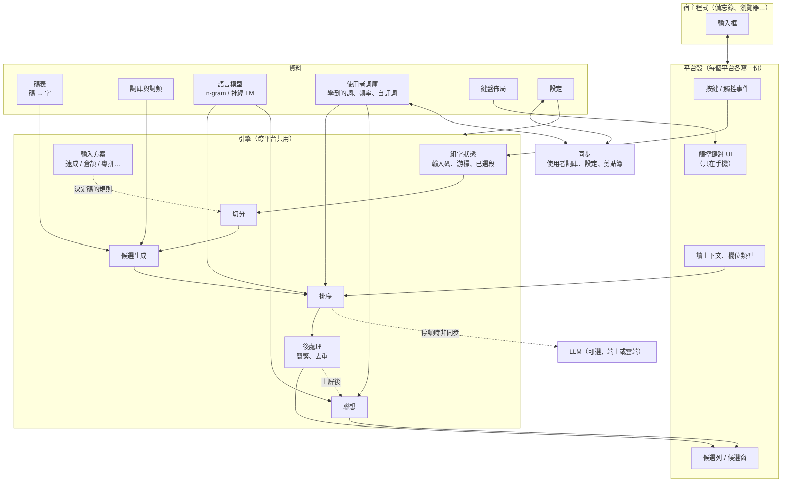
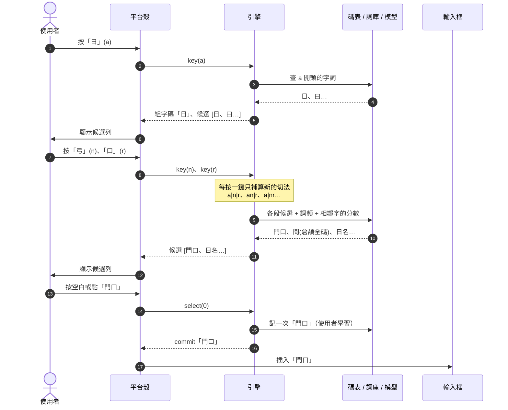
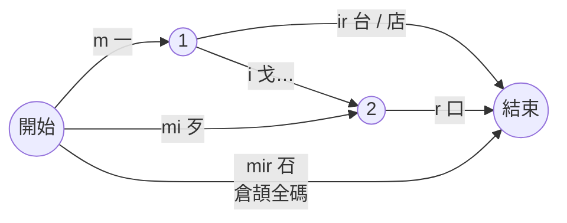

# 輸入法入門：組成、流程與候選排序

給沒做過輸入法的人看。事實與數字都來自同目錄的研究檔，每節標出處；標「推論」的是由研究結果推出、還沒實測的。寫於 2026-10-30。

研究檔：

| 檔案 | 內容 |
| --- | --- |
| `rime.md` | librime 架構、Rime 速成方案、三個案例的根因與復現 |
| `open-source-imes.md` | afm-ime、qingjian、Wisdom-Weasel、Fcitx5 / libime、FlorisBoard、AnySoftKeyboard、Trime、Hamster 等 |
| `closed-source-imes.md` | Gboard、iOS / macOS、Microsoft、搜狗的公開資料與黑箱測試表 |
| `platform-frameworks.md` | 五個平台的輸入法框架能做與不能做的事 |
| `data-sources.md` | 碼表、詞庫、字頻、語料、英文詞表、OpenCC 的來源與授權 |
| `ranking-techniques.md` | 排序技術的原理、資料、大小、延遲 |

## 1. 一個輸入法由哪些部分組成

| 部分 | 做什麼 | 成熟產品的例子 |
| --- | --- | --- |
| 平台殼 | 向作業系統註冊成輸入法；把按鍵轉給引擎；畫候選；把選好的字送進輸入框；讀上下文與欄位類型。每個平台的框架不同（iOS 鍵盤擴充、Android InputMethodService、macOS InputMethodKit、Windows TSF、Linux Fcitx5 / IBus），所以每個平台各寫一份 | 鼠鬚管、小狼毫、同文、倉輸入法都是 librime 的殼 |
| 引擎（核心） | 純邏輯：收輸入碼，回候選清單。和平台無關，所以能共用 | librime（C++）、libime（C++）、青簡（Rust） |
| 輸入方案 | 一種輸入法的規則：有哪些鍵、碼怎麼對字、怎麼切分。速成、倉頡、粵拼各是一個方案，共用同一個引擎 | Rime 的 `*.schema.yaml` |
| 碼表 | 碼 → 字的對照，例如 `ar → 問` | Rime `cangjie5.dict.yaml`、libcangjie `table.txt` |
| 詞庫與詞頻 | 多字詞（「門口」）和它們多常見 | rime-essay（八股文） |
| 語言模型 | 「這幾個字接在一起有多自然」的分數 | Rime octagram、libime 的 KenLM、Gboard 的 n-gram 與 LSTM |
| 使用者詞庫 | 使用者打過、選過、手動加的詞，以及頻率 | librime `*.userdb`、libime user dict |
| 鍵盤佈局 | 只有手機需要：每個鍵的位置、大小、按下輸出什麼、長按出什麼 | FlorisBoard XML、Trime YAML |
| 設定 | 候選數、簡繁、模糊音、主題… | — |
| 同步 | 讓使用者詞庫、設定、剪貼簿在多台裝置一致 | 倉輸入法用 iCloud 資料夾、同文用 librime `sync_user_data` |

出處：`open-source-imes.md` §2、`rime.md` §1、`platform-frameworks.md` §1。

### 1.1 為什麼要切成殼與核心

五個平台的輸入法框架語言都不同（Swift、Kotlin、C++ COM、C++ addon）。最難的部分是候選排序，它和平台無關。成熟做法是排序只寫一次，放在核心；每個平台只寫一層薄殼，負責把事件翻譯給核心（`platform-frameworks.md` §1 第 6 點、`open-source-imes.md` §5）。Windows 還多一層：輸入法 DLL 會被載入每個程式，所以小狼毫和青簡都把引擎放在獨立程序，DLL 只負責轉傳（`platform-frameworks.md` §6）。

### 1.2 「輸入方案」是讓核心不寫死速成的那一層

Rime 的做法：引擎只認「方案」，方案檔裡寫碼表、拼寫規則（拼寫運算 spelling algebra）、要用哪些翻譯器（translator）。換成倉頡或粵拼只要換方案檔，不改引擎（`rime.md` §1.2）。

這層也是三個案例出錯的地方：Rime 的速成方案其實載入的是倉頡全碼表，再用規則「另外加上」首尾碼，所以倉頡全碼仍然可以打，而引擎分不出哪個是倉頡碼、哪個是速成碼（`rime.md` §4，見本文 §4）。教訓是每個方案要有自己的碼索引，碼不能從別的方案滲進來。

## 2. 從按一個鍵到字上屏

以手機上連打 `a n r` 想打「門口」為例。

每一步在做什麼：

1. **收鍵**：平台殼把實體鍵或觸控座標轉成引擎認得的鍵。觸控時還可以帶上座標，給容錯用（§3.3）。
2. **組字狀態**：引擎記住目前打了哪些碼、游標在哪、哪幾段已經選定。這段還沒進輸入框，叫 composition（組字）。iOS 鍵盤擴充沒有 marked text，組字碼只能畫在鍵盤自己的候選列上（`platform-frameworks.md` §3.2）。
3. **切分**：`anr` 可以切成 `an|r`、`a|nr`、`a|n|r`，也可以整串當一個碼。所有切法畫成一張網，叫 lattice 或 word graph（§3.2）。
4. **候選生成**：每一段查碼表和詞庫拿到候選字詞。
5. **排序**：替每條完整路徑打分，分數最高的當首選（§3）。
6. **後處理**：簡繁轉換、去重、加上英文候選。
7. **上屏**：使用者選字，引擎回傳要送出的文字，平台殼插入輸入框。
8. **學習**：引擎把這次選擇記進使用者詞庫，影響下次排序（§3.4）。
9. **聯想**：上屏後可以接著建議下一個詞（iOS 內建速成的優點）。

延遲預算：Gboard 要求按鍵後約 20 ms 內有視覺回饋（`ranking-techniques.md` §0 第 4 點）。按鍵到候選出現沒找到專門的文獻，研究檔用 Gboard 的 20 ms 和「感覺即時」的約 100 ms 推出 50–100 ms 的工程預算（推論）。

## 3. 候選怎麼排序

速成的根本難題是**重碼**：全集只有 674 個不同的碼，同一個碼最多對到 480 個字，常用字裡最多也有 93 個（`data-sources.md` §1 第 4 點）。所以排序決定好不好用。

下面由簡到繁。每多一層，要的資料、記憶體和延遲都上升。

### 3.1 字頻 / 詞頻（unigram）

- **原理**：每個字或詞有一個「多常見」的分數。同一個碼的候選按分數排。
- **資料**：字頻、詞頻表。繁體詞頻目前只找到 LGPL 的 rime-essay 和 libchewing-data（`data-sources.md` §5）。
- **成本**：跟碼表同量級，查表時間可以忽略。端上跑。
- **侷限**：只看單一段，不看前後文。連打時路徑分數是各段相乘，段數越多分數越低，所以「門＋口」兩段天生比一段的「問」吃虧（`ranking-techniques.md` §1.3）。要靠「門口」本身是一個詞條、帶自己的詞頻來補。

### 3.2 n-gram 語言模型加 Viterbi / beam search

- **原理**：n-gram 估「前一兩個字 / 詞是 X 時，下一個是 Y 的機率」。bigram 看前一個、trigram 看前兩個。沒見過的組合用平滑（Katz、Kneser-Ney）分一點機率給它。
- **怎麼用在連打**：把所有切法和候選畫成 lattice，每條路徑的分數是「每段的字頻 × 相鄰兩段的 n-gram 分數」。路徑數會爆炸，所以用 **Viterbi**（動態規劃：每個位置只留到這裡為止最好的路徑）找最佳路徑；**beam search** 是每個位置只留前 K 條，用來控制計算量。libime 的預設 beam 是 20（`ranking-techniques.md` §4）。
- **增量**：每按一鍵只補算新增的節點，不整句重算（libime `PinyinContext::update()`，`ranking-techniques.md` §4.4）。

`mir` 的 lattice（示意）：要選出「一台」，路徑 `一 → 台` 的分數要高過 `歹 → 口` 與單字「䂖」。只看字頻時，「店」比「台」常見，會選成「一店」；要靠 bigram 或使用者學習才會選到「台」（`rime.md` §4 案例 1）。

- **資料**：斷好詞的語料，用 KenLM 之類的工具訓練。
- **成本**：Rime 現成的繁體 bigram 模型壓縮版，字級約 10.3 MB、詞級約 41.4 MB；Gboard 文獻說鍵盤 LM 不應超過 5–10 MB。每鍵查詢估計數 ms 內（推論）。端上跑（`ranking-techniques.md` §3、§10）。

### 3.3 容錯

- **原理**：使用者可能按到鄰鍵、漏一碼、多一碼。容錯就是在 lattice 上多加「如果這鍵其實是鄰鍵」的邊，並扣一點分。
  - 離散版：libime 只允許同一排左右相鄰的鍵。
  - 連續版：Gboard 用觸控座標，假設落點以按鍵中心為中心呈高斯分佈，並用 FST 處理替換、漏打、多打（`ranking-techniques.md` §5）。
- **資料**：鍵盤佈局；觸控版還要座標。
- **成本**：資料可以忽略，但 lattice 的邊數成倍增加。端上跑。
- **速成的特殊風險**：每字只有 1–2 碼、資訊很少，容錯比拼音更容易「改錯」（推論，`ranking-techniques.md` §5.5）。Gboard「打錯一兩碼首選仍對」靠的就是這層。

### 3.4 使用者學習

- **原理**：使用者選過的詞加分，常用的排前面；加分隨時間或次數衰減，習慣改了能跟上；一次誤選不能永久污染排序。
- **成熟做法**（`ranking-techniques.md` §6）：
  - librime：計數指數衰減，時間常數 200 次上屏。
  - libime：三個 LRU 池（128 / 8192 / 65536 句）把使用者的相鄰詞以固定權重混進語言模型。
  - Mozc：最近使用排前，再加 bigram 加成；選錯可以撤銷（Revert）。
- **Gboard 為什麼不前移**：它的個人化主要是解碼時用動態模型重排（on-the-fly rescoring），不是把選過的字往前移；macOS 則有官方的「Adjust word frequency」開關（`closed-source-imes.md` §2）。
- **成本**：小，端上跑，也是隱私最好的位置。

### 3.5 神經網路語言模型

- **原理**：用小型 LSTM 或 Transformer 取代或補強 n-gram，能看更長的前文。
- **先例**：Gboard 下一詞預測用 CIFG-LSTM，約 140 萬參數、量化後 1.4 MB、詞表 1 萬；top-1 召回率 n-gram 12.5%、聯邦學習訓練的 CIFG 15.8%（`ranking-techniques.md` §10）。iOS 17 起自動修正改用 transformer，但 Apple 沒公開大小和延遲。
- **兩種用法**：下一詞預測（聯想），或把 n-gram 解出的前 k 條結果重排（rescoring）。後者在鍵盤上的延遲沒有公開數字。
- **資料**：大量繁中 / 粵語語料，授權要逐一查（`data-sources.md` §7）。
- **成本**：MB 到數十 MB。端上跑。

### 3.6 LLM

- **原理**：把輸入框的前文和候選交給大模型，請它挑最合理的，或直接補完句子。
- **延遲**：iPhone 15 Pro 上，1.1B 模型處理 prompt 約 646 token/s；研究檔估算重排一次約 110 ms（1.1B）到 450 ms（3B），超過每鍵預算（推論，`ranking-techniques.md` §0、§10）。
- **成熟做法**：afm-ime、青簡、Wisdom-Weasel 都讓確定性引擎先即時出候選，LLM 在使用者停頓後非同步跑，結果只放第 2 位，過期就丟（`open-source-imes.md` §1 第 9 點、§5）。
- **平台限制**（`platform-frameworks.md` §1）：
  - iOS 鍵盤擴充有不公開的記憶體上限，能不能在擴充裡跑 Apple Foundation Models 未查證。
  - Android 的 Gemini Nano 只允許最前景的 App 推論，輸入法算不算未查證。
  - 上雲要網路，iOS 還要使用者開完整取用權限，也有隱私成本。

### 3.7 總表

| 技術 | 改善什麼 | 需要的資料 | 大小 | 每鍵延遲 | 端上 / 雲端 |
| --- | --- | --- | --- | --- | --- |
| 字頻 / 詞頻 | 同碼字的基本順序 | 字頻、詞頻表 | 與碼表同量級 | 可忽略 | 端上 |
| n-gram + Viterbi / beam | 連打切分、詞的選擇 | 斷詞語料 | 10–41 MB（Rime 繁體 bigram） | 估計數 ms | 端上 |
| 容錯 | 打錯仍選對 | 佈局、觸控座標 | 可忽略 | 邊數成倍增加 | 端上 |
| 使用者學習 | 個人常用詞排前 | 使用者上屏紀錄 | 小 | 可忽略 | 端上 |
| 神經 LM | 更長的上下文 | 大量語料 | 1.4 MB 起 | 未查證 | 端上 |
| 端上 LLM | 語意、補全 | 預訓練模型 | 0.3–1.7 GB（Q4，估計） | 約 100–450 ms（估計） | 端上，只能非同步 |
| 雲端 LLM | 最強語意 | 預訓練模型 | 無本地成本 | 超過每鍵預算 | 雲端，有隱私成本 |

出處：`ranking-techniques.md` §10。

## 4. 用這些概念讀懂三個 Rime 案例

三個案例都用本機的鼠鬚管實際打過並讀回畫面，也能用 `scripts/experiments/rime-cases/` 重跑（`rime.md` §4）。

| 案例 | 你看到的 | 原因 | 對應到哪一層 |
| --- | --- | --- | --- |
| 1. `mir` 想要「一台」 | 首選不是「一台」；本機實測是「一店、䂖、歹口」 | 「一台」不在詞庫裡；碼表裡有幾個剛好覆蓋整串 `mir` 的詞條（倉頡全碼單字「䂖」、低頻詞「一店」「歹口」），Rime 遇到這種詞條就不造句；就算造句，「店」的字頻也高過「台」 | 輸入方案（倉頡碼滲入）、詞庫品質、只有 unigram 沒有 bigram |
| 2. `anr` 想要「門口」 | 首選「問」 | 「問」的倉頡全碼正好是 `anr`（速成應該是 `ar`）；它和「門口」都算完整覆蓋 `anr` 的詞條，於是直接比詞頻：問 50737 勝過門口 9435 | 輸入方案（倉頡碼滲入） |
| 3. 連打碼等於某字的倉頡全碼 | 那個字排第一 | 案例 2 的一般情況：速成方案載入的是倉頡全碼表，速成碼是另外加上去的，全碼仍然有效；單字詞頻通常高過二字詞 | 輸入方案（倉頡碼滲入） |

另外兩點：

- 案例 2 在這台電腦的鼠鬚管上也能復現。倉輸入法和電腦版的差異沒查出原因（`rime.md` §4 案例 2）。
- 只保留速成碼（把規則從「另外加上」改成「取代」）後，`anr` 首選就變成「門口」。

對 QIM 的意思（`rime.md` §5）：

1. 每個方案的碼表只放這個方案的碼。
2. 「一個長詞條」和「造句」要用同一把尺比分數，不能「有詞條就不造句」。
3. 低頻垃圾詞要有門檻。
4. 使用者分段選字後要學成新詞；Rime 有做，實測有效。

## 5. 你的功能落在架構的哪一塊

「建議分級」是研究後的建議，階段 3 訪談時再定；標「待評估」的是可行性還沒確定的。

| # | 功能 | 落在哪 | 主要限制 / 依據 | 建議分級 |
| --- | --- | --- | --- | --- |
| 1a | 自動記住常打的內容（email、名字、字串） | 引擎的學習器 + 使用者詞庫；平台殼要告訴引擎欄位類型，密碼欄不學 | Gboard 的 `bc` → email 的機制未查證，可能是個人學詞、Android 11+ 的自動填入或帳號資料（`closed-source-imes.md` §3）；iOS 密碼欄本來就會換成系統鍵盤 | MVP 做手動與上屏學習；自動抓 email 這類字串之後 |
| 1b | 手動新增詞與觸發詞 | 使用者詞庫 + 設定 UI | 觸發詞就是「自訂碼 → 詞」，與 1c 共用格式 | MVP |
| 1c | 補上詞庫沒有的詞（「藍月」） | 使用者詞庫；社群詞庫 | 繁體詞庫只有 LGPL 來源，授權要先定（`data-sources.md` §5） | MVP（使用者詞） |
| 2 | 候選依使用頻率前移 | 排序 + 使用者詞庫 | librime / libime / Mozc 的衰減公式可參考；要防誤選污染、可開關可重置（`ranking-techniques.md` §6） | MVP |
| 3 | 輸入框上下文 + 語言模型 / LLM | 平台殼讀上下文；排序器留重排介面；LLM 提供者 | iOS 擴充記憶體上限不公開；Android Gemini Nano 有前景限制；LLM 只適合非同步（§3.6） | n-gram 用上下文：之後；LLM：待評估 |
| 4 | 簡繁切換 | 後處理 | OpenCC 是 Apache-2.0，有純 Rust 版（`data-sources.md` §9） | MVP |
| 5 | 後續建議詞（聯想） | 引擎的預測器，用 bigram 或使用者歷史 | 需要詞級 n-gram | 之後 |
| 6 | 完全自訂鍵盤佈局 | 佈局資料 + 手機殼的鍵盤渲染器 | 現有開源格式都只支援矩形；最接近的參考是 FlorisBoard 的 LDML keyboard3 加 Trime 的組字中行為（`open-source-imes.md` §4、§5）；任意形狀要自訂 | MVP 做資料驅動的矩形佈局、多頁、長按；任意形狀之後 |
| 7 | 中文狀態下顯示英文候選 | 引擎多一個英文翻譯器 + 合併規則 | macOS 官方有此功能；混排規則沒找到成熟產品的公開資料（`ranking-techniques.md` §9） | MVP |
| 8 | 英文滑動輸入 / 中文滑動輸入 | 手機殼的手勢解碼，需要佈局的鍵位座標 | FlorisBoard v0.5.2、AnySoftKeyboard 可參考（Apache-2.0）；速成碼要從「詞」改成「碼序列」，是推論 | 英文：之後；中文：待評估 |
| 9 | 剪貼簿歷史與多端同步 | 平台殼（剪貼簿權限）+ 同步服務 | iOS 要完整取用權限；Android 只有預設輸入法能讀；macOS 15.4 的剪貼簿隱私限制對輸入法是否生效未查證 | 之後 |
| 10 | 多端檔案傳輸 | 主 App + 同步服務，不在輸入法引擎裡 | iOS 擴充沒網路要開權限；檔案傳輸較適合放在主 App | 待評估 |

### 5.1 建議補充的功能

成熟產品都有、研究找到出處的：

| 功能 | 理由 | 出處 |
| --- | --- | --- |
| 字根提示 / 反查 | 速成使用者常想知道某字怎麼打；候選旁顯示倉頡碼也能幫忙學 | libime `Prompt`、macOS 速成（`open-source-imes.md` §6、`closed-source-imes.md` §6） |
| 萬用鍵 | 忘了一碼時用 `*` 代替 | fcitx5-table-extra `MatchingKey=*`、macOS 倉頡 Z 鍵 |
| 自動造詞 | 連打選過的組合自動成詞，直接解決案例 1 這類「詞庫沒有的詞」 | libime auto phrase、librime 實測（`rime.md` §4） |
| 學習資料可看、可刪、可全清 | 信任與除錯；刪掉誤學的詞，同步時不復活 | Gboard、macOS、libime / afm-ime 的刪除墓碑 |
| 無痕模式 | 尊重 App 傳來的「不要個人化學習」旗標 | AnySoftKeyboard、FlorisBoard、HeliBoard |
| 撤銷上一次上屏 / 學習 | 誤選時能還原，不污染排序 | Mozc Revert、macOS Shift-Delete |
| 候選展開面板 | 速成重碼多，一次看全部同碼字 | fcitx5 `BulkCandidateList`、Trime |
| 空白鍵滑動移游標 | 手機編輯效率 | Hamster、fcitx5-android |
| 常用語 / 快捷文字 | 地址、簽名；可與 1b 觸發詞合併 | Trime、青簡、AnySoftKeyboard |
| emoji 候選（含粵語標註） | 基本需求；CLDR 有粵語標註，授權寬鬆 | macOS、CLDR（`data-sources.md` §10） |
| 詞庫 / 碼表匯入 | 使用者自帶資料，繞開部分授權問題 | AnySoftKeyboard、青簡 |

## 6. 進入階段 3 前要你決定的事

研究把下列問題縮小到少數選項，階段 3 用 `/grill-with-docs` 逐題問：

1. **平台順序**：iOS 限制最多（記憶體不公開、沒有 marked text、密碼欄換系統鍵盤），Android 限制最少，桌面三平台各有怪癖。
2. **核心語言**：C++（Rime 先例）或 Rust（青簡先例，可用 uniffi / C ABI 給 Swift 與 Kotlin）。網頁 prototype 是否和核心共用程式碼也取決於此（例如 Rust 編 WebAssembly）。
3. **建在 librime 上還是自己寫**：librime 現成，但三個案例出在它的方案設計和「有詞條就不造句」的規則，要改就得改它的 translator；授權是 BSD-3，但碼表與詞庫是 LGPL / GPL。
4. **方案抽象**：照 Rime 用方案檔描述，還是更窄的「碼表 + 規則」。
5. **資料授權**：碼表用 libcangjie（Public Domain）、Unihan（Unicode License）還是 Rime 的（LGPL）；詞頻目前只有 LGPL 來源；粵語詞庫授權鏈未查明。LGPL / GPL 資料能否隨商店上架的 App 發佈，需要你判斷。
6. **隱私**：上下文和 LLM 是否上雲；iOS 是否要求完整取用權限，沒有權限時降級成什麼樣子；密碼欄與無痕旗標怎麼處理。
